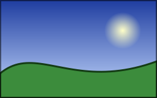

## Install the package

Add the `Meziantou.Framework.Imaging` package to a project that targets .NET 10 or later:

```bash
dotnet add package Meziantou.Framework.Imaging
```

The examples of this documentation omit the `using` directives. The first ones only need
`using Meziantou.Framework.Imaging;`; see [Namespaces](01-Introduction.md#namespaces) for the others.

## Load, resize and save

Load an image, resize it, and save it:

<!-- ref:../../samples/Meziantou.Framework.Imaging.Samples/PackageReadmeSnippets.cs;region=Imaging_QuickStart;format=md-fenced-code-block;dedent=true -->
```csharp
using var image = Image.Load("animation.gif");
image.Resize(new ResizeOptions(320, 240));
image.Save("thumbnail.gif");
```
<!-- endref -->

- `Image.Load` detects the format from the content of the file. The input here is an animated GIF: every frame is
  loaded.
- `Resize` resizes every frame. By default, the image fits inside the requested size and keeps its aspect ratio.
- `Save` chooses the format from the extension of the file. The animation, its frame durations and its loop count are
  kept.
- `Image` is disposable: the `using` declaration releases its memory.

## Choose the format and its settings

To choose the format and its options, pass an encoder to `Save`. Some formats store one picture only: a JPEG file
cannot hold an animation, so export the frame you want explicitly instead of letting the library drop the others:

<!-- ref:../../samples/Meziantou.Framework.Imaging.Samples/ReadmeSnippets.cs;region=Imaging_QuickStartWithEncoders;format=md-fenced-code-block;dedent=true -->
```csharp
using var image = Image.Load("animation.gif");          // every displayed frame, exact timing
image.Resize(new ResizeOptions(320, 240));               // all frames, atomically
image.Save("thumbnail.png", new PngEncoder());           // APNG, because the image is animated

image.Frames[0].Save("first.jpg",                         // JPEG stores one frame: export it explicitly
    new JpegEncoder { Quality = 85, BackgroundColor = new Rgba32(255, 255, 255) });
```
<!-- endref -->

Saving an animation to a JPEG file, or an image with transparency to a format without it, throws an
`UnsupportedImageFeatureException` instead of losing information. The settings that allow a conversion, such as
`BackgroundColor` above, are described in [Saving images](05-LoadingAndSaving/04-SavingImages.md).

## Create an image and draw on it

An image can also be created from scratch and drawn on:

<!-- ref:../../samples/Meziantou.Framework.Imaging.Samples/Examples.cs;region=Imaging_DrawShapes;format=md-fenced-code-block;dedent=true -->
```csharp
public static void DrawLandscape(string outputPath)
{
    using var image = new Image<Rgba32>(256, 160);

    // Brushes, pens and paths are immutable: create them once and reuse them
    var sky = new LinearGradientBrush(new PointD(0, 0), new PointD(0, 160), [new GradientStop(0, new Rgba32(30, 60, 160)), new GradientStop(1, new Rgba32(200, 220, 255))]);
    var sun = new RadialGradientBrush(new PointD(200, 50), 30, [new GradientStop(0, new Rgba32(255, 255, 200)), new GradientStop(1, new Rgba32(255, 180, 0, 0))]);
    var hill = new VectorPathBuilder()
        .MoveTo(0, 160).LineTo(0, 120)
        .CubicBezierTo(60, 70, 120, 150, 256, 100)
        .LineTo(256, 160).Close()
        .Build();
    var outline = new Pen(new Rgba32(20, 60, 20), 3) { LineJoin = LineJoin.Round };
    var frame = new Pen(new Rgba32(0, 0, 0, 128), 2);

    image.Frames[0].Draw(canvas =>
    {
        canvas.Fill(sky); // the whole canvas
        canvas.FillCircle(sun, new PointD(200, 50), 30); // fades to transparent at its edge
        canvas.Fill(new Rgba32(60, 140, 60), hill); // a color converts to a solid brush
        canvas.Stroke(outline, hill);
        canvas.StrokeRectangle(frame, new RectangleD(1, 1, 254, 158)); // centered on its path: from 0 to 2
    });

    image.Save(outputPath);
}
```
<!-- endref -->



## Next steps

- [Guides](03-Guides/01-Overview.md): complete solutions to common tasks.
- [Images, frames and animations](04-Concepts/02-ImagesFramesAndAnimations.md) and
  [Ownership and lifetimes](04-Concepts/04-OwnershipAndLifetimes.md): the model behind the API.
- [Loading images](05-LoadingAndSaving/02-LoadingImages.md) and [Saving images](05-LoadingAndSaving/04-SavingImages.md).
- [Processing](06-Processing/01-Overview.md), [Drawing](07-Drawing/01-Overview.md) and [Text](08-Text/01-Overview.md).
