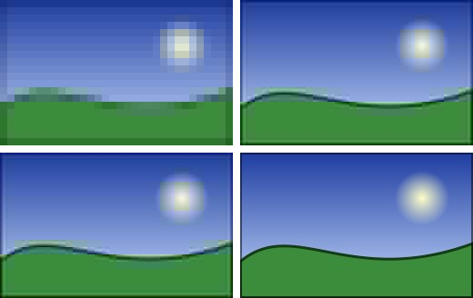

Some files store an image at increasing levels of detail: a coarse version comes first, then finer ones. A viewer can
show the coarse version as soon as its bytes arrive, as a browser does with a slow download. The readers of the library
give these intermediate renderings with `ReadFrameRefinementInto`.

## Read the renderings of a frame

Open a reader on the stream, create an image of the size of the canvas, and call `ReadFrameRefinementInto` until it
returns the final rendering. Each call writes a complete image of the frame's size into your image, and returns a
`FrameRefinement` that describes it:

<!-- ref:../../../samples/Meziantou.Framework.Imaging.Samples/Examples.cs;region=Imaging_ProgressiveRead;format=md-fenced-code-block;dedent=true -->
```csharp
public static int ShowWhileReading(Stream input, Action<Image<Rgba32>, FrameRefinement> show)
{
    using var reader = Image.OpenReader<Rgba32>(input);
    using var image = new Image<Rgba32>(reader.Info.Width, reader.Info.Height);
    var renderings = 0;

    // Each call writes a full image: coarse at first (Downsampling 8, then 4, 2), then the frame itself (IsFinal).
    // A file that is not progressive, or another format, gives its frame at once. An input that ends early gives the
    // renderings it has, then throws: truncation is never a clean end.
    while (reader.ReadFrameRefinementInto(image) is { } refinement)
    {
        show(image, refinement);
        renderings++;
        if (refinement.IsFinal)
            break;
    }

    return renderings;
}
```
<!-- endref -->

The first three renderings of a progressive JPEG file, then the frame itself:



| `FrameRefinement` property | Meaning |
| --- | --- |
| `IsFinal` | `true` when the image holds the frame itself: the same pixels as `ReadFrameInto`. The next call starts the next frame of an animation. |
| `Downsampling` | How coarse the rendering is in each direction: 8 when it has one value per block of 8x8 pixels, then 4 and 2, and 1 for full detail. The image always has the size of the frame. |
| `CompletedPasses` | The number of passes or scans of the frame that the rendering holds. |

`ReadFrameRefinementIntoAsync` does the same with asynchronous I/O and a `CancellationToken`. `ReadFrame` and
`ReadFrameInto` can be called at any time to skip the remaining renderings and read the frame itself. See
[Streaming readers and writers](05-StreamingReadersAndWriters.md) for the readers.

## What each format gives

| Input | Renderings before the frame |
| --- | --- |
| Progressive JPEG | One after each scan, once every color component has its first scan |
| Interlaced PNG (Adam7) | The passes completed by each piece of data that arrives; each missing pixel takes the value of a pixel of its block |
| Progressive JPEG XL | The image at one eighth of its detail, then one rendering for each pass |
| Any other file | None: the first call returns the frame, with `IsFinal` set |

- An interlaced PNG file gives renderings as its data arrives. When the whole file is already available, from a local
  file or bytes in memory, the first call can return the frame itself.
- A small JPEG XL frame stored in a single section gives the frame at once.
- The number of renderings and their pixels can change from one version of the library to the next: only the final
  rendering is guaranteed. Do not compare intermediate renderings in tests.
- The renderings count toward the `MaxTotalPixels` limit, like frames. See [Resource limits](07-ResourceLimits.md).

To write files that can be shown this way, see the `Process` option of [JPEG](../10-Formats/04-Jpeg.md), the
`Interlaced` option of [PNG](../10-Formats/02-Png.md) and the `Progressive` option of
[JPEG XL](../10-Formats/15-JpegXl.md).

## Partial downloads

An input that ends before the frame is complete is malformed, never a clean end. When the format allows it, the read
that reaches the end of the input returns a last intermediate rendering of what was decoded, as a browser shows a
partial download, and the next read throws an `InvalidImageContentException`:

- the coefficients decoded so far of a progressive JPEG frame;
- the passes decoded so far of an interlaced PNG image;
- the rows decoded so far of a GIF image, of a PNG image that is not interlaced, of a JPEG frame coded in one scan and of
  a still lossy WebP image (the other rows are zero).

Other inputs throw at once. The renderings returned before the error stay valid: keep showing the last one, and report
the error. See [Handling errors](08-ErrorHandling.md).
