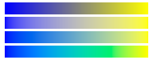
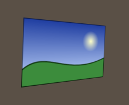
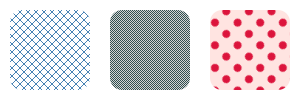
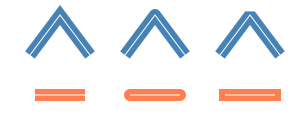
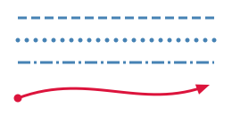

A brush says how the inside of a shape is painted; a pen says how its outline is drawn. Both are immutable: create
them once and reuse them.

## Paint with a color

An `Rgba32` or an `Rgba64` converts to a `SolidBrush`, so a color can be passed wherever a brush is expected. Colors
come from the `Colors` class (the named colors of CSS), from a constructor (`new Rgba32(255, 200, 0, 128)`, the last
value being the alpha), or from `Rgba32.ParseHex("#E63946")`.

Every brush has an `Opacity`, as `globalAlpha` of the HTML canvas: it multiplies the alpha of the paint at each pixel.
A brush also has a `BlendMode` and a `CompositeMode`, which say how its paint is mixed with the pixels under it: see
[Layers, masks and filters](05-LayersMasksAndFilters.md).

The color of a brush is a set of sample values of the image: no color profile is applied, unless the drawing says what
its colors are (see [Rendering quality](06-RenderingQuality.md)).

## Paint with a gradient

<!-- ref:../../../samples/Meziantou.Framework.Imaging.Samples/DrawingExamples.cs;region=Imaging_DrawGradients;format=md-fenced-code-block;dedent=true -->
```csharp
public static void DrawGradients(string outputPath)
{
    // Gradients are positioned in the coordinates of the canvas, not of the shape they fill
    var linear = new LinearGradientBrush(new PointD(6, 0), new PointD(70, 0), [new GradientStop(0, Colors.Crimson), new GradientStop(1, Colors.Gold)]);

    // A light on a sphere: the gradient spreads from a focal point above and left of the center
    var radial = new RadialGradientBrush(new PointD(112, 40), 32, [new GradientStop(0, Colors.White), new GradientStop(1, Colors.MidnightBlue)])
    {
        FocalPoint = new PointD(102, 30),
    };

    // A color wheel: the colors go around the center, clockwise from its right
    var sweep = new SweepGradientBrush(new PointD(188, 40), [
        new GradientStop(0, Colors.Red),
        new GradientStop(1 / 3.0, Colors.Lime),
        new GradientStop(2 / 3.0, Colors.Blue),
        new GradientStop(1, Colors.Red)]);

    // A color for each corner of a triangle, mixed across it
    PointD[] triangle = [new(262, 8), new(294, 72), new(230, 72)];
    var mesh = new PathGradientBrush(triangle, [Colors.Red, Colors.Lime, Colors.Blue], Colors.White);

    using var image = new Image<Rgba32>(300, 80, Colors.White);
    image.Draw(canvas =>
    {
        canvas.FillRectangle(linear, new RectangleD(6, 8, 64, 64));
        canvas.FillCircle(radial, new PointD(112, 40), 32);
        canvas.FillCircle(sweep, new PointD(188, 40), 32);
        canvas.FillPolygon(mesh, triangle);
    });

    image.Save(outputPath);
}
```
<!-- endref -->


| Brush | Colors change |
| --- | --- |
| `LinearGradientBrush` | Along the line between two points |
| `RadialGradientBrush` | From a center up to a radius (a circle, or an ellipse with two radii) |
| `SweepGradientBrush` | Around a center, with the angle, clockwise from `StartAngle` to `EndAngle` (a full turn from the right of the center by default) |
| `PathGradientBrush` | Across a polygon, from the color of each corner to the color of a center |

- A `GradientStop` is an offset from 0 to 1 and a color. Two stops with the same offset make a hard edge. Stops are
  mixed on alpha-premultiplied values, so a transparent stop does not tint its neighbors.
- Gradients are placed in the coordinates of the canvas, whatever the shape they fill. Their `Transform` places them
  differently: a rotation turns a gradient, and a scaling that differs on both axes makes a radial gradient
  elliptical.
- `SpreadMode` gives the colors beyond the first and the last stops: `Pad` (the default) extends them, `Repeat` and
  `Reflect` repeat the gradient, and `Transparent` paints nothing there.
- A radial gradient can spread from a `FocalPoint` that is not its center, a highlight on a sphere. With a
  `FocalRadius`, it starts on a circle around that point instead, as the radial gradients of SVG 2 and of the HTML
  canvas do.
- The colors of a sweep gradient change abruptly at its start angle, unless it ends on the color it starts with.
- A `PathGradientBrush` mixes its colors across the triangles from the center to each side, and paints nothing outside
  them. The center is the mean of the points unless one is given. Its cost grows with the number of points.

## Choose how the colors of a gradient mix

`ColorSpace` says in which space the colors of two stops are mixed. Each row is the same gradient from blue to yellow:

<!-- ref:../../../samples/Meziantou.Framework.Imaging.Samples/DrawingExamples.cs;region=Imaging_GradientColorSpaces;format=md-fenced-code-block;dedent=true -->
```csharp
public static void DrawGradientColorSpaces(string outputPath)
{
    GradientColorSpace[] spaces = [GradientColorSpace.Encoded, GradientColorSpace.LinearSrgb, GradientColorSpace.Oklab, GradientColorSpace.Oklch];

    using var image = new Image<Rgba32>(256, 100, Colors.White);
    image.Draw(canvas =>
    {
        for (var i = 0; i < spaces.Length; i++)
        {
            // From blue to yellow, one row per color space, from top to bottom
            var brush = new LinearGradientBrush(new PointD(8, 0), new PointD(248, 0), [new GradientStop(0, Colors.Blue), new GradientStop(1, Colors.Yellow)])
            {
                ColorSpace = spaces[i],
            };
            canvas.FillRectangle(brush, new RectangleD(8, 4 + (i * 24), 240, 20));
        }
    });

    image.Save(outputPath);
}
```
<!-- endref -->



| `GradientColorSpace` | Mixes | Half way from red to green |
| --- | --- | --- |
| `Encoded` (the default, as CSS and SVG) | The stored sample values | A dark olive, (128, 128, 0) |
| `LinearSrgb` | Light, as light does | A yellow, (188, 188, 0) |
| `Oklab` | A space where lightness and hue change evenly: no dull band between two saturated colors | (208, 168, 0) |
| `Oklch` | The lightness, the chroma and the hue of Oklab, the hue along the shorter arc as CSS does | An orange |

The stops are taken as sRGB colors. From blue to yellow, `Oklab` goes through a gray where `Oklch` goes through a teal.

## Draw an image

`DrawImage` draws a frame of another image: at a position (its pixels as they are), stretched to a rectangle, a region
of it stretched to a rectangle (a sprite of a sheet), or placed by an `AffineTransform` (turned, skewed, mirrored), with
an optional opacity:

<!-- ref:../../../samples/Meziantou.Framework.Imaging.Samples/Examples.cs;region=Imaging_DrawCard;format=md-fenced-code-block;dedent=true -->
```csharp
public static void ComposeCard(string photoPath, string outputPath)
{
    using var photo = Image.Load(photoPath);
    using var card = new Image<Rgba32>(320, 120);

    var shade = new LinearGradientBrush(new PointD(0, 0), new PointD(0, 120), [new GradientStop(0, Rgba32.ParseHex("#2B5876")), new GradientStop(1, Rgba32.ParseHex("#4E4376"))]);
    var portrait = new VectorPathBuilder().AddCircle(new PointD(60, 60), 40).Build();
    var ring = new Pen(Colors.White, 3);
    var rule = new Pen(new Rgba32(255, 255, 255, 160), 2) { DashPattern = [6, 4] };
    var gauge = new Pen(Colors.Gold, 6) { LineCap = LineCap.Round };

    card.Frames[0].Draw(canvas =>
    {
        // The pixels outside the rounded corners stay transparent
        canvas.FillRoundedRectangle(shade, new Rectangle(0, 0, 320, 120), 16);

        // The photo is stretched to the square around the circle, and only changes the inside of the circle
        canvas.Clip(portrait, clipped => clipped.DrawImage(photo.Frames[0], new Rectangle(20, 20, 80, 80)));
        canvas.Stroke(ring, portrait);

        // Dashes of 6 pixels and gaps of 4, then three quarters of a circle from its top, clockwise
        canvas.StrokeLine(rule, new PointD(120, 60), new PointD(300, 60));
        canvas.StrokeArc(gauge, new PointD(270, 30), 14, -90, 270);
    });

    card.Save(outputPath);
}
```
<!-- endref -->


- An image drawn on whole pixels without scaling keeps its pixels exactly. A quarter turn or a mirror keeps them too.
- Its pixels are converted to the pixel format of the canvas, and no color profile is applied.
- The frame cannot be one of the frames the canvas draws on. It can be another frame of the same image when the drawing
  is on one frame (`ImageFrame.Draw`).

The `ImageSampling` says how the image is read when it is not drawn on whole pixels:

| `ImageSampling` | Reads |
| --- | --- |
| `Bilinear` (the default) | The four pixels around a position, interpolated |
| `Nearest` | The pixel that contains the position: an enlarged image keeps square pixels (pixel art) |
| `Bicubic` | The sixteen pixels around a position, as browsers draw a scaled image with high quality |
| `Smooth` | Every pixel of the image a pixel of the canvas covers: a photo drawn as a thumbnail has no aliasing |
| `Box` | The average of what a pixel of the canvas covers: sharper on stripes reduced by a whole factor |

With the first three, an image drawn much smaller than it is skips pixels. Each pixel of the canvas reads as many pixels
of the image as it covers: `Resize` an image that is drawn many times (see
[Resizing](../06-Processing/03-Resizing.md)).

An `ImageBrush` paints any shape, or a text, with an image. Its `Transform` places the image on the canvas, and
`WrapMode` gives the colors around it: `Transparent` (the default), `Pad`, `Repeat` (tiles) or `Reflect`. `WrapModeX`
and `WrapModeY` set each direction (a row of tiles), `SourceRegion` uses a part of the image, and `Sampling` and
`Opacity` work as above.

## Draw an image in perspective

`DrawImage` with four points draws an image on a quadrilateral, as a plane seen in perspective: a screenshot on the
screen of a photo, a label on a wall.

<!-- ref:../../../samples/Meziantou.Framework.Imaging.Samples/Examples.cs;region=Imaging_DrawPerspective;format=md-fenced-code-block;dedent=true -->
```csharp
public static void DrawOnScreen(string photoPath, string screenshotPath, string outputPath)
{
    using var photo = Image.Load(photoPath);
    using var screenshot = Image.Load(screenshotPath);

    // Where the four corners of the screenshot go on the photo, from its top-left corner, clockwise. The
    // screenshot is larger than the screen: smooth sampling reads every pixel of it that a pixel of the photo covers.
    photo.Draw(canvas => canvas.DrawImage(
        screenshot.Frames[0],
        new PointD(40, 30),
        new PointD(180, 44),
        new PointD(176, 132),
        new PointD(36, 150),
        ImageSampling.Smooth));

    photo.Save(outputPath);
}
```
<!-- endref -->



The four corners of the image go to the four points, in the order top-left, top-right, bottom-right, bottom-left.
The points must be the corners of a convex quadrilateral, in order around it (the other way around mirrors the image).
Straight lines stay straight, and what is further away is smaller. With `ImageSampling.Smooth`, each pixel reads what it
covers of the image, which changes from the near side to the far side. A `ProjectiveTransform` can place an image the
same way: see [Transformations](04-Transformations.md).

## Paint with a pattern

A `PatternBrush` repeats a tile: a ready-made hatch, or a drawing made by a callback.

<!-- ref:../../../samples/Meziantou.Framework.Imaging.Samples/DrawingExamples.cs;region=Imaging_DrawPatterns;format=md-fenced-code-block;dedent=true -->
```csharp
public static void DrawPatterns(string outputPath)
{
    // Ready-made tiles of 8 by 8 pixels: lines, or a fraction of the pixels
    var crossHatch = new PatternBrush(HatchStyle.DiagonalCross, Colors.SteelBlue, Colors.White);
    var halftone = new PatternBrush(HatchStyle.Percent50, Colors.DarkSlateGray, Colors.LightGray);

    // A tile of 16 by 16 drawn once by a callback, then repeated: a dot, the tiles turned by 45 degrees
    var dots = new PatternBrush(new RectangleD(0, 0, 16, 16), tile =>
    {
        tile.Fill(Colors.MistyRose);
        tile.FillCircle(Colors.Crimson, new PointD(8, 8), 4);
    })
    {
        Transform = AffineTransform.CreateRotation(45),
    };

    using var image = new Image<Rgba32>(300, 100, Colors.White);
    image.Draw(canvas =>
    {
        canvas.FillRoundedRectangle(crossHatch, new RectangleD(10, 10, 80, 80), 12);
        canvas.FillRoundedRectangle(halftone, new RectangleD(110, 10, 80, 80), 12);
        canvas.FillRoundedRectangle(dots, new RectangleD(210, 10, 80, 80), 12);
    });

    image.Save(outputPath);
}
```
<!-- endref -->



- A `HatchStyle` and two colors make a tile of 8 by 8 pixels: lines (`Horizontal`, `Vertical`, `Cross`,
  `ForwardDiagonal`, `BackwardDiagonal`, `DiagonalCross`) or a fraction of the pixels (`Percent10` to `Percent90`). The
  tile starts at the origin of the canvas, so shapes painted with the same hatch line up, and on whole pixels each pixel
  has exactly the color of the tile.
- A tile drawn by a callback is a rectangle of the coordinates of the pattern. It is drawn once at the size it has on
  the canvas, then repeated: an enlarged pattern stays sharp. What the callback draws outside the tile is not painted.
- The callback must draw the same thing every time: it runs again when the size of the tile changes. It can use any
  brush but its own pattern.
- `Transform` places and turns the tiles, `SpacingX` and `SpacingY` leave a gap after each tile, and `WrapModeX` and
  `WrapModeY` say how tiles are laid in each direction (`Repeat` by default; `Transparent` paints one tile in that
  direction).

## Choose the width, the joins and the caps of a pen

A `Pen` is a brush and a width, centered on the outline it draws:

<!-- ref:../../../samples/Meziantou.Framework.Imaging.Samples/DrawingExamples.cs;region=Imaging_DrawJoinsAndCaps;format=md-fenced-code-block;dedent=true -->
```csharp
public static void DrawJoinsAndCaps(string outputPath)
{
    LineJoin[] joins = [LineJoin.Miter, LineJoin.Round, LineJoin.Bevel];
    LineCap[] caps = [LineCap.Butt, LineCap.Round, LineCap.Square];

    // A thin line on the path shows where the wide stroke is centered
    var path = new Pen(Colors.White, 1);

    using var image = new Image<Rgba32>(300, 120, Colors.White);
    image.Draw(canvas =>
    {
        for (var i = 0; i < 3; i++)
        {
            var x = 30 + (i * 95);

            // The corner of the path is a join
            PointD[] corner = [new(x, 55), new(x + 30, 15), new(x + 60, 55)];
            canvas.StrokePolyline(new Pen(Colors.SteelBlue, 12) { LineJoin = joins[i] }, corner);
            canvas.StrokePolyline(path, corner);

            // The ends of an open path are caps
            var start = new PointD(x + 5, 95);
            var end = new PointD(x + 55, 95);
            canvas.StrokeLine(new Pen(Colors.Coral, 12) { LineCap = caps[i] }, start, end);
            canvas.StrokeLine(path, start, end);
        }
    });

    image.Save(outputPath);
}
```
<!-- endref -->



| Property | Values |
| --- | --- |
| `LineJoin` (the corners) | `Miter` (the default; beveled beyond `MiterLimit`), `Round`, `Bevel` |
| `LineCap` (the ends of open contours) | `Butt` (the default: the stroke ends at the end of the path), `Round`, `Square` (it goes beyond by half the width) |
| `Alignment` | `Center` (the default), `Inside` or `Outside` what the path fills |
| `ScalesWithTransform` | `true` by default: see [Transformations](04-Transformations.md) |

- The parts of a stroke that overlap are painted once, also with a translucent paint.
- `PenAlignment.Inside` keeps an outline inside its shape, so that it does not make the shape larger or go over what is
  next to it, as the border of the chart in [Shapes and paths](02-ShapesAndPaths.md) does. `Outside` keeps it outside,
  so that it does not cover the shape: the outline of a text.
- A pen of width 0 is a hairline: one pixel of the canvas wide, whatever the transformation.

## Draw dashes, dots and arrow heads

<!-- ref:../../../samples/Meziantou.Framework.Imaging.Samples/DrawingExamples.cs;region=Imaging_DrawDashes;format=md-fenced-code-block;dedent=true -->
```csharp
public static void DrawDashes(string outputPath)
{
    // Dashes of 10 pixels and gaps of 5
    var dashed = new Pen(Colors.SteelBlue, 3) { DashPattern = [10, 5] };

    // Dashes of length 0 are drawn by their caps alone: round caps make dots
    var dotted = new Pen(Colors.SteelBlue, 5) { DashPattern = [0, 10], LineCap = LineCap.Round };

    // A long dash, a gap, a short dash, a gap, repeated
    var dashDot = new Pen(Colors.SteelBlue, 3) { DashPattern = [14, 4, 3, 4] };

    // A disk at the start and an arrow head at the end, scaled by the width of the pen
    var arrow = new Pen(Colors.Crimson, 3) { StartMarker = LineMarker.Circle, EndMarker = LineMarker.Arrow };

    using var image = new Image<Rgba32>(260, 130, Colors.White);
    image.Draw(canvas =>
    {
        canvas.StrokeLine(dashed, new PointD(20, 20), new PointD(240, 20));
        canvas.StrokeLine(dotted, new PointD(20, 45), new PointD(240, 45));
        canvas.StrokeLine(dashDot, new PointD(20, 70), new PointD(240, 70));
        canvas.StrokeBezier(arrow, new PointD(20, 110), new PointD(100, 80), new PointD(160, 125), new PointD(235, 95));
    });

    image.Save(outputPath);
}
```
<!-- endref -->



- `DashPattern` is a list of lengths in pixels, alternately of a dash and of a gap, repeated along each contour. A
  pattern of an odd number of lengths is used twice: `[4]` is dashes of 4 and gaps of 4. `DashOffset` is where a
  contour starts in the pattern.
- Each dash gets the caps of the pen at both ends. A dash of length 0 is drawn by its caps alone: `[0, 5]` with round
  caps is a dotted line, and nothing with butt caps.
- On a closed contour, the last dash continues with the first one when the contour ends in the middle of a dash.
- `StartMarker` and `EndMarker` draw a shape at the ends of open contours: `LineMarker.Arrow` (whose tip is exactly the
  end of the path), `Circle`, `Square` and `Diamond`. A marker is scaled by the width of the pen and turned to the
  direction of the path. Closed contours have no marker; a dashed contour has them at its ends.
- `new LineMarker(shape, inset)` makes a marker of any `VectorPath`, in units of the width of the pen, with the end of
  the contour at its origin and the direction of the contour along its x axis. The inset shortens the stroke so that it
  does not show beyond a marker that narrows to a point.
