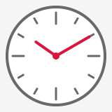
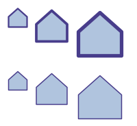
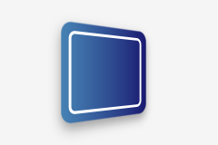

`canvas.Transform(transform, callback)` transforms everything a callback draws. Draw a shape in the coordinates that
are the simplest for it (a tick at the top of a dial, an icon of 24 by 24 pixels), and let the transformation put it in
place.

## Move, turn and scale a drawing

<!-- ref:../../../samples/Meziantou.Framework.Imaging.Samples/DrawingExamples.cs;region=Imaging_DrawRotated;format=md-fenced-code-block;dedent=true -->
```csharp
public static void DrawClock(string outputPath)
{
    var center = new PointD(80, 80);
    var tick = new Pen(Colors.DimGray, 3) { LineCap = LineCap.Round };
    var hand = new Pen(Colors.Crimson, 4) { LineCap = LineCap.Round };

    using var image = new Image<Rgba32>(160, 160, Colors.WhiteSmoke);
    image.Draw(canvas =>
    {
        canvas.FillCircle(Colors.White, center, 70);
        canvas.StrokeCircle(new Pen(Colors.DimGray, 4), center, 70);

        for (var hour = 0; hour < 12; hour++)
        {
            // The same tick at the top of the dial, turned by a twelfth of a turn around the center each time
            var length = hour % 3 == 0 ? 16 : 8;
            canvas.Transform(AffineTransform.CreateRotation(hour * 30, center), turned => turned.StrokeLine(tick, new PointD(80, 18), new PointD(80, 18 + length)));
        }

        // Ten past ten: the hands point up, then turn clockwise
        canvas.Transform(AffineTransform.CreateRotation(305, center), turned => turned.StrokeLine(hand, center, new PointD(80, 45)));
        canvas.Transform(AffineTransform.CreateRotation(60, center), turned => turned.StrokeLine(hand, center, new PointD(80, 25)));
        canvas.FillCircle(Colors.Crimson, center, 5);
    });

    image.Save(outputPath);
}
```
<!-- endref -->



An `AffineTransform` combines translations, scalings, rotations and skews:

| Method | Creates |
| --- | --- |
| `CreateTranslation(dx, dy)` | A move |
| `CreateScale(sx, sy)`, `CreateScale(sx, sy, center)` | A scaling, from the origin or around a point |
| `CreateRotation(degrees)`, `CreateRotation(degrees, center)` | A rotation, around the origin or around a point |
| `CreateSkew(degreesX, degreesY)` | A skew |
| `new AffineTransform(m11, m12, m21, m22, offsetX, offsetY)` | Any affine transformation, from its matrix |

- `first.Then(second)` (or `first * second`) applies `first`, then `second`.
- Angles are in degrees, and a positive angle turns clockwise on the image (Y grows downward). A rotation by a multiple
  of 90 degrees is exact.
- `Transform(point)` and `TransformVector(vector)` transform a point and a direction, `TryInvert` gives the inverse,
  and `TransformBounds(rectangle)` gives the box a transformed rectangle lands in: the size of an image that holds a
  turned label or picture.

Everything the callback draws is transformed: shapes, strokes (a scaling makes a pen wider), the gradients, images and
patterns of the brushes, images, texts, clips, and the offset and the blur of a shadow. Curves are drawn for the size
the transformation gives them, so they stay smooth however they are enlarged. Transformations nest, the inner one
applying first, with clips and layers in any order.

To transform a path rather than a drawing, use `VectorPath.Transform`: the result is exact, curves stay curves and an
ellipse stays an ellipse. See [Shapes and paths](02-ShapesAndPaths.md).

## Keep the width of a pen at every scale

By default, a pen is transformed with the path it strokes. With `ScalesWithTransform = false`, the path is transformed,
then stroked: the width, the dashes and the markers of the pen stay in pixels.

<!-- ref:../../../samples/Meziantou.Framework.Imaging.Samples/DrawingExamples.cs;region=Imaging_DrawScaled;format=md-fenced-code-block;dedent=true -->
```csharp
public static void DrawScaledIcons(string outputPath)
{
    // A house, in the coordinates of an icon of 24 by 24 pixels
    var house = VectorPath.ParseSvgPathData("M3 11 L12 3 L21 11 V21 H3 Z");
    var scaled = new Pen(Colors.DarkSlateBlue, 1.5) { LineJoin = LineJoin.Round };
    var fixedWidth = new Pen(Colors.DarkSlateBlue, 1.5) { LineJoin = LineJoin.Round, ScalesWithTransform = false };
    double[] scales = [1.5, 2.5, 3.5];

    using var image = new Image<Rgba32>(200, 184, Colors.White);
    image.Draw(canvas =>
    {
        var x = 8.0;
        foreach (var scale in scales)
        {
            // Scaled, then moved: the transformation passed to Then applies after the first one
            var top = AffineTransform.CreateScale(scale, scale).Then(AffineTransform.CreateTranslation(x, 8));
            var bottom = AffineTransform.CreateScale(scale, scale).Then(AffineTransform.CreateTranslation(x, 100));

            // First row: the pen is scaled with the drawing; second row: it stays 1.5 pixels wide
            canvas.Transform(top, icon =>
            {
                icon.Fill(Colors.LightSteelBlue, house);
                icon.Stroke(scaled, house);
            });
            canvas.Transform(bottom, icon =>
            {
                icon.Fill(Colors.LightSteelBlue, house);
                icon.Stroke(fixedWidth, house);
            });

            x += (21 * scale) + 6;
        }
    });

    image.Save(outputPath);
}
```
<!-- endref -->



A chart, a map or an icon drawn in coordinates of its own then has lines of the same width at every scale. Without it,
a scaling that is not the same along both axes also makes the pen wider in one direction.

## Replay a drawing

A drawing that is needed in several places, at several sizes, can be kept as a `DrawingAction` (the delegate that the
callbacks are) and called inside `canvas.Transform` wherever it is needed. Since it is drawn again each time, it stays
as sharp as its shapes at any size.

## Draw in perspective and in 3D

A `ProjectiveTransform` keeps straight lines straight, but not parallel lines parallel: it draws a plane seen in
perspective. A `Transform3D` is a 4x4 matrix, as the 3D transforms of CSS; the drawing is its plane `z = 0`.
`canvas.Transform` takes both:

<!-- ref:../../../samples/Meziantou.Framework.Imaging.Samples/Examples.cs;region=Imaging_Draw3d;format=md-fenced-code-block;dedent=true -->
```csharp
public static void DrawTiltedCard(string outputPath)
{
    using var image = new Image<Rgba32>(240, 160, Colors.WhiteSmoke);
    var card = new RectangleD(60, 30, 120, 100);
    var face = new LinearGradientBrush(new PointD(60, 0), new PointD(180, 0), [new GradientStop(0, Colors.SteelBlue), new GradientStop(1, Colors.MidnightBlue)]);

    // "perspective: 300px" and "transform: rotateY(40deg)", both around the center of the image: the turn of the
    // card applies first, then the perspective, combined in three dimensions
    var toCenter = Transform3D.CreateTranslation(-120, -80, 0);
    var fromCenter = Transform3D.CreateTranslation(120, 80, 0);
    var perspective = toCenter.Then(Transform3D.CreatePerspective(300)).Then(fromCenter);
    var turn = toCenter.Then(Transform3D.CreateRotationY(40)).Then(fromCenter);

    image.Draw(canvas => canvas.Transform(perspective, viewer => viewer.Transform(turn, plane =>
    {
        // Everything is drawn in the plane of the card: its shadow, its gradient, its border
        plane.Shadow(new Rgba32(0, 0, 0, 90), new PointD(0, 6), 6, shadowed => shadowed.FillRoundedRectangle(face, card, 12));
        plane.StrokeRoundedRectangle(new Pen(Colors.White, 3), card.Inflate(-10, -10), 6);
    })));

    image.Save(outputPath);
}
```
<!-- endref -->



| Method | Creates |
| --- | --- |
| `ProjectiveTransform.CreateFromQuadrilateral(rectangle, topLeft, topRight, bottomRight, bottomLeft)` | The transformation that maps a rectangle to four points |
| `Transform3D.CreateTranslation`, `CreateScale` | A move and a scaling in space |
| `Transform3D.CreateRotationX`, `CreateRotationY`, `CreateRotationZ`, `CreateRotation(axisX, axisY, axisZ, degrees)` | A rotation around an axis |
| `Transform3D.CreatePerspective(distance)` | A perspective, from the distance between the viewer and the plane |

- `Then` combines transformations, the first one applying first. `Transform3D.ToProjectiveTransform` gives what a 3D
  transformation does to the drawing, and an `AffineTransform` converts to a `ProjectiveTransform`.
- Everything the callback draws is drawn in perspective, the paints of the brushes included. Shadows and blurs are
  drawn on an image of the plane, then that image is drawn in perspective.
- What is on the other side of the horizon (behind the viewer) has no image: a drawing that crosses the horizon is cut
  there, and nothing is rejected.
- Transformations started inside each other are combined in three dimensions: a rotation inside a perspective shows the
  side that comes closer larger, as the transforms of nested elements of CSS do.

To draw one image on four points, `DrawImage` takes the four corners directly: see
[Brushes and pens](03-BrushesAndPens.md). To straighten a photo of a document instead, see
[Rotate, flip and transform](../06-Processing/04-RotateFlipAndTransform.md).

## Coordinates out of range

Coordinates must be no larger than 16,777,216 in magnitude. Once a transformation is applied, a drawing can go beyond
that range (a shape scaled a million times): what goes beyond it is cut, as browsers draw what is visible, and only a
coordinate that is no longer a finite number is rejected.
