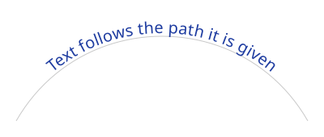
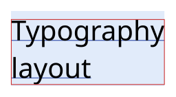
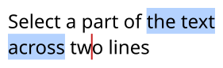
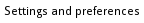

A `TextLayout` knows where each of its characters is. This page shows how to draw a layout along a path, how to read
its measures, how to map points to characters for an editor or a link, and how to draw sharper small text.

## Draw a text along a path

`FillText` and `StrokeText` take a `VectorPath` and `TextPathOptions` instead of an origin:

<!-- ref:../../../samples/Meziantou.Framework.Imaging.Samples/Examples.cs;region=Imaging_DrawTextOnPath;format=md-fenced-code-block;dedent=true -->
```csharp
public static void DrawTextOnPath(string fontPath, string outputPath)
{
    var font = Font.Load(fontPath);
    var layout = TextLayout.Create("Text follows the path it is given", font, size: 20);

    // An arch: the text is centered on it, its baseline 4 pixels above the path
    var arch = new VectorPathBuilder().MoveTo(20, 150).CubicBezierTo(100, 10, 300, 10, 380, 150).Build();
    var options = new TextPathOptions { Alignment = TextPathAlignment.Center, BaselineOffset = 4 };

    using var image = new Image<Rgba32>(400, 170, new Rgba32(255, 255, 255));
    image.Draw(canvas =>
    {
        canvas.Stroke(new Pen(new Rgba32(200, 200, 200), 1), arch);
        canvas.FillText(new Rgba32(30, 60, 160), layout, arch, options);
    });

    image.Save(outputPath);
}
```
<!-- endref -->



The baseline of the first line follows the path from its start, and the text stands on the left of its direction:
above a path drawn from left to right. Each character, with its marks, is placed whole where the middle of its advance
falls on the path, and turned to the direction of the path there: a glyph is never bent.

| `TextPathOptions` | Default | What it does |
| --- | --- | --- |
| `Alignment` | `Start` | Puts the text at the start, the center or the end of the path |
| `StartOffset` | 0 | Moves the text along the path, in pixels |
| `BaselineOffset` | 0 | Moves the baseline away from the path, in pixels |
| `Side` | `Left` | `Right` follows the path from its end, as if it were reversed: the text is on the other side |
| `Overflow` | `Extend` | Beyond an end of an open path, the text continues straight; with `Clip`, a character whose middle is not on the path is not drawn |

- A path of one closed contour has no end: the text goes around it.
- The other lines of the layout and the decorations keep their distance to the first baseline. A decoration is cut
  where the direction of the path changes.
- On a tight curve, neighboring characters overlap or part: give the style some letter spacing when that matters.
- `layout.Placeholders` gives the rectangles of a text drawn at a point, not along a path.

## Measure a text

A layout gives its measures before it is drawn: size an image, a button or a label from them.

<!-- ref:../../../samples/Meziantou.Framework.Imaging.Samples/TextExamples.cs;region=Imaging_MeasureText;format=md-fenced-code-block;dedent=true -->
```csharp
public static RectangleD DrawMeasuredText(string fontPath, string outputPath)
{
    var layout = TextLayout.Create("Typography\nlayout", Font.Load(fontPath), size: 40);

    const int Margin = 16;
    var origin = new PointD(Margin, Margin);
    using var image = new Image<Rgba32>((int)Math.Ceiling(layout.Width) + (2 * Margin), (int)Math.Ceiling(layout.Height) + (2 * Margin), new Rgba32(255, 255, 255));
    image.Draw(canvas =>
    {
        // The box of the layout: the advances of the glyphs, and the ascent and the descent of the font on each line
        canvas.FillRectangle(new Rgba32(225, 235, 250), new RectangleD(origin.X, origin.Y, layout.Width, layout.Height));

        // Each line has its position, its width and its baseline, from its top
        foreach (var line in layout.Lines)
        {
            var y = origin.Y + line.Y + line.Baseline;
            canvas.StrokeLine(new Pen(new Rgba32(30, 60, 160), 1), new PointD(origin.X + line.X, y), new PointD(origin.X + line.X + line.Width, y));
        }

        canvas.FillText(new Rgba32(0, 0, 0), layout, origin);

        // The ink box contains everything the text paints, which is not the box of the layout
        canvas.StrokeRectangle(new Pen(new Rgba32(200, 30, 30), 1), layout.InkBounds.Offset(origin.X, origin.Y));
    });

    image.Save(outputPath);
    return layout.InkBounds;
}
```
<!-- endref -->



| Member | What it gives |
| --- | --- |
| `Width`, `Height` | The size of the layout: the widest line, and the sum of the heights of the lines |
| `Baseline` | The distance from the top of the layout to the baseline of its first line |
| `Lines`, `LineCount` | Each line: its part of the text (`Start`, `Length`), its rectangle (`X`, `Y`, `Width`, `Height`), its `Baseline` from its top, and `IsRightToLeft` |
| `InkBounds` | A rectangle that contains everything the layout paints when it is filled |
| `GetInkBounds(pen)` | The same, with the reach of a pen that strokes the text |
| `IsTruncated`, `HasMissingGlyphs` | A part of the text was cut, or a character has no glyph in the fonts |

All the positions are relative to the top-left corner of the layout: add the origin you draw it at. The ink box can be
smaller than the layout box, as here, or extend beyond it: glyphs overhang their advance and marks rise above the
ascent. The white space that ends a wrapped line does not count in its width.

In a vertical layout, a line is a column: its rectangle is the one it has on the image, and its `Baseline` is the
distance from its left to its central baseline.

## Find the character at a point, carets and selections

`HitTest` finds the character at a point of the layout, or the nearest one: what a click selects.
`GetCaretRectangle` gives where to draw a caret, and `GetSelectionRectangles` the rectangles that highlight a range of
the text:

<!-- ref:../../../samples/Meziantou.Framework.Imaging.Samples/TextExamples.cs;region=Imaging_HitTestText;format=md-fenced-code-block;dedent=true -->
```csharp
public static TextHit DrawSelection(string fontPath, PointD click, string outputPath)
{
    const string Text = "Select a part of the text\nacross two lines";
    var layout = TextLayout.Create(Text, Font.Load(fontPath), size: 24);
    var origin = new PointD(10, 10);

    // The positions are relative to the top-left corner of the layout: remove the origin it is drawn at
    var hit = layout.HitTest(new PointD(click.X - origin.X, click.Y - origin.Y));

    // A caret is a rectangle without width, as tall as its line, before the character of an index of the text
    var caret = layout.GetCaretRectangle(hit.CaretIndex);

    // A range of the text is one rectangle per line, or more where directions are mixed
    var start = Text.IndexOf("the text", StringComparison.Ordinal);
    var selection = layout.GetSelectionRectangles(start, Text.IndexOf(" two", StringComparison.Ordinal) - start);

    using var image = new Image<Rgba32>((int)Math.Ceiling(layout.Width) + 20, (int)Math.Ceiling(layout.Height) + 20, new Rgba32(255, 255, 255));
    image.Draw(canvas =>
    {
        foreach (var rectangle in selection)
        {
            canvas.FillRectangle(new Rgba32(180, 210, 255), rectangle.Offset(origin.X, origin.Y));
        }

        canvas.FillText(new Rgba32(0, 0, 0), layout, origin);
        canvas.FillRectangle(new Rgba32(200, 30, 30), new RectangleD(origin.X + caret.X - 1, origin.Y + caret.Y, 2, caret.Height));
    });

    image.Save(outputPath);
    return hit;
}
```
<!-- endref -->



| `TextHit` | What it gives |
| --- | --- |
| `LineIndex` | The line of the point, or the nearest line |
| `TextIndex`, `Length` | The character, as an index and a length in UTF-16 code units of the text |
| `IsInside` | Whether the point is on the character; `false` above, below or beside the text |
| `IsTrailing` | Whether the point is nearer to the end of the character, in the direction of its text |
| `CaretIndex` | Where a click puts the caret: before the character, or after it when `IsTrailing` |

- A character is a grapheme cluster: a letter with its marks, an emoji sequence. It takes the space of its advance,
  not of its ink, and the characters a font draws as one glyph share its width.
- A caret is a rectangle without width, as tall as its line: give it the width you want when you draw it.
- A right-to-left character starts on its right. In a text that mixes directions, the characters of a line are not in
  the order of the text: a caret jumps where the direction changes, and a range can be several rectangles on one
  line.
- In a vertical layout, a character is found down its column, and a caret lies across its column.

## Draw your own glyph runs

A caller that shapes text itself, such as a browser engine, draws the glyphs it placed with
`canvas.FillGlyphs(brush, font, size, glyphs, options)`: each `PositionedGlyph` is a glyph index of the font and its
origin on the baseline, in the coordinates of the drawing. `canvas.StrokeGlyphs` strokes their outlines as one shape.

- Each glyph is filled on its own, over the ones before it, as browsers draw text.
- `GlyphRunOptions` gives a synthetic bold and oblique (`Synthesis`, `BoldWidth`, `ObliqueShear`) and the palette of
  color glyphs (`Palette`).
- `GlyphRunOptions.Cache` is a `GlyphCache` you own, bounded in bytes, that keeps the coverage of the glyphs drawn
  with it: the pixels are the same with or without it, and a run whose glyphs are in the cache allocates nothing.

## Hint small text

Text of 9 to 16 pixels is blurry when the edges of its glyphs fall across pixels. `TextLayoutOptions.Hinting` fits the
outlines to the pixel grid:

<!-- ref:../../../samples/Meziantou.Framework.Imaging.Samples/Examples.cs;region=Imaging_DrawHintedText;format=md-fenced-code-block;dedent=true -->
```csharp
public static void DrawSmallLabel(string fontPath, string outputPath)
{
    // The instructions of the font fit the glyphs to the pixel grid: sharper text at small sizes, with advances
    // of whole pixels. TextHinting.Light fits them vertically only, without the instructions, for any font.
    var options = new TextLayoutOptions { Hinting = TextHinting.Full };
    var layout = TextLayout.Create("Settings and preferences", new TextStyle(Font.Load(fontPath), size: 12), options);

    using var image = new Image<Rgba32>((int)layout.Width + 8, (int)Math.Ceiling(layout.Height) + 8, new Rgba32(255, 255, 255));

    // The grid is the pixel grid of the layout: draw it at a whole-pixel origin, without a transform that scales it
    image.Draw(canvas => canvas.FillText(new Rgba32(0, 0, 0), layout, new PointD(4, 4)));
    image.Save(outputPath);
}
```
<!-- endref -->



| `TextHinting` | What it does |
| --- | --- |
| `None` (the default) | The outlines are scaled exactly and placed at fractions of a pixel |
| `Light` | The outlines move along the vertical axis only: the baseline, the x-height and the cap height fall on whole pixels, and horizontal stems get a whole number of pixels. Works with every font |
| `Full` | The TrueType instructions of the font fit the outlines along both axes; the advances are whole pixels. A font without instructions, or an instance of a variable font, is hinted as with `Light` |

- The grid is the pixel grid of the layout: draw it at a whole-pixel origin, without a transformation that scales or
  rotates the canvas.
- A hinted layout measures what it draws: its baselines, and with `Full` its advances, are whole pixels.
- The result is the same on every platform, with or without hinting. A vertical layout is not hinted.
- The instructions of a font are untrusted code: each one counts toward `MaxGlyphComplexity`, so a program that loops
  forever fails with an `ImageResourceLimitException`.
