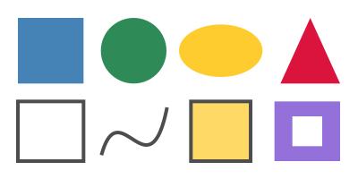
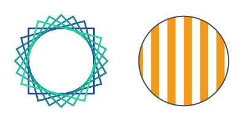

A shape is drawn in two steps: the path is built (`Rectangle`, `Circle`, `MoveTo`, `LineTo`, `CurveTo`...), then painted
(`Fill`, `Stroke`...) with the colors and the line style of the graphics state.

## Fill and outline shapes

<!-- ref:../../../tests/Meziantou.Framework.Pdf.Tests/PdfContentBuilderTests.cs;region=Pdf_DrawShapes;format=md-fenced-code-block;dedent=true -->
```csharp
public static void DrawShapes(string outputPath)
{
    var document = new PdfDocument();
    document.Pages.Add(new PdfSize(300, 150)).CreateContentBuilder()
        // Filled shapes: set the fill color, build the path, then fill it
        .SetFillRgb(0.27, 0.51, 0.71).Rectangle(15, 80, 55, 55).Fill()
        .SetFillColor(PdfColor.FromRgb24(46, 139, 87)).Circle(112, 107.5, 27.5).Fill()
        .SetFillCmyk(0, 0.2, 0.9, 0).Ellipse(185, 107.5, 35, 22).Fill()
        .SetFillRgb(0.86, 0.08, 0.24).MoveTo(235, 80).LineTo(285, 80).LineTo(260, 135).ClosePath().Fill()

        // Outlines: set the stroke color and the line width, build the path, then stroke it
        .SetStrokeGray(0.3).SetLineWidth(3)
        .Rectangle(15, 15, 55, 50).Stroke()
        .MoveTo(85, 20).CurveTo(100, 75, 125, -15, 140, 60).Stroke() // a cubic Bézier curve

        // Both: fill, then stroke the same path
        .SetFillRgb(1, 0.85, 0.4).Rectangle(160, 15, 50, 50).FillAndStroke()

        // Two squares, one inside the other: with the even-odd rule, the inner one is a hole
        .SetFillRgb(0.58, 0.44, 0.86).Rectangle(230, 15, 55, 50).Rectangle(245, 27.5, 25, 25).Fill(PdfFillRule.EvenOdd);

    document.Save(outputPath);
}
```
<!-- endref -->



| To build | Call |
| --- | --- |
| A rectangle | `Rectangle(x, y, width, height)` or `Rectangle(PdfRectangle)`, from its lower-left corner |
| A circle, an ellipse | `Circle(centerX, centerY, radius)`, `Ellipse(centerX, centerY, radiusX, radiusY)` |
| Lines | `MoveTo` starts a subpath, `LineTo` adds a straight line, `ClosePath` goes back to the start |
| Curves | `CurveTo` adds a cubic Bézier curve; `CurveToFromCurrentPoint` and `CurveToEndPoint` take one control point from the ends |

| To paint the path | Call |
| --- | --- |
| Fill it | `Fill` |
| Draw its outline | `Stroke`, or `CloseAndStroke` to close it first |
| Both | `FillAndStroke`, `CloseFillAndStroke` |
| Neither (after a clip) | `EndPath` |

- A path can have several subpaths: they are painted together. The fill rule decides what is inside: `NonZero` (the
  default) fills a shape inside another one, `EvenOdd` makes it a hole.
- The fill color is set with `SetFillGray`, `SetFillRgb`, `SetFillCmyk` or `SetFillColor`, the outline color with the
  `SetStroke...` methods. The components go from 0 to 1. `PdfColor` holds a color: `FromGray`, `FromRgb`, `FromRgb24`
  (0 to 255), `FromCmyk`, `Black` and `White`.
- The fill color also paints text. Gradients and patterns are colors as well: see
  [Gradients and patterns](06-GradientsAndPatterns.md).

## Style the lines

<!-- ref:../../../tests/Meziantou.Framework.Pdf.Tests/PdfContentBuilderTests.cs;region=Pdf_DrawLineStyles;format=md-fenced-code-block;dedent=true -->
```csharp
public static void DrawLineStyles(string outputPath)
{
    var document = new PdfDocument();
    var builder = document.Pages.Add(new PdfSize(300, 150)).CreateContentBuilder().SetStrokeRgb(0.2, 0.3, 0.5);

    // Caps: the ends of the lines, butt (the default), round and projecting square
    builder.SetLineWidth(10)
        .SetLineCap(PdfLineCap.Butt).MoveTo(25, 125).LineTo(105, 125).Stroke()
        .SetLineCap(PdfLineCap.Round).MoveTo(25, 100).LineTo(105, 100).Stroke()
        .SetLineCap(PdfLineCap.ProjectingSquare).MoveTo(25, 75).LineTo(105, 75).Stroke();

    // Joins: the corners, miter (the default), round and bevel
    builder.SetLineCap(PdfLineCap.Butt)
        .SetLineJoin(PdfLineJoin.Miter).MoveTo(135, 70).LineTo(155, 125).LineTo(175, 70).Stroke()
        .SetLineJoin(PdfLineJoin.Round).MoveTo(190, 70).LineTo(210, 125).LineTo(230, 70).Stroke()
        .SetLineJoin(PdfLineJoin.Bevel).MoveTo(245, 70).LineTo(265, 125).LineTo(285, 70).Stroke();

    // Dashes: 12 points drawn, 6 skipped; then dashes of length 0 with round caps, which are dots
    builder.SetLineWidth(3).SetDashPattern([12, 6]).MoveTo(25, 40).LineTo(285, 40).Stroke()
        .SetLineWidth(5).SetLineCap(PdfLineCap.Round).SetDashPattern([0, 10]).MoveTo(25, 20).LineTo(285, 20).Stroke()
        .SetDashPattern([]); // solid lines again

    document.Save(outputPath);
}
```
<!-- endref -->


- `SetLineWidth` sets the width, centered on the path. A width of 0 is the thinnest line the device can draw.
- `SetLineCap` sets the ends of open lines and dashes; `SetLineJoin` the corners. A miter join longer than
  `SetMiterLimit` times the width is beveled.
- `SetDashPattern` takes the lengths of the dashes and the gaps, and a phase where the pattern starts; an empty array
  draws solid lines again.

## Move, turn and clip

The transformation of the graphics state moves, turns and scales what is drawn after it, and a clip limits the region
that can be painted. Both last until the graphics state is restored:

<!-- ref:../../../tests/Meziantou.Framework.Pdf.Tests/PdfContentBuilderTests.cs;region=Pdf_DrawTransformations;format=md-fenced-code-block;dedent=true -->
```csharp
public static void DrawTransformations(string outputPath)
{
    var document = new PdfDocument();
    var builder = document.Pages.Add(new PdfSize(300, 150)).CreateContentBuilder();

    // The same square, turned around the center of the left half: move the origin there, then rotate the axes
    for (var i = 0; i < 6; i++)
    {
        builder.SaveGraphicsState()
            .Translate(75, 75)
            .Rotate(i * 15) // degrees, counterclockwise
            .SetStrokeRgb(0.1, 0.25 + (i * 0.12), 0.6).SetLineWidth(2)
            .Rectangle(-40, -40, 80, 80).Stroke()
            .RestoreGraphicsState(); // back to the coordinates of the page
    }

    // Clipping: stripes painted through a circle
    builder.SaveGraphicsState()
        .Circle(225, 75, 55).Clip().EndPath()
        .SetFillRgb(0.95, 0.6, 0.1);
    for (var x = 165; x < 285; x += 20)
    {
        builder.Rectangle(x, 0, 10, 150);
    }

    builder.Fill()
        .RestoreGraphicsState() // removes the clip
        .SetStrokeGray(0.3).SetLineWidth(1.5).Circle(225, 75, 55).Stroke();

    document.Save(outputPath);
}
```
<!-- endref -->



- `Translate`, `Rotate` and `Scale` change the coordinates of what follows; `Transform` applies any `PdfMatrix`
  (`CreateTranslation`, `CreateRotation`, `CreateScale`, `Multiply`). Each change applies to the coordinates the
  previous ones made: translate first, then rotate, to turn around a point.
- `Clip` intersects the clip with the current path, which must then be painted or ended with `EndPath`. The clip can only
  shrink: save the graphics state before, and restore it to remove the clip.
- `SaveGraphicsState` and `RestoreGraphicsState` must be balanced in a content stream: `RestoreGraphicsState` without a
  save throws `InvalidOperationException`.
