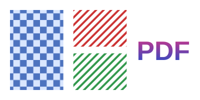

## Gradients

A shading (`PdfShading`) is a smooth change of color. `PaintShading` paints it over the whole clipping region: clip to a
shape first.

<!-- ref:../../../tests/Meziantou.Framework.Pdf.Tests/PdfContentBuilderTests.cs;region=Pdf_DrawGradients;format=md-fenced-code-block;dedent=true -->
```csharp
public static void DrawGradients(string outputPath)
{
    var document = new PdfDocument();
    var builder = document.Pages.Add(new PdfSize(300, 150)).CreateContentBuilder();

    // An axial gradient: the colors change along a line, from x = 15 to x = 135, with three stops
    var sunset = PdfShading.Axial(PdfDeviceColorSpace.Rgb, 15, 0, 135, 0, PdfFunction.Gradient(
        (0, PdfColor.FromRgb(0.98, 0.8, 0.2)),
        (0.5, PdfColor.FromRgb(0.95, 0.35, 0.3)),
        (1, PdfColor.FromRgb(0.35, 0.15, 0.5))));

    // A shading paints the whole clipping region: clip to the rectangle first
    builder.SaveGraphicsState()
        .Rectangle(15, 15, 120, 120).Clip().EndPath()
        .PaintShading(sunset)
        .RestoreGraphicsState();

    // A radial gradient: from a small circle of light to the edge of the sphere
    var sphere = PdfShading.Radial(PdfDeviceColorSpace.Rgb, 205, 95, 5, 225, 75, 60,
        PdfFunction.Gradient((0, PdfColor.FromRgb(1, 1, 1)), (1, PdfColor.FromRgb(0.1, 0.35, 0.75))));
    builder.SaveGraphicsState()
        .Circle(225, 75, 60).Clip().EndPath()
        .PaintShading(sphere)
        .RestoreGraphicsState();

    document.Save(outputPath);
}
```
<!-- endref -->


| Shading | The color changes |
| --- | --- |
| `PdfShading.Axial` | Along a line, between two points |
| `PdfShading.Radial` | Between two circles |
| `PdfShading.FunctionBased` | With the position, by a function of two inputs |
| `PdfShading.TriangleMesh`, `LatticeMesh` | Between the colors of the vertices of triangles |
| `PdfShading.CoonsPatchMesh`, `TensorPatchMesh` | Inside patches bounded by Bézier curves (`PdfPatch`) |

- An axial or a radial shading stops at its ends; `extendStart` and `extendEnd` continue its first and last colors.
- The colors come from a function (`PdfFunction`). `PdfFunction.Gradient` creates one from stops, a position from 0 to
  1 and a color; all the colors must be in the same color space (gray, RGB or CMYK), the color space of the shading.
  The other functions are `Exponential` (between two colors), `Stitching` (functions side by side), `Sampled` (a table
  of values) and `PostScript` (a small program).
- `Background` paints the area outside the shading when the shading is used in a pattern, and `AntiAlias` asks the
  readers to smooth it.

## Patterns

A pattern is a color that repeats a drawing or follows a gradient. It fills shapes and text, and outlines them, with
`SetFillPattern` and `SetStrokePattern`:

<!-- ref:../../../tests/Meziantou.Framework.Pdf.Tests/PdfContentBuilderTests.cs;region=Pdf_DrawPatterns;format=md-fenced-code-block;dedent=true -->
```csharp
public static void DrawPatterns(string outputPath)
{
    var document = new PdfDocument();
    var builder = document.Pages.Add(new PdfSize(300, 150)).CreateContentBuilder();

    // A colored tiling pattern: a cell of 20 by 20 points with its own colors, repeated every 20 points
    var checkerboard = document.CreateTilingPattern(new PdfRectangle(0, 0, 20, 20), 20, 20);
    checkerboard.CreateContentBuilder()
        .SetFillRgb(0.85, 0.9, 1).Rectangle(0, 0, 20, 20).Fill()
        .SetFillRgb(0.3, 0.45, 0.75).Rectangle(0, 0, 10, 10).Rectangle(10, 10, 10, 10).Fill();
    builder.SetFillPattern(checkerboard).Rectangle(15, 15, 80, 120).Fill();

    // An uncolored tiling pattern: a shape without colors, painted with the color given when it is used.
    // The matrix of the pattern turns its stripes by 45 degrees.
    var stripes = document.CreateTilingPattern(new PdfRectangle(0, 0, 8, 8), 8, 8, isColored: false, matrix: PdfMatrix.CreateRotation(45));
    stripes.CreateContentBuilder().Rectangle(0, 0, 8, 3).Fill();
    builder.SetFillPattern(stripes, PdfColor.FromRgb(0.8, 0.2, 0.2)).Rectangle(110, 80, 80, 55).Fill()
        .SetFillPattern(stripes, PdfColor.FromRgb(0.2, 0.6, 0.3)).Rectangle(110, 15, 80, 55).Fill();

    // A shading pattern: a gradient used as a color, here to fill text
    var gradient = new PdfShadingPattern(PdfShading.Axial(PdfDeviceColorSpace.Rgb, 0, 50, 0, 100,
        PdfFunction.Gradient((0, PdfColor.FromRgb(0.1, 0.3, 0.8)), (1, PdfColor.FromRgb(0.9, 0.2, 0.5)))));
    builder.SetFillPattern(gradient).DrawText("PDF", PdfFont.GetStandardFont(PdfStandardFont.HelveticaBold), 40, 205, 60);

    document.Save(outputPath);
}
```
<!-- endref -->



- `CreateTilingPattern` creates a tiling pattern: a cell drawn once with its own content builder, repeated every
  `xStep` and `yStep` points. A colored pattern sets its own colors; an uncolored one (`isColored: false`) is a shape,
  painted with the color given to `SetFillPattern`, so one pattern serves for every color.
- `PdfShadingPattern` uses a shading as a color, so that a gradient can fill text or outline a shape.
- A pattern is positioned in the coordinates of the page, not in those of the current transformation: its matrix
  (`matrix` of `CreateTilingPattern`, of `PdfShadingPattern`) moves, turns or scales it, as the stripes of the example.
- A tiling pattern belongs to its document, like a form. Shadings, functions and shading patterns do not belong to a
  document: create them once, and use them in several documents.
