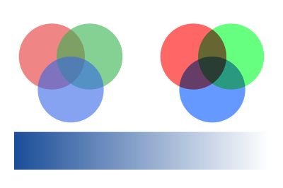

The transparency parameters have no operator of their own: they are set by a graphics state parameter dictionary,
`PdfExtGState`, with `SetGraphicsState`. They last until the graphics state is restored.

<!-- ref:../../../tests/Meziantou.Framework.Pdf.Tests/PdfContentBuilderTests.cs;region=Pdf_DrawTransparency;format=md-fenced-code-block;dedent=true -->
```csharp
public static void DrawTransparency(string outputPath)
{
    var document = new PdfDocument();
    var builder = document.Pages.Add(new PdfSize(300, 200)).CreateContentBuilder();

    // Constant alpha: three disks at 60% opacity
    builder.SaveGraphicsState()
        .SetGraphicsState(new PdfExtGState { FillAlpha = 0.6 })
        .SetFillRgb(0.9, 0.2, 0.2).Circle(55, 140, 35).Fill()
        .SetFillRgb(0.2, 0.7, 0.3).Circle(95, 140, 35).Fill()
        .SetFillRgb(0.2, 0.4, 0.9).Circle(75, 105, 35).Fill()
        .RestoreGraphicsState();

    // A blend mode: the same disks, opaque, multiplied with the colors under them
    builder.SaveGraphicsState()
        .SetGraphicsState(new PdfExtGState { BlendMode = PdfBlendMode.Multiply })
        .SetFillRgb(1, 0.4, 0.4).Circle(205, 140, 35).Fill()
        .SetFillRgb(0.4, 1, 0.5).Circle(245, 140, 35).Fill()
        .SetFillRgb(0.4, 0.6, 1).Circle(225, 105, 35).Fill()
        .RestoreGraphicsState();

    // A soft mask: the luminosity of a gradient from white to black fades the band from opaque to transparent
    var fade = document.CreateForm(new PdfRectangle(0, 0, 300, 200), group: new PdfTransparencyGroup { ColorSpace = PdfDeviceColorSpace.Gray });
    fade.CreateContentBuilder().PaintShading(PdfShading.Axial(PdfDeviceColorSpace.Gray, 15, 0, 285, 0,
        PdfFunction.Exponential(PdfColor.FromGray(1), PdfColor.FromGray(0))));
    builder.SaveGraphicsState()
        .SetGraphicsState(new PdfExtGState { SoftMask = PdfSoftMask.FromLuminosity(fade) })
        .SetFillRgb(0.1, 0.3, 0.6).Rectangle(15, 20, 270, 40).Fill()
        .RestoreGraphicsState();

    document.Save(outputPath);
}
```
<!-- endref -->



## Opacity and blend modes

- `FillAlpha` is the opacity of the fills, text and images, from 0 (transparent) to 1 (opaque); `StrokeAlpha` the
  opacity of the outlines.
- `BlendMode` combines the colors with the colors under them: `Multiply` darkens, `Screen` lightens, and `Overlay`,
  `Darken`, `Lighten`, `ColorDodge`, `ColorBurn`, `HardLight`, `SoftLight`, `Difference`, `Exclusion`, `Hue`,
  `Saturation`, `Color` and `Luminosity` are the other blend modes of PDF.
- The members of a `PdfExtGState` that are not set do not change the graphics state. It also sets the line style, the
  overprint and the flatness. A `PdfExtGState` is immutable and does not belong to a document: create one for each
  combination of parameters, and reuse it.

## Soft masks

A soft mask gives an opacity to each point of what is painted, from a form that is a transparency group:

- `PdfSoftMask.FromLuminosity` takes the opacity from the brightness of the group: white is opaque, black is
  transparent, as the gradient of the example. The group must have a color space (`PdfTransparencyGroup.ColorSpace`).
- `PdfSoftMask.FromAlpha` takes it from the opacity of the group.
- `PdfSoftMask.None` removes the current soft mask.

A transfer function can change the opacity the mask gives, and `FromLuminosity` takes the color the group is composited
on (black by default).

## Transparency groups

A form created with a `PdfTransparencyGroup` is composited as one object: its objects are combined together first, then
the result is painted with the opacity and the blend mode of the graphics state. A logo whose shapes overlap painted at
50% opacity is then evenly translucent, without darker overlaps.

- `Isolated`: the group is composited on a transparent backdrop, not on what is under it.
- `Knockout`: each object of the group replaces the objects of the group under it instead of being composited with them.
- `ColorSpace`: the color space the colors are blended in.

PDF/A-1 does not allow transparency: see [PDF/A](../08-AccessibilityAndArchiving/03-PdfA.md).
