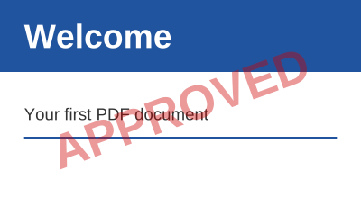

## Stamp the pages of a document

A content builder created for a page of an existing document draws over its content:

<!-- ref:../../../tests/Meziantou.Framework.Pdf.Tests/PdfDocumentTests.cs;region=Pdf_StampPages;format=md-fenced-code-block;dedent=true -->
```csharp
public static void StampPages(string inputPath, string outputPath)
{
    var document = PdfDocument.Open(inputPath);
    var font = PdfFont.GetStandardFont(PdfStandardFont.HelveticaBold);
    var translucent = new PdfExtGState { FillAlpha = 0.4 };
    var width = font.GetTextWidth("APPROVED", 40);

    foreach (var page in document.Pages)
    {
        // The new content is painted over the content of the page, from the default graphics state
        var box = page.CropBox;
        page.CreateContentBuilder()
            .SetGraphicsState(translucent)
            .SetFillRgb(0.8, 0, 0)
            .Translate(box.Left + (box.Width / 2), box.Bottom + (box.Height / 2)) // the center of the page
            .Rotate(20)
            .DrawText("APPROVED", font, 40, -width / 2, -14);
    }

    document.Save(outputPath);
}
```
<!-- endref -->



- The new content is painted after the content of the page, so over it. The existing content is wrapped between a save
  and a restore of the graphics state first, so that the new content starts with the default graphics state, whatever
  the existing content left.
- Use the crop box, not the media box, to place content in the visible area. The coordinates of a page whose `Rotation`
  is set are those of the page before it is turned.
- Add pages with `Pages.Add` and `Pages.Insert`, and remove them with `Pages.RemoveAt`. The page tree of the file is
  kept.

## Full and incremental saves

A document read from a file can be saved in two ways:

| Save | Writes | Use it to |
| --- | --- | --- |
| `Save`, `SaveAsync`, `ToByteArray` | A new file with the objects the document uses, renumbered | Get a clean, compact file; remove the objects of deleted pages; change the encryption |
| `SaveIncremental`, `SaveIncrementalAsync` | The bytes of the original file, followed by the objects that changed | Keep the original bytes, so that its signatures stay valid; write little for a small change of a large file |

<!-- ref:../../../tests/Meziantou.Framework.Pdf.Tests/PdfDocumentTests.cs;region=Pdf_IncrementalUpdate;format=md-fenced-code-block;dedent=true -->
```csharp
var document = PdfDocument.Open(file);
document.Information.Author = "Reviewer";

using var output = new MemoryStream();
document.SaveIncremental(output);
```
<!-- endref -->

- The incremental update holds the objects that were added or changed: the library notices the changes, whether they are
  made through the high-level API or the object model.
- It keeps the kind of cross-reference of the original file (a table or a stream), and writes no object stream.
- It throws `InvalidOperationException` for a document that was not read from a file, or that was repaired
  (`IsRepaired`). It cannot change the encryption of the document either: use a full save.
- A full save of a document read from an encrypted file keeps its encryption: see
  [Encryption](../07-Security/02-Encryption.md).

To sign a document, use `PdfSigner`, which appends the signature as an incremental update itself: see
[Digital signatures](../07-Security/03-DigitalSignatures.md).
