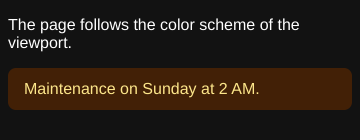

The viewport is the window of a browser in which the page is laid out. Its size is in CSS pixels, 800x600 by default. The
media queries, the viewport units (`vw`, `vh`), the layout and the screenshots use it.

## Set the viewport

Set `BrowsingContextOptions.Viewport` when you create the browsing context, or `BrowsingContext.Viewport` later: the
styles and the layout follow the new viewport.

| `ViewportOptions` | Effect |
| --- | --- |
| `Width`, `Height` | The size of the viewport, in CSS pixels |
| `DevicePixelRatio` | The number of device pixels per CSS pixel: the `resolution` media feature and the size of the screenshots |
| `ScreenWidth`, `ScreenHeight` | The size of the screen (`device-width`, `screen.width`): the viewport by default |
| `IsMobile`, `HasTouch` | A mobile device: the `viewport` meta element sets the layout viewport; a touch screen: `pointer: coarse`, `hover: none` |
| `MediaType` | `screen` (default) or `print` |
| `PreferredColorScheme`, `PreferredContrast` | `prefers-color-scheme`, `prefers-contrast` |
| `PrefersReducedMotion`, `PrefersReducedTransparency` | `prefers-reduced-motion`, `prefers-reduced-transparency` |
| `ForcedColors`, `ForcedColorsTheme` | The forced colors mode (`forced-colors: active`) and its palette |
| `ScrollbarsVisible`, `ScrollbarThickness` | Classic scrollbars, which take space in the layout, or overlay scrollbars |

`BrowsingContextOptions.UserAgent` sets `navigator.userAgent` and the `User-Agent` header of the requests.

## Emulate a device

`DeviceDescriptor` describes a device with the names of the device descriptors of Playwright, and creates its viewport.
The library has no list of devices: copy the values of the device you need.

<!-- ref:../../../tests/Meziantou.Framework.WebPlatform.Tests/Dom/CssomViewTests.cs;region=DeviceDescriptor_Example;format=md-fenced-code-block;dedent=true -->
```csharp
// The values of the "iPhone 13" device of Playwright
var iPhone13 = new DeviceDescriptor
{
    Width = 390,
    Height = 664,
    ScreenWidth = 390,
    ScreenHeight = 844,
    DevicePixelRatio = 3,
    IsMobile = true,
    HasTouch = true,
    UserAgent = "Mozilla/5.0 (iPhone; CPU iPhone OS 15_0 like Mac OS X) AppleWebKit/605.1.15 (KHTML, like Gecko) Version/15.0 Mobile/15E148 Safari/604.1",
};

using var context = new BrowsingContext(new BrowsingContextOptions
{
    Viewport = iPhone13.CreateViewport(),
    UserAgent = iPhone13.UserAgent,
});
var document = context.Navigate("https://example.com/", _ => "<!DOCTYPE html><p>Hello</p>");

Assert.True(document.DefaultView!.MatchMedia("(pointer: coarse) and (max-device-width: 500px)").Matches);
Assert.Equal(iPhone13.UserAgent, document.DefaultView.Navigator.UserAgent);
```
<!-- endref -->

On a mobile device, the `<meta name="viewport">` element of the page sets the width of the layout viewport and the scale
of the page, as in the mobile emulation of Chromium. There is no pinch zoom.

## Emulate the preferences of the user

The color scheme, the contrast and the reduced motion are preferences of the user that the pages read with media queries.
Here, the same page in dark mode:

<!-- ref:../../../tests/Meziantou.Framework.WebPlatform.Imaging.Tests/DocumentationImageTests.cs;region=WebPlatformImaging_DarkColorScheme;format=md-fenced-code-block;dedent=true -->
```csharp
using var context = new BrowsingContext(new BrowsingContextOptions
{
    Viewport = new ViewportOptions { Width = 360, Height = 140, PreferredColorScheme = PreferredColorScheme.Dark },
    RenderingBackend = new ImagingRenderingBackend(),
});

var document = context.Navigate("https://example.com/", _ => """
    <!DOCTYPE html>
    <meta name="color-scheme" content="light dark">
    <style>
      body { font-family: sans-serif }
      .notice { padding: 12px 16px; border-radius: 8px; background: #fef3c7; color: #78350f }
      @media (prefers-color-scheme: dark) {
        .notice { background: #422006; color: #fde68a }
      }
    </style>
    <p>The page follows the color scheme of the viewport.</p>
    <div class="notice">Maintenance on Sunday at 2 AM.</div>
    """);
context.EventLoop.RunUntilIdle();

Assert.True(context.Window.MatchMedia("(prefers-color-scheme: dark)").Matches);
using var screenshot = context.TakeScreenshot();
```
<!-- endref -->



The `color-scheme` meta element lets the browser colors (the canvas, the text, the form controls, the scrollbars) follow
the dark scheme, as in a browser.

## Print media

`MediaType = "print"` applies the print styles (`@media print`) to the page in the viewport. To print the pages themselves (the
`@page` rules, the page breaks, one image or one PDF page per page), see [Printing pages](../07-Rendering/03-PrintingPages.md).
