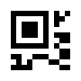
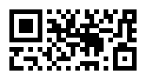
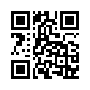
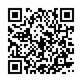

## Choose the kind of QR code

| Kind | Method | Size in modules | Standard |
| --- | --- | --- | --- |
| Standard QR code | `QRCode.Create` | 21×21 to 177×177 (versions 1 to 40) | ISO/IEC 18004 |
| Micro QR code | `QRCode.CreateMicroQR` | 11×11 to 17×17 (versions M1 to M4) | ISO/IEC 18004 |
| Rectangular Micro QR code (rMQR) | `QRCode.CreateRMQR` | Rectangular, wider than high | ISO/IEC 23941 |

<!-- ref:../../tests/Meziantou.Framework.Barcodes.Tests/QRCodeTests.cs;region=QRCode_Create;format=md-fenced-code-block;dedent=true -->
```csharp
// Standard QR code
var standardQr = QRCode.Create("HELLO WORLD", ErrorCorrectionLevel.H);

// Micro QR code (smaller, single finder pattern)
var microQr = QRCode.CreateMicroQR("12345", ErrorCorrectionLevel.L);

// Rectangular Micro QR code (narrow rectangular shape)
var rmqr = QRCode.CreateRMQR("https://www.meziantou.net", ErrorCorrectionLevel.M);

// Format info: type, width and height in modules
Assert.Equal((QRCodeType.Standard, 25, 25), (standardQr.Type, standardQr.Width, standardQr.Height));
Assert.Equal((QRCodeType.MicroQR, 11, 11), (microQr.Type, microQr.Width, microQr.Height));
Assert.Equal((QRCodeType.RMQR, 43, 13), (rmqr.Type, rmqr.Width, rmqr.Height));
```
<!-- endref -->

A standard QR code is what every phone reads. Use a Micro QR code or an rMQR code only when the space is too small and
you know the scanners support them: a Micro QR code has a single finder pattern and holds a few characters, an rMQR
code fits in a narrow strip, such as the edge of a label.

<!-- ref:../../tests/Meziantou.Framework.Barcodes.Tests/QRCodeTests.cs;region=QRCode_SmallSymbols;format=md-fenced-code-block;dedent=true -->
```csharp
var microQr = QRCode.CreateMicroQR("12345");
var rmqr = QRCode.CreateRMQR("HELLO WORLD");

Assert.Equal((1, 11, 11), (microQr.Version, microQr.Width, microQr.Height));
Assert.Equal((27, 13), (rmqr.Width, rmqr.Height));

var microPng = microQr.ToPng(new QRCodePngOptions { ModuleSize = 6, QuietZoneModules = 2 });
var rmqrPng = rmqr.ToPng(new QRCodePngOptions { ModuleSize = 6, QuietZoneModules = 2 });
```
<!-- endref -->




## Choose the error correction level

The error correction level says how much of the code can be damaged or hidden and still be read. A higher level stores
more redundancy, so the same data takes a larger code:

| Level | Recovers about |
| --- | --- |
| `ErrorCorrectionLevel.L` | 7% |
| `ErrorCorrectionLevel.M` | 15% (the default of `Create` and `CreateRMQR`) |
| `ErrorCorrectionLevel.Q` | 25% |
| `ErrorCorrectionLevel.H` | 30% |

<!-- ref:../../tests/Meziantou.Framework.Barcodes.Tests/QRCodeTests.cs;region=QRCode_ErrorCorrectionLevel;format=md-fenced-code-block;dedent=true -->
```csharp
var low = QRCode.Create("https://www.meziantou.net", ErrorCorrectionLevel.L);
var high = QRCode.Create("https://www.meziantou.net", ErrorCorrectionLevel.H);

// More redundancy takes more modules: the version is the smallest one that holds the data
Assert.Equal((2, 25), (low.Version, low.Width));
Assert.Equal((4, 33), (high.Version, high.Width));

var lowPng = low.ToPng(new QRCodePngOptions { ModuleSize = 4 });
var highPng = high.ToPng(new QRCodePngOptions { ModuleSize = 4 });
```
<!-- endref -->




- Use `H` when a logo covers the middle of the code (see [the logo of the SVG renderer](06-SvgAndPng.md#add-a-logo)),
  or when the printed code can get dirty or scratched.
- Not every kind supports every level. Micro QR versions M2 and M3 support `L` and `M`, M4 supports `L`, `M` and `Q`,
  and M1 only detects errors (its `ErrorCorrectionLevel` is reported as `L`). `CreateMicroQR` uses `L` by default.
  rMQR codes support `M` and `H` only.
- `QRCode.ErrorCorrectionLevel` gives the level the code was built with, and `Version` its version.

## How the data is encoded

The whole text is encoded in one mode, the most compact one that can hold all its characters:

- Digits only take the fewest bits.
- Uppercase letters, digits, the space and `$%*+-./:` (the alphanumeric mode) take fewer bits than other characters.
- A text whose characters are all double-byte Shift JIS characters, such as Japanese kanji and kana, is encoded in
  the kanji mode.
- Any other text is encoded as UTF-8. `Create` also takes bytes, encoded as they are.

<!-- ref:../../tests/Meziantou.Framework.Barcodes.Tests/QRCodeTests.cs;region=QRCode_EncodingModes;format=md-fenced-code-block;dedent=true -->
```csharp
// Uppercase letters, digits and " $%*+-./:" take fewer bits than other characters
Assert.Equal(2, QRCode.Create("HTTPS://WWW.MEZIANTOU.NET/BLOG/").Version);
Assert.Equal(3, QRCode.Create("https://www.meziantou.net/blog/").Version);

// Digits alone take even fewer
Assert.Equal(1, QRCode.Create("0123456789012345678901234567890123").Version);

// Any other text is encoded as UTF-8, and binary data as it is
Assert.Equal(1, QRCode.Create("Caf\u00E9").Version);
Assert.Equal(1, QRCode.Create([0x00, 0x01, 0xFE, 0xFF]).Version);
```
<!-- endref -->

The scheme and the host name of a URL are not case-sensitive, so an uppercase URL can give a smaller code, provided the
path of the site accepts uppercase too.

Data too long for the largest version throws an `InvalidOperationException`; empty data throws an `ArgumentException`.

## Read the modules

A `QRCode` is a grid of modules: `Width` columns and `Height` rows (`Size` is the side of a square code), and the
indexer tells whether a module is dark. Use it to render the code your own way:

<!-- ref:../../tests/Meziantou.Framework.Barcodes.Tests/QRCodeTests.cs;region=QRCode_Modules;format=md-fenced-code-block;dedent=true -->
```csharp
var qrCode = QRCode.Create("HELLO");

// The modules, row by row: true for a dark module
var text = new StringBuilder();
for (var row = 0; row < qrCode.Height; row++)
{
    for (var column = 0; column < qrCode.Width; column++)
    {
        text.Append(qrCode[row, column] ? '#' : '.');
    }

    text.Append('\n');
}

Assert.StartsWith("#######.", text.ToString()); // the top-left finder pattern, then its separator
```
<!-- endref -->

The grid does not include the quiet zone: leave a light margin around the modules when you draw them.
