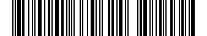

## Create a barcode

Each symbology has its own method on `Barcode`. The result has the `Type`, the `Width` in modules, the `Height` (1: a
linear barcode is one row of modules) and the `Text` printed under the bars:

<!-- ref:../../tests/Meziantou.Framework.Barcodes.Tests/BarCodeAdditionalTypesTests.cs;region=Barcode_Create;format=md-fenced-code-block;dedent=true -->
```csharp
var code39 = Barcode.CreateCode39("ABC-123", includeChecksum: true);
var code93 = Barcode.CreateCode93("ABC123");
var code128 = Barcode.CreateCode128("SKU-123456");
var ean8 = Barcode.CreateEan8("5512345");
var ean13 = Barcode.CreateEan13("400638133393");
var upcA = Barcode.CreateUpcA("03600029145", extension: "12");
var codabar = Barcode.CreateCodabar("40156", startCharacter: 'A', stopCharacter: 'B');
var itf = Barcode.CreateItf("12345678");

// Type, width in modules and height (a linear barcode is one module high)
Assert.Equal((BarcodeType.Code39, 129, 1), (code39.Type, code39.Width, code39.Height));
Assert.Equal((BarcodeType.Code93, 91, 1), (code93.Type, code93.Width, code93.Height));
Assert.Equal((BarcodeType.Code128, 123, 1), (code128.Type, code128.Width, code128.Height));
Assert.Equal((BarcodeType.Ean8, 67, 1), (ean8.Type, ean8.Width, ean8.Height));
Assert.Equal((BarcodeType.Ean13, 95, 1), (ean13.Type, ean13.Width, ean13.Height));
Assert.Equal((BarcodeType.UpcA, 124, 1), (upcA.Type, upcA.Width, upcA.Height));
Assert.Equal((BarcodeType.Codabar, 71, 1), (codabar.Type, codabar.Width, codabar.Height));
Assert.Equal((BarcodeType.Itf, 81, 1), (itf.Type, itf.Width, itf.Height));

// The human-readable text, with the characters the barcode adds (check digits, add-on, Codabar guards)
Assert.Equal("ABC-123W", code39.Text);
Assert.Equal("55123457", ean8.Text);
Assert.Equal("4006381333931", ean13.Text);
Assert.Equal("036000291452 12", upcA.Text);
Assert.Equal("A40156B", codabar.Text);
```
<!-- endref -->

## Choose the symbology

The symbology is usually imposed by what reads the barcode: a retail checkout reads EAN and UPC, a warehouse or a
shipping label often uses Code 128.

| Symbology | Method | Data |
| --- | --- | --- |
| Code 39 | `CreateCode39` | Uppercase letters, digits and `-. $/+%`; an optional Mod 43 check character (`includeChecksum`) |
| Code 93 | `CreateCode93` | Any ASCII character: the characters outside the base set are encoded with the extended encoding |
| Code 128 | `CreateCode128` | The printable ASCII characters (code set B); runs of digits switch to the denser code set C |
| EAN-8 | `CreateEan8` | 7 digits, or 8 with the check digit |
| EAN-13 | `CreateEan13` | 12 digits, or 13 with the check digit |
| UPC-A | `CreateUpcA` | 11 digits, or 12 with the check digit |
| Codabar | `CreateCodabar` | Digits and `-$:/.+`, between a start and a stop character (`A`, `B`, `C` or `D`) |
| ITF (Interleaved 2 of 5) | `CreateItf` | An even number of digits |

For free text, prefer Code 128: it encodes letters of both cases and is compact, especially for digits.

## Check digits and add-ons

EAN-8, EAN-13 and UPC-A end with a check digit. Pass the data without it and the method computes it, or with it and the
method verifies it. The three take an optional add-on of 2 or 5 digits (`extension`), such as the price add-on printed
next to the barcode of a book:

<!-- ref:../../tests/Meziantou.Framework.Barcodes.Tests/BarCodeAdditionalTypesTests.cs;region=Barcode_Ean13WithAddOn;format=md-fenced-code-block;dedent=true -->
```csharp
// A book: its ISBN without the check digit, and a 5-digit add-on
var barcode = Barcode.CreateEan13("978020137962", extension: "52499");
Assert.Equal("9780201379624 52499", barcode.Text); // the check digit is added

var png = barcode.ToPng(new BarcodePngOptions { ModuleHeight = 60 });
```
<!-- endref -->



`Text` is what is printed under the bars: it includes the characters the barcode adds (the check digit, then a space
and the add-on; the Mod 43 check character of Code 39 when it is included; the start and stop characters of Codabar),
and not the start and stop characters of Code 39 and Code 93.

## Invalid data

Data a symbology cannot encode throws an `ArgumentException` whose `ParamName` is the parameter at fault:

<!-- ref:../../tests/Meziantou.Framework.Barcodes.Tests/BarCodeAdditionalTypesTests.cs;region=Barcode_InvalidData;format=md-fenced-code-block;dedent=true -->
```csharp
// A check digit that does not match the data
Assert.Throws<ArgumentException>("data", () => Barcode.CreateEan13("4006381333932"));

// A character the symbology cannot encode
Assert.Throws<ArgumentException>("data", () => Barcode.CreateCode39("abc"));

// ITF encodes pairs of digits
Assert.Throws<ArgumentException>("data", () => Barcode.CreateItf("12345"));
```
<!-- endref -->

Validate input from users before creating the barcode, or catch the exception to report it.

## Read the modules

Like a QR code, a barcode is a grid of modules, with a single row: the indexer tells whether a module is a bar. Use it
to render the barcode your own way:

<!-- ref:../../tests/Meziantou.Framework.Barcodes.Tests/BarCodeAdditionalTypesTests.cs;region=Barcode_Modules;format=md-fenced-code-block;dedent=true -->
```csharp
var barcode = Barcode.CreateEan8("5512345");

// One row of modules: true for a bar
var bars = new StringBuilder();
for (var column = 0; column < barcode.Width; column++)
{
    bars.Append(barcode[0, column] ? '|' : ' ');
}

Assert.StartsWith("| |", bars.ToString()); // the start guard
```
<!-- endref -->

The grid does not include the quiet zone, the light margin on each side that scanners need.
