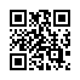
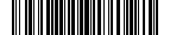

## Install the package

Add the `Meziantou.Framework.Barcodes` package to a project, and `Meziantou.Framework.Imaging.Barcodes` to save the
codes as PNG files or other images:

<InstallNuGetPackage Id="Meziantou.Framework.Barcodes" />
<InstallNuGetPackage Id="Meziantou.Framework.Imaging.Barcodes" />

The examples of this documentation omit the `using` directives: they need `using Meziantou.Framework.Barcodes;`,
`using Meziantou.Framework.VectorGraphics;` for the colors, and `using Meziantou.Framework.Imaging.Barcodes;` for the
images.

## Generate a QR code

[QRCode.Create](cref:Meziantou.Framework.Barcodes.QRCode.Create) encodes a text in the smallest QR code that holds it, and [ToImage](cref:Meziantou.Framework.Imaging.Barcodes.QRCodeImageRenderer.ToImage) renders it as an image,
to save as a PNG file:

<!-- ref:../../tests/Meziantou.Framework.Barcodes.Tests/QRCodeTests.cs;region=QRCode_GettingStarted;format=md-fenced-code-block;dedent=true -->
```csharp
var qrCode = QRCode.Create("https://www.meziantou.net");

// ToImage comes from Meziantou.Framework.Imaging.Barcodes: save the image as PNG with image.Save("qrcode.png")
using var image = qrCode.ToImage(new QRCodeRenderOptions { ModuleSize = 4 });
```
<!-- endref -->



- [ModuleSize](cref:Meziantou.Framework.Barcodes.QRCodeRenderOptions.ModuleSize) is the size of a module, the small square of a QR code, in pixels. It is 10 by default.
- The image includes the quiet zone, the light margin a scanner needs around the code: 4 modules by default.
- The same options give an SVG document with [ToSvg](cref:Meziantou.Framework.Barcodes.QRCodeRenderer.ToSvg), which needs only `Meziantou.Framework.Barcodes`,
  or a PDF document. See [SVG, images and PDF](06-SvgImagesAndPdf.md).

## Generate a barcode

The `Barcode.Create*` methods create linear barcodes, one method per symbology:

<!-- ref:../../tests/Meziantou.Framework.Barcodes.Tests/BarCodeAdditionalTypesTests.cs;region=Barcode_GettingStarted;format=md-fenced-code-block;dedent=true -->
```csharp
var barcode = Barcode.CreateCode128("SKU-123456");

// ToImage comes from Meziantou.Framework.Imaging.Barcodes: save the image as PNG with image.Save("barcode.png")
using var image = barcode.ToImage(new BarcodeRenderOptions { ModuleHeight = 60 });
```
<!-- endref -->



To print the human-readable text under the bars, set [Text](cref:Meziantou.Framework.Barcodes.BarcodeRenderOptions.Text): see
[Print the text under a barcode](06-SvgImagesAndPdf.md#print-the-text-under-a-barcode).

## Next steps

- [QR codes](03-QRCodes.md): the kinds of QR codes, the error correction level and how the data is encoded.
- [Linear barcodes](04-LinearBarcodes.md): which symbology to use, check digits and add-ons.
- [QR code content](05-QRCodeContent.md): Wi-Fi networks, contacts, payments and more.
