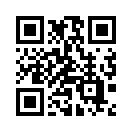
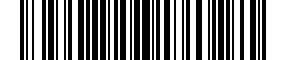

## Install the package

Add the `Meziantou.Framework.Barcodes` package to a project:

```bash
dotnet add package Meziantou.Framework.Barcodes
```

The examples of this documentation omit the `using` directives: they need `using Meziantou.Framework.Barcodes;`.

## Generate a QR code

`QRCode.Create` encodes a text in the smallest QR code that holds it, and `ToPng` renders it as the bytes of a PNG
file:

<!-- ref:../../tests/Meziantou.Framework.Barcodes.Tests/QRCodeTests.cs;region=QRCode_GettingStarted;format=md-fenced-code-block;dedent=true -->
```csharp
var qrCode = QRCode.Create("https://www.meziantou.net");

// The bytes of a PNG file, to save with File.WriteAllBytes("qrcode.png", png)
var png = qrCode.ToPng(new QRCodePngOptions { ModuleSize = 4 });
```
<!-- endref -->



- `ModuleSize` is the size of a module, the small square of a QR code, in pixels. It is 10 by default.
- The image includes the quiet zone, the light margin a scanner needs around the code: 4 modules by default.
- `ToPng` is an extension method; `WriteToPng` writes to a stream, and `ToSvg` gives an SVG document. See
  [SVG and PNG](06-SvgAndPng.md).

## Generate a barcode

The `Barcode.Create*` methods create linear barcodes, one method per symbology:

<!-- ref:../../tests/Meziantou.Framework.Barcodes.Tests/BarCodeAdditionalTypesTests.cs;region=Barcode_GettingStarted;format=md-fenced-code-block;dedent=true -->
```csharp
var barcode = Barcode.CreateCode128("SKU-123456");

// The bytes of a PNG file, to save with File.WriteAllBytes("barcode.png", png)
var png = barcode.ToPng(new BarcodePngOptions { ModuleHeight = 60 });
```
<!-- endref -->



The PNG renderer draws the bars only. To print the text under them, use the image renderer of
`Meziantou.Framework.Imaging.Barcodes` with a font: see [Images](08-Images.md).

## Next steps

- [QR codes](03-QRCodes.md): the kinds of QR codes, the error correction level and how the data is encoded.
- [Linear barcodes](04-LinearBarcodes.md): which symbology to use, check digits and add-ons.
- [QR code content](05-QRCodeContent.md): Wi-Fi networks, contacts, payments and more.
