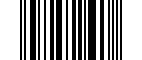
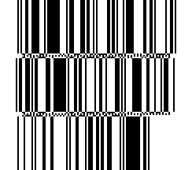
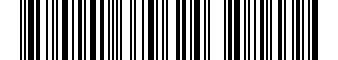

## Create a barcode

Each symbology has its own method on [Barcode](cref:Meziantou.Framework.Barcodes.Barcode). The result has the [Type](cref:Meziantou.Framework.Barcodes.Barcode.Type), the [Width](cref:Meziantou.Framework.Barcodes.Barcode.Width) in modules, the [Height](cref:Meziantou.Framework.Barcodes.Barcode.Height) (1: a
linear barcode is one row of modules, except the stacked GS1 DataBar symbols) and the [Text](cref:Meziantou.Framework.Barcodes.Barcode.Text) printed under the bars:

<!-- ref:../../tests/Meziantou.Framework.Barcodes.Tests/BarCodeAdditionalTypesTests.cs;region=Barcode_Create;format=md-fenced-code-block;dedent=true -->
```csharp
var code39 = Barcode.CreateCode39("ABC-123", includeChecksum: true);
var code93 = Barcode.CreateCode93("ABC123");
var code128 = Barcode.CreateCode128("SKU-123456");
var ean8 = Barcode.CreateEan8("5512345");
var ean13 = Barcode.CreateEan13("400638133393");
var upcA = Barcode.CreateUpcA("03600029145", extension: "12");
var codabar = Barcode.CreateCodabar("40156", startCharacter: 'A', stopCharacter: 'B');
var itf = Barcode.CreateItf("12345678");
var upcE = Barcode.CreateUpcE("0425261");
var dataBar = Barcode.CreateGs1DataBar("0950110153000");

// Type, width in modules and height (a linear barcode is one module high)
Assert.Equal((BarcodeType.Code39, 129, 1), (code39.Type, code39.Width, code39.Height));
Assert.Equal((BarcodeType.Code93, 91, 1), (code93.Type, code93.Width, code93.Height));
Assert.Equal((BarcodeType.Code128, 123, 1), (code128.Type, code128.Width, code128.Height));
Assert.Equal((BarcodeType.Ean8, 67, 1), (ean8.Type, ean8.Width, ean8.Height));
Assert.Equal((BarcodeType.Ean13, 95, 1), (ean13.Type, ean13.Width, ean13.Height));
Assert.Equal((BarcodeType.UpcA, 124, 1), (upcA.Type, upcA.Width, upcA.Height));
Assert.Equal((BarcodeType.Codabar, 71, 1), (codabar.Type, codabar.Width, codabar.Height));
Assert.Equal((BarcodeType.Itf, 81, 1), (itf.Type, itf.Width, itf.Height));
Assert.Equal((BarcodeType.UpcE, 51, 1), (upcE.Type, upcE.Width, upcE.Height));
Assert.Equal((BarcodeType.Gs1DataBar, 96, 1), (dataBar.Type, dataBar.Width, dataBar.Height));

// The human-readable text, with the characters the barcode adds (check digits, add-on, Codabar guards)
Assert.Equal("ABC-123W", code39.Text);
Assert.Equal("55123457", ean8.Text);
Assert.Equal("4006381333931", ean13.Text);
Assert.Equal("036000291452 12", upcA.Text);
Assert.Equal("A40156B", codabar.Text);
Assert.Equal("04252614", upcE.Text);
Assert.Equal("(01)09501101530003", dataBar.Text);
```
<!-- endref -->

## Choose the symbology

The symbology is usually imposed by what reads the barcode: a retail checkout reads EAN and UPC, a warehouse or a
shipping label often uses Code 128.

| Symbology | Method | Data |
| --- | --- | --- |
| Code 39 | [CreateCode39](cref:Meziantou.Framework.Barcodes.Barcode.CreateCode39) | Uppercase letters, digits and `-. $/+%`; an optional Mod 43 check character (`includeChecksum`) |
| Code 93 | [CreateCode93](cref:Meziantou.Framework.Barcodes.Barcode.CreateCode93) | Any ASCII character: the characters outside the base set are encoded with the extended encoding |
| Code 128 | [CreateCode128](cref:Meziantou.Framework.Barcodes.Barcode.CreateCode128) | Any ASCII character, control characters included; the method switches between code sets A, B and C |
| GS1-128 | [CreateGs1128](cref:Meziantou.Framework.Barcodes.Barcode.CreateGs1128) | GS1 element strings: application identifiers and their data |
| EAN-8 | [CreateEan8](cref:Meziantou.Framework.Barcodes.Barcode.CreateEan8) | 7 digits, or 8 with the check digit |
| EAN-13 | [CreateEan13](cref:Meziantou.Framework.Barcodes.Barcode.CreateEan13) | 12 digits, or 13 with the check digit |
| UPC-A | [CreateUpcA](cref:Meziantou.Framework.Barcodes.Barcode.CreateUpcA) | 11 digits, or 12 with the check digit |
| UPC-E | [CreateUpcE](cref:Meziantou.Framework.Barcodes.Barcode.CreateUpcE) | A UPC-A number of number system 0 or 1 without some of its zeros: 6, 7 or 8 digits, or the UPC-A number to compress |
| GS1 DataBar Omnidirectional, Stacked, Stacked Omnidirectional | [CreateGs1DataBar](cref:Meziantou.Framework.Barcodes.Barcode.CreateGs1DataBar), [CreateGs1DataBarStacked](cref:Meziantou.Framework.Barcodes.Barcode.CreateGs1DataBarStacked), [CreateGs1DataBarStackedOmnidirectional](cref:Meziantou.Framework.Barcodes.Barcode.CreateGs1DataBarStackedOmnidirectional) | A GTIN: 13 digits, or 14 with the check digit |
| GS1 DataBar Limited | [CreateGs1DataBarLimited](cref:Meziantou.Framework.Barcodes.Barcode.CreateGs1DataBarLimited) | A GTIN that starts with 0 or 1 |
| GS1 DataBar Expanded, Expanded Stacked | [CreateGs1DataBarExpanded](cref:Meziantou.Framework.Barcodes.Barcode.CreateGs1DataBarExpanded), [CreateGs1DataBarExpandedStacked](cref:Meziantou.Framework.Barcodes.Barcode.CreateGs1DataBarExpandedStacked) | GS1 element strings |
| Codabar | [CreateCodabar](cref:Meziantou.Framework.Barcodes.Barcode.CreateCodabar) | Digits and `-$:/.+`, between a start and a stop character (`A`, `B`, `C` or `D`) |
| ITF (Interleaved 2 of 5) | [CreateItf](cref:Meziantou.Framework.Barcodes.Barcode.CreateItf) | An even number of digits |

For free text, prefer Code 128: it encodes letters of both cases and is compact, especially for digits.

## Code 128 code sets

Code 128 has three code sets: A holds the uppercase letters, the digits, the punctuation and the ASCII control
characters (`\t`, `\r`, `\n`, ...); B holds the same printable characters and the lowercase letters; C holds pairs of
digits, which halves the width of numbers. You pass the text, and
[CreateCode128](cref:Meziantou.Framework.Barcodes.Barcode.CreateCode128) chooses the code sets: C for runs of 4 digits or
more, A for control characters, B for lowercase letters, and a single-character shift when the other set is only needed
for one character. Control characters let a scanner that types the data into a form move between fields or submit it:

<!-- ref:../../tests/Meziantou.Framework.Barcodes.Tests/BarCode128Tests.cs;region=Barcode_Code128ControlCharacters;format=md-fenced-code-block;dedent=true -->
```csharp
// A Tab between the fields and an Enter at the end, for a scanner that types the data into a form
var barcode = Barcode.CreateCode128("SKU-123456\tQTY-5\r");
Assert.Equal("SKU-123456\tQTY-5\r", barcode.Text);
```
<!-- endref -->

Characters outside ASCII (`é`, `€`) throw an `ArgumentException`.

## GS1-128

GS1-128 is the Code 128 of logistics labels: it holds GS1 element strings, each an application identifier (AI) that
says what the data is, followed by the data: `01` for a GTIN, `17` for an expiry date, `10` for a batch number, and so
on. Pass the elements to [CreateGs1128](cref:Meziantou.Framework.Barcodes.Barcode.CreateGs1128) as
[Gs1Element](cref:Meziantou.Framework.Barcodes.Gs1Element) instances:

<!-- ref:../../tests/Meziantou.Framework.Barcodes.Tests/BarCode128Tests.cs;region=Barcode_Gs1128;format=md-fenced-code-block;dedent=true -->
```csharp
// A GTIN, an expiry date and a batch number
var barcode = Barcode.CreateGs1128(
    new Gs1Element("01", "09521234543213"),
    new Gs1Element("17", "250101"),
    new Gs1Element("10", "ABC123"));

// The human-readable interpretation printed under the bars: the parentheses are not encoded
Assert.Equal("(01)09521234543213(17)250101(10)ABC123", barcode.Text);
Assert.Equal(BarcodeType.Gs1128, barcode.Type);
```
<!-- endref -->

The parentheses are only in the human-readable interpretation, the [Text](cref:Meziantou.Framework.Barcodes.Barcode.Text)
printed under the bars: they are not encoded. What is encoded is a FNC1 function character, which tells a reader that the
symbol is GS1-128, then the application identifiers and their data. A reader cannot know where the data of an
identifier without a predefined length (such as the batch number `10`) ends, so a FNC1 separator follows it when other
elements come after it. A reader returns the separators as the ASCII group separator character (U+001D). Put
the elements of variable length last to save separators.

[CreateCode128](cref:Meziantou.Framework.Barcodes.Barcode.CreateCode128) never adds FNC1: passing it `(01)09521234543213`
creates an ordinary Code 128 symbol with the parentheses in its data, which a GS1 application does not read as a GTIN.

By default, [Gs1Element](cref:Meziantou.Framework.Barcodes.Gs1Element) checks the syntax every element follows: an
application identifier of 2 to 4 digits; data from the GS1 character set 82 (letters, digits and
`!"%&'()*+,-./:;<=>?_`, no space, and `#` for the component/part identifier `8010`); and digits of the right length
for the identifiers whose data has a predefined length (`00` to `04`, `11` to `20`, `31nn` to `36nn`, `41n`). A GS1-128
symbol holds at most 48 characters, application identifiers and separators included.

### Check the data against the GS1 dictionary

Scanners in the supply chain reject labels whose data does not match the format of its application identifier. Pass
[Gs1ValidationMode.Dictionary](cref:Meziantou.Framework.Barcodes.Gs1ValidationMode.Dictionary) to check the element
against the GS1 dictionary of application identifiers:

<!-- ref:../../tests/Meziantou.Framework.Barcodes.Tests/Gs1DictionaryTests.cs;region=Gs1Element_Dictionary;format=md-fenced-code-block;dedent=true -->
```csharp
// The syntax rules accept any data of 14 digits for a GTIN
var element = new Gs1Element("01", "09521234543214");
Assert.Equal("(01)09521234543214", element.ToString());

// The GS1 dictionary also checks the check digit, the dates, the country codes, ...
var exception = Assert.Throws<ArgumentException>("value", () => new Gs1Element("01", "09521234543214", Gs1ValidationMode.Dictionary));
Assert.Contains("The numeric check digit is incorrect.", exception.Message);

var gtin = new Gs1Element("01", "09521234543213", Gs1ValidationMode.Dictionary);
var expiry = new Gs1Element("17", "250100", Gs1ValidationMode.Dictionary); // day 00: the end of the month
var barcode = Barcode.CreateGs1128(gtin, expiry);
Assert.Equal("(01)09521234543213(17)250100", barcode.Text);
```
<!-- endref -->

The application identifier must be in the dictionary, and its data must match the format of the identifier: the
length and the character set of each part, check digits (GTIN, SSCC, GLN, ...), the check character pairs of the
alphanumeric keys, dates (`YYMMDD`, where the day `00` means the end of the month when the identifier allows it),
times, ISO 3166 country codes, ISO 4217 currency codes, IBANs, coordinates, and the fields of the North American
coupon codes. The message of the exception names the format of the identifier and the position of the error in the
data. The dictionary is the
[GS1 Barcode Syntax Dictionary](https://github.com/gs1/gs1-syntax-dictionary), embedded in the package.

Some application identifiers only make sense together, and others must not be used together: a batch number (`10`)
qualifies a trade item, so it requires a GTIN (`01`). [ValidateAssociations](cref:Meziantou.Framework.Barcodes.Gs1Element.ValidateAssociations)
checks these rules, and that an application identifier does not appear twice with different data:

<!-- ref:../../tests/Meziantou.Framework.Barcodes.Tests/Gs1DictionaryTests.cs;region=Gs1Element_ValidateAssociations;format=md-fenced-code-block;dedent=true -->
```csharp
var gtin = new Gs1Element("01", "09521234543213", Gs1ValidationMode.Dictionary);
var batch = new Gs1Element("10", "ABC123", Gs1ValidationMode.Dictionary);
Gs1Element.ValidateAssociations(gtin, batch);

// A batch number qualifies a trade item: it requires a GTIN
Assert.Throws<ArgumentException>("elements", () => Gs1Element.ValidateAssociations(batch));
```
<!-- endref -->

The rules apply to all the data marked on an item, so pass the elements of every barcode of the item:
[CreateGs1128](cref:Meziantou.Framework.Barcodes.Barcode.CreateGs1128) does not check them, since another barcode may
hold the required identifier.

## UPC-E

UPC-E is the short form of a UPC-A number that has enough zeros: the zeros are removed, and the number system (0 or 1)
and the check digit are encoded by the parities of the 6 digits, so a UPC-E symbol is only 51 modules wide. Pass the
6 digits, the number system and the 6 digits, the same with the check digit, or the UPC-A number to compress to
[CreateUpcE](cref:Meziantou.Framework.Barcodes.Barcode.CreateUpcE):

<!-- ref:../../tests/Meziantou.Framework.Barcodes.Tests/BarCodeAdditionalTypesTests.cs;region=Barcode_UpcE;format=md-fenced-code-block;dedent=true -->
```csharp
// The number system (0 or 1) and 6 digits: the check digit is the one of the UPC-A number it stands for
var barcode = Barcode.CreateUpcE("0425261");
Assert.Equal("04252614", barcode.Text);

// The same symbol from the UPC-A number, 04210000526, which has the zeros UPC-E removes
var fromUpcA = Barcode.CreateUpcE("04210000526");
Assert.Equal("04252614", fromUpcA.Text);

// A UPC-A number without these zeros has no UPC-E form
Assert.Throws<ArgumentException>("data", () => Barcode.CreateUpcE("03600029145"));

var png = barcode.ToPng(new BarcodePngOptions { ModuleHeight = 60 });
```
<!-- endref -->



The check digit is the one of the UPC-A number. Each UPC-A number with a UPC-E form has a single one: other digits that
stand for the same UPC-A number, such as `0182433` for `01820000043` (written `0180432`), throw an `ArgumentException`.
Like UPC-A, UPC-E takes an optional add-on of 2 or 5 digits (`extension`).

## GS1 DataBar

GS1 DataBar holds a GTIN in a symbol smaller than EAN-13, and GS1 DataBar Expanded holds GS1 element strings, such as
the weight, the price or the expiry date of fresh food:

| Variant | Size in modules | Use |
| --- | --- | --- |
| GS1 DataBar Omnidirectional ([Gs1DataBar](cref:Meziantou.Framework.Barcodes.BarcodeType.Gs1DataBar)) | 96 wide, at least 33 high | A GTIN, read by omnidirectional retail scanners |
| GS1 DataBar Truncated | 96 wide, 13 high | The same symbol drawn 13 modules high: use [CreateGs1DataBar](cref:Meziantou.Framework.Barcodes.Barcode.CreateGs1DataBar) with a `ModuleHeight` of 13 times the `ModuleWidth` |
| GS1 DataBar Stacked | 50 wide, 13 high | A GTIN on small items, in two short rows |
| GS1 DataBar Stacked Omnidirectional | 50 wide, 69 high | A GTIN in two full-height rows that omnidirectional scanners read |
| GS1 DataBar Limited | 74 wide | A GTIN that starts with 0 or 1, on very small items |
| GS1 DataBar Expanded | Up to 543 wide | Up to 74 digits or 41 letters of element strings |
| GS1 DataBar Expanded Stacked | 2 to 20 segments per row | GS1 DataBar Expanded in rows, for narrow spaces |

<!-- ref:../../tests/Meziantou.Framework.Barcodes.Tests/BarCodeAdditionalTypesTests.cs;region=Barcode_Gs1DataBar;format=md-fenced-code-block;dedent=true -->
```csharp
// A GTIN of 13 digits (the check digit is added) or 14 digits
var omnidirectional = Barcode.CreateGs1DataBar("09501101530003");
var limited = Barcode.CreateGs1DataBarLimited("09501101530003"); // the GTIN starts with 0 or 1
Assert.Equal("(01)09501101530003", omnidirectional.Text);
Assert.Equal((96, 74), (omnidirectional.Width, limited.Width));

// The stacked variants have one row per module of height: 5 + 1 + 7 for GS1 DataBar Stacked
var stacked = Barcode.CreateGs1DataBarStacked("09501101530003");
Assert.True(stacked.IsStacked);
Assert.Equal((50, 13), (stacked.Width, stacked.Height));

// The renderers draw the rows of a stacked barcode as high as a module is wide
var png = stacked.ToPng(new BarcodePngOptions { ModuleWidth = 3 });
```
<!-- endref -->


The [Text](cref:Meziantou.Framework.Barcodes.Barcode.Text) of GS1 DataBar is the GTIN as an element string,
`(01)` followed by its 14 digits. GS1 DataBar Expanded takes [Gs1Element](cref:Meziantou.Framework.Barcodes.Gs1Element)
instances, like [GS1-128](#gs1-128):

<!-- ref:../../tests/Meziantou.Framework.Barcodes.Tests/BarCodeAdditionalTypesTests.cs;region=Barcode_Gs1DataBarExpanded;format=md-fenced-code-block;dedent=true -->
```csharp
// A GTIN, an expiration date and a batch number
Gs1Element[] elements = [new("01", "09501101530003"), new("17", "250101"), new("10", "ABC123")];
var barcode = Barcode.CreateGs1DataBarExpanded(elements);
Assert.Equal("(01)09501101530003(17)250101(10)ABC123", barcode.Text);

// The same data in rows of 4 segments: 34-module rows, separated by 3 rows of separator patterns
var stacked = Barcode.CreateGs1DataBarExpandedStacked(4, elements);
Assert.Equal((102, 3 * 34 + 2 * 3), (stacked.Width, stacked.Height));

var png = stacked.ToPng(new BarcodePngOptions { ModuleWidth = 2 });
```
<!-- endref -->



GS1 DataBar Expanded holds 21 data characters of 12 bits. The data is shortest when it starts with a GTIN (`01`) with
a valid check digit, which is then not encoded, and shorter still for a variable measure trade item, whose GTIN starts
with 9, followed by its weight (`310n` or `320n`) and an optional date (`11`, `13`, `15` or `17`), or by its price
(`392n` or `393n`). Data that does not fit throws an `ArgumentException`. In a stacked symbol, the last row may be
shorter; it never has a single segment.

The stacked variants are several rows of bars, and the height of each row is part of the symbology:
[IsStacked](cref:Meziantou.Framework.Barcodes.Barcode.IsStacked) is `true`, and the matrix has one row per module of
height (GS1 DataBar Stacked is a 5-module row, a 1-module separator and a 7-module row). The SVG, PNG and image
renderers draw each of these rows as high as a module is wide, and ignore `ModuleHeight`.

## Check digits and add-ons

EAN-8, EAN-13, UPC-A and UPC-E end with a check digit, and a GTIN of GS1 DataBar ends with one. Pass the data without
it and the method computes it, or with it and the method verifies it. EAN-8, EAN-13, UPC-A and UPC-E take an optional add-on of 2 or 5 digits (`extension`), such as the price add-on printed
next to the barcode of a book:

<!-- ref:../../tests/Meziantou.Framework.Barcodes.Tests/BarCodeAdditionalTypesTests.cs;region=Barcode_Ean13WithAddOn;format=md-fenced-code-block;dedent=true -->
```csharp
// A book: its ISBN without the check digit, and a 5-digit add-on
var barcode = Barcode.CreateEan13("978020137962", extension: "52499");
Assert.Equal("9780201379624 52499", barcode.Text); // the check digit is added

var png = barcode.ToPng(new BarcodePngOptions { ModuleHeight = 60 });
```
<!-- endref -->



[Text](cref:Meziantou.Framework.Barcodes.Barcode.Text) is what is printed under the bars: it includes the characters the barcode adds (the check digit, then a space
and the add-on; the Mod 43 check character of Code 39 when it is included; the start and stop characters of Codabar),
and not the start and stop characters of Code 39 and Code 93.

## Invalid data

Data a symbology cannot encode throws an `ArgumentException` whose `ParamName` is the parameter at fault:

<!-- ref:../../tests/Meziantou.Framework.Barcodes.Tests/BarCodeAdditionalTypesTests.cs;region=Barcode_InvalidData;format=md-fenced-code-block;dedent=true -->
```csharp
// A check digit that does not match the data
Assert.Throws<ArgumentException>("data", () => Barcode.CreateEan13("4006381333932"));

// A character the symbology cannot encode
Assert.Throws<ArgumentException>("data", () => Barcode.CreateCode39("abc"));

// ITF encodes pairs of digits
Assert.Throws<ArgumentException>("data", () => Barcode.CreateItf("12345"));
```
<!-- endref -->

Validate input from users before creating the barcode, or catch the exception to report it.

## Read the modules

Like a QR code, a barcode is a grid of modules, with a single row except for stacked symbols: the indexer tells
whether a module is a bar. Use it to render the barcode your own way:

<!-- ref:../../tests/Meziantou.Framework.Barcodes.Tests/BarCodeAdditionalTypesTests.cs;region=Barcode_Modules;format=md-fenced-code-block;dedent=true -->
```csharp
var barcode = Barcode.CreateEan8("5512345");

// One row of modules: true for a bar
var bars = new StringBuilder();
for (var column = 0; column < barcode.Width; column++)
{
    bars.Append(barcode[0, column] ? '|' : ' ');
}

Assert.StartsWith("| |", bars.ToString()); // the start guard
```
<!-- endref -->

The grid does not include the quiet zone, the light margin on each side that scanners need.
