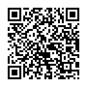

A phone that scans a QR code acts on its text when it recognizes a format: it joins a Wi-Fi network, adds a contact,
opens a mail. `QRCodePayload` builds these texts; pass the result to `QRCode.Create`:

<!-- ref:../../tests/Meziantou.Framework.Barcodes.Tests/QRCodePayloadTests.cs;region=QRCodePayload_WifiQRCode;format=md-fenced-code-block;dedent=true -->
```csharp
var payload = QRCodePayload.Wifi("Guests", "correct horse battery staple", WifiAuthentication.WPA);
var qrCode = QRCode.Create(payload, ErrorCorrectionLevel.Q);

// A phone that scans it offers to join the network
var png = qrCode.ToPng(new QRCodePngOptions { ModuleSize = 4 });
```
<!-- endref -->



## Formats

<!-- ref:../../tests/Meziantou.Framework.Barcodes.Tests/QRCodePayloadTests.cs;region=QRCodePayload_Create;format=md-fenced-code-block;dedent=true -->
```csharp
// WiFi
var wifi = QRCodePayload.Wifi("MyNetwork", "password123", WifiAuthentication.WPA);
Assert.Equal("WIFI:T:WPA;S:MyNetwork;P:password123;;", wifi);

// vCard
var vcard = QRCodePayload.VCard("Doe", "John", phone: "+1234567890", email: "john@example.com");
Assert.StartsWith("BEGIN:VCARD\r\nVERSION:3.0\r\nN:Doe;John;;;\r\nFN:John Doe\r\n", vcard);

// MeCard (compact contact format)
var mecard = QRCodePayload.MeCard("Doe", "John", phone: "+1234567890");
Assert.Equal("MECARD:N:Doe,John;TEL:+1234567890;;", mecard);

// Email
var email = QRCodePayload.Email("test@example.com", subject: "Hello");
Assert.Equal("mailto:test@example.com?subject=Hello", email);

// Phone
var phone = QRCodePayload.Phone("+1234567890");
Assert.Equal("tel:+1234567890", phone);

// SMS
var sms = QRCodePayload.Sms("+1234567890", "Hello!");
Assert.Equal("smsto:+1234567890:Hello!", sms);

// Geolocation
var geo = QRCodePayload.Geolocation(48.8566, 2.3522);
Assert.Equal("geo:48.8566,2.3522", geo);

// Calendar event
var evt = QRCodePayload.CalendarEvent("Meeting",
    new DateTime(2025, 6, 15, 14, 0, 0, DateTimeKind.Utc),
    new DateTime(2025, 6, 15, 15, 0, 0, DateTimeKind.Utc),
    location: "Room 42");
Assert.Contains("DTSTART:20250615T140000Z\r\n", evt);

// OTP Auth (2FA setup)
var otp = QRCodePayload.OneTimePassword(OneTimePasswordType.Totp,
    "JBSWY3DPEHPK3PXP", "user@example.com", issuer: "MyApp");
Assert.Equal("otpauth://totp/MyApp:user%40example.com?secret=JBSWY3DPEHPK3PXP&issuer=MyApp", otp);

// Bitcoin payment
var btc = QRCodePayload.Bitcoin("1A1zP1eP5QGefi2DMPTfTL5SLmv7DivfNa", amount: 0.05m);
Assert.Equal("bitcoin:1A1zP1eP5QGefi2DMPTfTL5SLmv7DivfNa?amount=0.05", btc);

// SEPA payment (EPC QR)
var sepa = QRCodePayload.SepaPayment("Example", "DE00000000000000000000", 12.50m,
    remittanceText: "Donation");
Assert.StartsWith("BCD\n002\n1\nSCT\n", sepa);
```
<!-- endref -->

| Method | Gives | Notes |
| --- | --- | --- |
| `Wifi` | `WIFI:` | `WifiAuthentication.None`, `WEP` or `WPA`; `hidden` for a network that does not broadcast its name |
| `VCard` | A vCard 3.0 | Lines end with CRLF on every platform |
| `MeCard` | `MECARD:` | A compact contact format |
| `Email` | `mailto:` | The subject and the body are escaped |
| `Phone` | `tel:` | |
| `Sms` | `smsto:` | |
| `Geolocation` | `geo:` | Latitude and longitude in decimal degrees |
| `CalendarEvent` | A `VEVENT` | The start and the end are in UTC |
| `OneTimePassword` | `otpauth://` | The setup of an authenticator app: TOTP or HOTP, the secret in base 32, the algorithm (`SHA1` by default), the digits (6) and the period (30 seconds) |
| `Bitcoin` | `bitcoin:` | A payment request of BIP 21 |
| `SepaPayment` | An EPC QR code | A SEPA credit transfer, in euros |

- The values are escaped for their format: a `;` or a line feed in a name cannot change the fields of a vCard, and a
  `?` in an email address cannot add parameters to the `mailto:` link.
- `SepaPayment` follows the limits of the format: an amount from 0.01 to 999,999,999.99, a beneficiary name of 70
  characters at most, and either a structured reference or a text. A value that contains a control character, which the
  format cannot escape, throws an `ArgumentException` instead of shifting the fields.
- A payload is plain text: you can also write your own, such as a URL.
