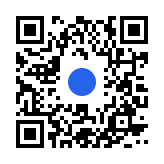
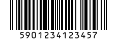

## One drawing for every format

Every renderer draws the same drawing: a vector scene of
[Meziantou.Framework.VectorGraphics](../VectorGraphics/01-Introduction.md). [CreateScene](cref:Meziantou.Framework.Barcodes.QRCodeRenderer.CreateScene) lays out the symbol once,
with its quiet zone, its modules, its logo and its text, and each format draws that scene:

| Format | Method | Package |
| --- | --- | --- |
| SVG | [ToSvg](cref:Meziantou.Framework.Barcodes.QRCodeRenderer.ToSvg) | `Meziantou.Framework.Barcodes` |
| PNG, WebP, JPEG and the other image formats | [ToImage](cref:Meziantou.Framework.Imaging.Barcodes.QRCodeImageRenderer.ToImage), [DrawQRCode](cref:Meziantou.Framework.Imaging.Barcodes.QRCodeImageRenderer.DrawQRCode), [DrawBarcode](cref:Meziantou.Framework.Imaging.Barcodes.BarcodeImageRenderer.DrawBarcode), [DrawBarcode2D](cref:Meziantou.Framework.Imaging.Barcodes.Barcode2DImageRenderer.DrawBarcode2D) | `Meziantou.Framework.Imaging.Barcodes`: see [Images](08-Images.md) |
| PDF | [ToPdf](cref:Meziantou.Framework.Pdf.VectorGraphics.ScenePdfRenderer.ToPdf) | `Meziantou.Framework.Pdf.VectorGraphics` |
| Anything else | [CreateScene](cref:Meziantou.Framework.Barcodes.QRCodeRenderer.CreateScene) | `Meziantou.Framework.Barcodes` |

The options are the same for every format: one options class for each kind of symbol. A logo or a line of text is
drawn in every format, at the same place.

## Render as SVG

[ToSvg](cref:Meziantou.Framework.Barcodes.QRCodeRenderer.ToSvg) gives an SVG document as a string. Use it in a web page, or save it as a `.svg` file:

<!-- ref:../../tests/Meziantou.Framework.Barcodes.Tests/QRCodeSvgRendererTests.cs;region=QRCode_ToSvg;format=md-fenced-code-block;dedent=true -->
```csharp
var qrCode = QRCode.Create("HELLO WORLD", ErrorCorrectionLevel.H);
var microQr = QRCode.CreateMicroQR("12345", ErrorCorrectionLevel.L);
var barcode = Barcode.CreateCode128("SKU-123456");

var svg = qrCode.ToSvg();
Assert.StartsWith("<svg xmlns=\"http://www.w3.org/2000/svg\" width=\"330\" height=\"330\" viewBox=\"0 0 330 330\"", svg);

var microSvg = microQr.ToSvg(new QRCodeRenderOptions { ModuleSize = 2, QuietZoneModules = 2 });
Assert.Contains("viewBox=\"0 0 30 30\"", microSvg);

var customSvg = qrCode.ToSvg(new QRCodeRenderOptions
{
    ModuleSize = 10,
    QuietZoneModules = 4,
    DarkPaint = new SceneColor(0x00, 0x00, 0x00),
    LightPaint = new SceneColor(0xff, 0xff, 0xff),
    // A PNG, JPEG, GIF or WebP file, such as File.ReadAllBytes("logo.png"): the SVG embeds it
    Logo = new BarcodeLogo(Convert.FromBase64String("iVBORw0KGgoAAAANSUhEUgAAAAEAAAABCAIAAACQd1PeAAAADElEQVR42mNg+M8AAAICAQBF9FLUAAAAAElFTkSuQmCC"))
    {
        SizePercent = 20,
    },
});
Assert.Contains("href=\"data:image/png;base64,", customSvg);

var barcodeSvg = barcode.ToSvg(new BarcodeRenderOptions
{
    ModuleWidth = 2,
    ModuleHeight = 80,
    QuietZoneModules = 10,
});
Assert.Contains("viewBox=\"0 0 286 80\"", barcodeSvg);
```
<!-- endref -->

- The document has a `viewBox`, and a size in CSS pixels. The sizes of the options set the proportions and the units
  of the coordinates.
- The dark modules are one path, drawn on a rectangle of the light color.
- The second parameter takes the options of the SVG writer
  ([SvgRenderOptions](cref:Meziantou.Framework.VectorGraphics.SvgRenderOptions)): set [IncludeNamespace](cref:Meziantou.Framework.VectorGraphics.SvgRenderOptions.IncludeNamespace) to `false` for an SVG inlined in
  HTML, or [EmbedFonts](cref:Meziantou.Framework.VectorGraphics.SvgRenderOptions.EmbedFonts) to embed the font of the text.

## Render as PNG and other images

[ToImage](cref:Meziantou.Framework.Imaging.Barcodes.QRCodeImageRenderer.ToImage) of `Meziantou.Framework.Imaging.Barcodes` draws the scene as an image, which you save as PNG, WebP, JPEG or
any format of `Meziantou.Framework.Imaging`. The sizes are in pixels, times the [Scale](cref:Meziantou.Framework.Imaging.VectorGraphics.SceneImageOptions.Scale) of the image options:

<!-- ref:../../tests/Meziantou.Framework.Barcodes.Tests/QRCodePngRendererTests.cs;region=QRCode_ToPng;format=md-fenced-code-block;dedent=true -->
```csharp
var qrCode = QRCode.Create("HELLO WORLD", ErrorCorrectionLevel.H);
var microQr = QRCode.CreateMicroQR("12345", ErrorCorrectionLevel.L);
var barcode = Barcode.CreateCode39("ABC-123", includeChecksum: true);

// ToImage comes from Meziantou.Framework.Imaging.Barcodes. Save the image to a file (image.Save("qrcode.png"))
// or to a stream, in any format
using var image = qrCode.ToImage();
using var stream = new MemoryStream();
image.Save(stream, new PngEncoder());
Assert.Equal((330, 330), (image.Width, image.Height));

using var microImage = microQr.ToImage(new QRCodeRenderOptions
{
    ModuleSize = 4,
    QuietZoneModules = 2,
    DarkPaint = new SceneColor(0x1f, 0x29, 0x37),
    LightPaint = new SceneColor(0xf9, 0xfa, 0xfb),
});
Assert.Equal((60, 60), (microImage.Width, microImage.Height));

// Twice as many pixels, for high-density screens
using var barcodeImage = barcode.ToImage(
    new BarcodeRenderOptions
    {
        ModuleWidth = 2,
        ModuleHeight = 80,
        DarkPaint = new SceneColor(0x0f, 0x76, 0x6e),
        LightPaint = new SceneColor(0xec, 0xfe, 0xff),
    },
    new SceneImageOptions { Scale = 2 });
Assert.Equal(160, barcodeImage.Height); // 80 units high, at 2 pixels per unit
```
<!-- endref -->

With the default [SnapToPixels](cref:Meziantou.Framework.Barcodes.QRCodeRenderOptions.SnapToPixels), the modules are whole pixels: the image has the two colors of the options, with no
antialiasing at the edges. To draw the code on an existing image, see [Images](08-Images.md).

## Render as PDF

The scene is a vector drawing: [ToPdf](cref:Meziantou.Framework.Pdf.VectorGraphics.ScenePdfRenderer.ToPdf) of `Meziantou.Framework.Pdf.VectorGraphics` writes it in a PDF document, where
the bars stay vectors and print sharply at any size. The fonts of the text are embedded:

<!-- ref:../../tests/Meziantou.Framework.Barcodes.Tests/QRCodeSvgRendererTests.cs;region=Barcode_ToPdf;format=md-fenced-code-block;dedent=true -->
```csharp
var barcode = Barcode.CreateCode128("SKU-123456");

// ToPdf comes from Meziantou.Framework.Pdf.VectorGraphics: the bars stay vectors, and OCR-B is embedded
var scene = barcode.CreateScene(new BarcodeRenderOptions { Text = new BarcodeTextOptions() });
var pdf = scene.ToPdf().ToByteArray(); // or .Save("barcode.pdf")
```
<!-- endref -->

[DrawScene](cref:Meziantou.Framework.Pdf.VectorGraphics.ScenePdfRenderer.DrawScene) of the same package draws the scene on a page of an existing document.

## Options

| QR code ([QRCodeRenderOptions](cref:Meziantou.Framework.Barcodes.QRCodeRenderOptions)) | Default | Description |
| --- | --- | --- |
| [ModuleSize](cref:Meziantou.Framework.Barcodes.QRCodeRenderOptions.ModuleSize) | 10 | The size of a module |
| [QuietZoneModules](cref:Meziantou.Framework.Barcodes.QRCodeRenderOptions.QuietZoneModules) | 4 | The width of the margin around the code, in modules |
| [DarkPaint](cref:Meziantou.Framework.Barcodes.QRCodeRenderOptions.DarkPaint) | black | The paint of the dark modules: a color, a gradient or a pattern |
| [LightPaint](cref:Meziantou.Framework.Barcodes.QRCodeRenderOptions.LightPaint) | white | The paint of the light modules and of the margin; `null` for a transparent background |
| [SnapToPixels](cref:Meziantou.Framework.Barcodes.QRCodeRenderOptions.SnapToPixels) | `true` | Rounds the module size to a whole number, at least 1 |
| [Logo](cref:Meziantou.Framework.Barcodes.QRCodeRenderOptions.Logo) | `null` | The image drawn in the middle of the code |

| Two-dimensional barcode ([Barcode2DRenderOptions](cref:Meziantou.Framework.Barcodes.Barcode2DRenderOptions)) | Default | Description |
| --- | --- | --- |
| [ModuleSize](cref:Meziantou.Framework.Barcodes.Barcode2DRenderOptions.ModuleSize) | 4 | The size of a module |
| [QuietZoneModules](cref:Meziantou.Framework.Barcodes.Barcode2DRenderOptions.QuietZoneModules) | 2 | The width of the margin around the symbol, in modules |
| [DarkPaint](cref:Meziantou.Framework.Barcodes.Barcode2DRenderOptions.DarkPaint), [LightPaint](cref:Meziantou.Framework.Barcodes.Barcode2DRenderOptions.LightPaint), [SnapToPixels](cref:Meziantou.Framework.Barcodes.Barcode2DRenderOptions.SnapToPixels) | | As for QR codes |

| Barcode ([BarcodeRenderOptions](cref:Meziantou.Framework.Barcodes.BarcodeRenderOptions)) | Default | Description |
| --- | --- | --- |
| [ModuleWidth](cref:Meziantou.Framework.Barcodes.BarcodeRenderOptions.ModuleWidth) | 2 | The width of a module |
| [ModuleHeight](cref:Meziantou.Framework.Barcodes.BarcodeRenderOptions.ModuleHeight) | 80 | The height of the bars; the rows of a stacked GS1 DataBar symbol are `ModuleWidth` high instead |
| [QuietZoneModules](cref:Meziantou.Framework.Barcodes.BarcodeRenderOptions.QuietZoneModules) | 10 | The width of the margins on the left and on the right, in modules |
| [DarkPaint](cref:Meziantou.Framework.Barcodes.BarcodeRenderOptions.DarkPaint) | black | The paint of the bars |
| [LightPaint](cref:Meziantou.Framework.Barcodes.BarcodeRenderOptions.LightPaint) | white | The paint of the spaces, of the margins and of the background of the text |
| [SnapToPixels](cref:Meziantou.Framework.Barcodes.BarcodeRenderOptions.SnapToPixels) | `true` | Rounds the module sizes to whole numbers, at least 1 |
| [Text](cref:Meziantou.Framework.Barcodes.BarcodeRenderOptions.Text) | `null` | The style of the human-readable text under the bars; `null` for no text |

Scanners need a quiet zone: reduce it only when the code is already surrounded by a light area.

## Colors

The paints are those of `Meziantou.Framework.VectorGraphics`:
[SceneColor](cref:Meziantou.Framework.VectorGraphics.SceneColor) converts to a paint, and
[SceneColor.Parse](cref:Meziantou.Framework.VectorGraphics.SceneColor.Parse) reads the CSS forms (`#rrggbb`, `rgb()`, `hsl()`, the color names...):

<!-- ref:../../tests/Meziantou.Framework.Barcodes.Tests/QRCodePngRendererTests.cs;region=QRCode_Colors;format=md-fenced-code-block;dedent=true -->
```csharp
var qrCode = QRCode.Create("https://www.meziantou.net");
var options = new QRCodeRenderOptions
{
    ModuleSize = 4,
    QuietZoneModules = 2,
    DarkPaint = SceneColor.Parse("#1e3a8a"),
    LightPaint = SceneColor.Parse("rgb(239, 246, 255)"),
};

var svg = qrCode.ToSvg(options);
using var image = qrCode.ToImage(options);
```
<!-- endref -->


Keep a strong contrast, with dark modules on a light background: many scanners do not read light modules on a dark
background. A gradient is in the coordinates of the scene, where (0, 0) is the top-left corner of the quiet zone: see
[Images](08-Images.md) for an example. The dark modules are painted over the background, so a translucent dark paint
shows the light paint through it.

## Add a logo

[Logo](cref:Meziantou.Framework.Barcodes.QRCodeRenderOptions.Logo) draws an image in the middle of a QR code, in every format. The
[BarcodeLogo](cref:Meziantou.Framework.Barcodes.BarcodeLogo) takes the bytes of a PNG, JPEG, GIF or WebP file: the SVG embeds them as a data URI,
and the image and PDF renderers decode them. The image keeps its proportions, centered in a square of [SizePercent](cref:Meziantou.Framework.Barcodes.BarcodeLogo.SizePercent)
of the side of the code (20 by default). The modules under the logo are not drawn, so the logo sits on a clean area
instead of over half-visible modules:

<!-- ref:../../tests/Meziantou.Framework.Barcodes.Tests/QRCodeSvgRendererTests.cs;region=QRCode_Logo;format=md-fenced-code-block;dedent=true -->
```csharp
// A logo: the bytes of a PNG, JPEG, GIF or WebP file, such as File.ReadAllBytes("logo.png"). Here, a blue disc
using var logoImage = new Image<Rgba32>(64, 64, Colors.White);
logoImage.Draw(canvas => canvas.FillCircle(new SolidBrush(new Rgba32(0x25, 0x63, 0xeb)), new PointD(32, 32), 28));
using var logoStream = new MemoryStream();
logoImage.Save(logoStream, new PngEncoder());

// The modules around the logo are not drawn: the error correction of level H recovers them
var qrCode = QRCode.Create("https://www.meziantou.net", ErrorCorrectionLevel.H);
var options = new QRCodeRenderOptions
{
    ModuleSize = 4,
    Logo = new BarcodeLogo(logoStream.ToArray())
    {
        SizePercent = 20,
        MarginModules = 1, // A ring of light modules around the logo
    },
};

// Every output draws the logo
var svg = qrCode.ToSvg(options);
using var image = qrCode.ToImage(options);
```
<!-- endref -->



The cleared area is the smallest rectangle of whole modules around the logo, grown by
[MarginModules](cref:Meziantou.Framework.Barcodes.BarcodeLogo.MarginModules) on each side (0 by default). A wide or tall logo clears only the band
of its square it covers, except an image with Exif metadata, whose orientation can turn it in a viewer. The scanner recovers its modules with the
error correction, so rendering checks that it can, and throws an `ArgumentOutOfRangeException` when:

- the area covers a finder pattern, a timing pattern, the format information or the version information, which locate
  and describe the code: the logo is too large for a small code;
- an error correction block of the code has more codewords in the area than its level recovers. The logo can make
  any module of the area read wrong, so every codeword with a module in the area counts as an error. Level L recovers
  about 7% of the codewords, M 15%, Q 25% and H 30%, minus a few codewords in the smallest codes.

For example, for 120 characters (versions 6 to 11) and a margin of 1 module, the largest logo accepted among 10, 15, 20,
25 and 30 percent:

| Level | L | M | Q | H |
| --- | --- | --- | --- | --- |
| Largest [SizePercent](cref:Meziantou.Framework.Barcodes.BarcodeLogo.SizePercent) | 10 | 20 | 30 | 30 |

Create the code with [ErrorCorrectionLevel.H](cref:Meziantou.Framework.Barcodes.ErrorCorrectionLevel.H) and keep the logo small: the check is
for a perfect print, and a scanner also has to deal with blur, glare and distortion. The alignment patterns under the
logo are cleared too: scanners read the code with the others. A Micro QR code or an rMQR code is too small to lose a
centered area, so most logos are rejected on them.

[BackdropPaint](cref:Meziantou.Framework.Barcodes.BarcodeLogo.BackdropPaint) paints the cleared area, under the logo, with
[BackdropCornerRadius](cref:Meziantou.Framework.Barcodes.BarcodeLogo.BackdropCornerRadius) rounded corners, in modules: set it when the code has no
light paint, or to draw the logo on a color of its own. Keep it light, as dark areas read as dark modules. Set
[ClearModules](cref:Meziantou.Framework.Barcodes.BarcodeLogo.ClearModules) to `false` to draw the modules under the logo instead, without the
check: then check that the result scans. Data that is not one of these formats throws an `ArgumentException`.

## Print the text under a barcode

[Text](cref:Meziantou.Framework.Barcodes.BarcodeRenderOptions.Text) prints the human-readable text ([Barcode.Text](cref:Meziantou.Framework.Barcodes.Barcode.Text)) under the
bars, in every format. The default font is OCR-B ([BarcodeFonts.OcrB](cref:Meziantou.Framework.Barcodes.BarcodeFonts.OcrB)), the font usually
printed under EAN and UPC barcodes; [BarcodeFonts.OcrA](cref:Meziantou.Framework.Barcodes.BarcodeFonts.OcrA) and any font loaded with
[SceneFontCollection](cref:Meziantou.Framework.VectorGraphics.SceneFontCollection) work too. The text is measured with the metrics of its font, so a viewer that draws the SVG
with another font draws it at another width: embed the font.

<!-- ref:../../tests/Meziantou.Framework.Barcodes.Tests/QRCodeSvgRendererTests.cs;region=Barcode_TextInSvg;format=md-fenced-code-block;dedent=true -->
```csharp
var barcode = Barcode.CreateEan13("590123412345");
var options = new BarcodeRenderOptions
{
    ModuleHeight = 60,
    Text = new BarcodeTextOptions { Fonts = BarcodeFonts.OcrB, FontSize = 20 },
};

// Viewers do not have the OCR-B font: embed it in the document
var svg = barcode.ToSvg(options, new SvgRenderOptions { EmbedFonts = true });

// The image (Meziantou.Framework.Imaging.Barcodes) draws the text at the same place
using var image = barcode.ToImage(options);
```
<!-- endref -->



EAN-8, EAN-13, UPC-A and UPC-E print their digits as the GS1 General Specifications do:

- The guard bars (start, center and end) extend 5 modules below the other bars, and the digits are printed between
  them: 4 and 4 digits for EAN-8, 6 and 6 for EAN-13, 5 and 5 for UPC-A, and 6 for UPC-E.
- The digits that have no bars of their own are printed outside the bars: the first digit of EAN-13 on the left, the
  number system digit of UPC-A and UPC-E on the left and their check digit on the right, smaller. The bars of the
  first and last characters of UPC-A extend like the guards.
- The digits of an add-on are printed above its bars, which start lower and end with the guard bars.
- The quiet zone widens when it is too narrow for the digits outside the bars, and the font shrinks when a group of
  digits is wider than the bars it is printed under: the font size is a maximum.

The other symbologies print the text on one line, centered under the bars. A text wider than the bars widens the
drawing, and the bars are centered above it. The [BarcodeTextOptions](cref:Meziantou.Framework.Barcodes.BarcodeTextOptions) also set the size of the font
(14), the space between the bars and the text (2; for EAN and UPC, between the shorter bars and the digits), and the
paint of the text (the paint of the bars by default).
