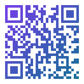
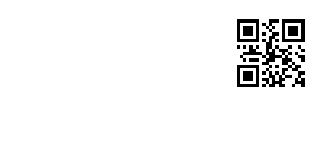
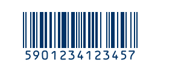
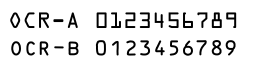

`Meziantou.Framework.Imaging.Barcodes` renders codes with [Meziantou.Framework.Imaging](../Imaging/01-Introduction.md):
save them in any format the library writes, draw them on existing images, and paint them with gradients or patterns.

<InstallNuGetPackage Id="Meziantou.Framework.Imaging.Barcodes" />

The types are in the [Meziantou.Framework.Imaging.Barcodes](cref:Meziantou.Framework.Imaging.Barcodes) namespace. The examples also use the
[Meziantou.Framework.Barcodes](cref:Meziantou.Framework.Barcodes), [Meziantou.Framework.Imaging](cref:Meziantou.Framework.Imaging), [Meziantou.Framework.Imaging.Drawing](cref:Meziantou.Framework.Imaging.Drawing) and
[Meziantou.Framework.Imaging.Formats](cref:Meziantou.Framework.Imaging.Formats) namespaces.

## Render a code as an image

`ToImage` renders a QR code or a barcode on a new [Image\<Rgba32\>](cref:Meziantou.Framework.Imaging.Image{TPixel}) of its size, quiet zone included:

<!-- ref:../../tests/Meziantou.Framework.Imaging.Barcodes.Tests/ImageRendererTests.cs;region=ImagingBarcodes_QRCodeToImage;format=md-fenced-code-block;dedent=true -->
```csharp
var qrCode = QRCode.Create("https://www.meziantou.net", ErrorCorrectionLevel.M);

// Default options: 10 pixels per module, a 4-module quiet zone, black on white
using var image = qrCode.ToImage();
Assert.Equal((330, 330), (image.Width, image.Height));

// Save to a file (image.Save("qrcode.webp", new WebPEncoder())) or to a stream
using var webp = new MemoryStream();
image.Save(webp, new WebPEncoder());

// Custom options, the same as the canvas drawing takes: any brush, and no background
using var customImage = qrCode.ToImage(new QRCodeDrawingOptions
{
    ModuleSize = 4,
    QuietZoneModules = 2,
    DarkBrush = new SolidBrush(new Rgba32(0x00, 0x33, 0x66)),
    LightBrush = null,
});
Assert.Equal((116, 116), (customImage.Width, customImage.Height));
Assert.Equal(Colors.Transparent, customImage.Frames[0][0, 0]);
Assert.Equal(new Rgba32(0x00, 0x33, 0x66), customImage.Frames[0][8, 8]);

// An indexed PNG stores the two colors in a palette, as ToPng does
using var png = new MemoryStream();
customImage.Save(png, new PngEncoder { PixelLayout = PngPixelLayout.Indexed });
```
<!-- endref -->

<!-- ref:../../tests/Meziantou.Framework.Imaging.Barcodes.Tests/ImageRendererTests.cs;region=ImagingBarcodes_BarcodeToImage;format=md-fenced-code-block;dedent=true -->
```csharp
var barcode = Barcode.CreateEan13("5901234123457");
using var image = barcode.ToImage(new BarcodeDrawingOptions { ModuleWidth = 3, ModuleHeight = 100 });
Assert.Equal((345, 100), (image.Width, image.Height));
```
<!-- endref -->

Save the image like any other: see [Saving images](../Imaging/05-LoadingAndSaving/04-SavingImages.md).

## Paint with any brush

The modules are painted with brushes, so a code can have a gradient, a pattern or an image. The brushes are in the
coordinates of the image:

<!-- ref:../../tests/Meziantou.Framework.Imaging.Barcodes.Tests/ImageRendererTests.cs;region=ImagingBarcodes_GradientQRCode;format=md-fenced-code-block;dedent=true -->
```csharp
var qrCode = QRCode.Create("https://www.meziantou.net", ErrorCorrectionLevel.Q);

// The brushes are in the coordinates of the image: the gradient goes across the whole symbol
var options = new QRCodeDrawingOptions
{
    ModuleSize = 5,
    QuietZoneModules = 2,
    DarkBrush = new LinearGradientBrush(new PointD(0, 0), new PointD(165, 165), [new GradientStop(0, new Rgba32(0x7c, 0x3a, 0xed)), new GradientStop(1, new Rgba32(0x0e, 0x74, 0x90))]),
};

using var image = qrCode.ToImage(options);
```
<!-- endref -->



Keep the modules dark and the background light everywhere: a gradient that gets too light loses the contrast scanners
need. See [Brushes and pens](../Imaging/07-Drawing/03-BrushesAndPens.md) for the brushes.

## Draw on an existing image

[DrawQRCode](cref:Meziantou.Framework.Imaging.Barcodes.QRCodeImageRenderer.DrawQRCode) and [DrawBarcode](cref:Meziantou.Framework.Imaging.Barcodes.BarcodeImageRenderer.DrawBarcode) draw on the canvas of [Image.Draw](cref:Meziantou.Framework.Imaging.Image.Draw), as vector shapes: the transform, the clip and the
layers of the canvas apply. [MeasureQRCode](cref:Meziantou.Framework.Imaging.Barcodes.QRCodeImageRenderer.MeasureQRCode) and [MeasureBarcode](cref:Meziantou.Framework.Imaging.Barcodes.BarcodeImageRenderer.MeasureBarcode) give the size of the drawing first, to place it:

<!-- ref:../../tests/Meziantou.Framework.Imaging.Barcodes.Tests/ImageRendererTests.cs;region=ImagingBarcodes_DrawQRCode;format=md-fenced-code-block;dedent=true -->
```csharp
using var ticket = new Image<Rgba32>(400, 200, Colors.White); // or Image.Load<Rgba32>("ticket.png")
var qrCode = QRCode.Create("TICKET-0042");
var options = new QRCodeDrawingOptions { ModuleSize = 4, QuietZoneModules = 2 };

// The size of the drawing, quiet zone included, to lay out the page before drawing
var size = QRCodeImageRenderer.MeasureQRCode(qrCode, options);
Assert.Equal((100, 100), (size.Width, size.Height)); // (21 modules + 2 x 2) x 4 pixels

// Drawn as a vector shape: the transform and the clip of the canvas apply, any brush works
ticket.Draw(canvas => canvas.DrawQRCode(qrCode, new PointD(400 - 16 - size.Width, 16), options));
Assert.Equal(Colors.Black, ticket.Frames[0][284 + 8, 16 + 8]); // the top-left finder pattern, after the 8-pixel quiet zone

// Save to a file (ticket.Save("ticket-with-qrcode.png")) or to a stream
using var png = new MemoryStream();
ticket.Save(png, new PngEncoder());
```
<!-- endref -->



With [SnapToPixels](cref:Meziantou.Framework.Imaging.Barcodes.QRCodeDrawingOptions.SnapToPixels) (the default), the module sizes and the position are rounded to whole pixels, so that every module
has the same size and sharp edges. Turn it off to draw a code at an exact fractional size, for instance under a scale
transform.

## Print the text under a barcode

[DrawBarcode](cref:Meziantou.Framework.Imaging.Barcodes.BarcodeImageRenderer.DrawBarcode) prints the human-readable text of the barcode ([Barcode.Text](cref:Meziantou.Framework.Barcodes.Barcode.Text), with its check digit) under the bars when
[BarcodeDrawingOptions.Font](cref:Meziantou.Framework.Imaging.Barcodes.BarcodeDrawingOptions.Font) is set:

<!-- ref:../../tests/Meziantou.Framework.Imaging.Barcodes.Tests/ImageRendererTests.cs;region=ImagingBarcodes_DrawBarcode;format=md-fenced-code-block;dedent=true -->
```csharp
var barcode = Barcode.CreateEan13("590123412345");
var options = new BarcodeDrawingOptions
{
    ModuleWidth = 2,
    ModuleHeight = 60,
    QuietZoneModules = 9,
    DarkBrush = new SolidBrush(new Rgba32(0x00, 0x33, 0x66)),
    Font = BarcodeFonts.OcrB, // prints barcode.Text, "5901234123457", under the bars
    FontSize = 24,
};

var size = BarcodeImageRenderer.MeasureBarcode(barcode, options);
Assert.Equal(226, size.Width); // (95 modules + 2 x 9) x 2 pixels

using var label = new Image<Rgba32>(300, 140, Colors.White);
label.Draw(canvas => canvas.DrawBarcode(barcode, new PointD(20, 20), options));
Assert.Equal(new Rgba32(0x00, 0x33, 0x66), label.Frames[0][20 + 18, 50]); // the first guard bar
```
<!-- endref -->



[BarcodeFonts](cref:Meziantou.Framework.Imaging.Barcodes.BarcodeFonts) has the two fonts of optical character recognition usually printed under barcodes: [OcrB](cref:Meziantou.Framework.Imaging.Barcodes.BarcodeFonts.OcrB) under EAN and
UPC barcodes, and [OcrA](cref:Meziantou.Framework.Imaging.Barcodes.BarcodeFonts.OcrA). They are [Font](cref:Meziantou.Framework.Imaging.Typography.Font)s of `Meziantou.Framework.Imaging`, so you can also draw any text with them:

<!-- ref:../../tests/Meziantou.Framework.Imaging.Barcodes.Tests/ImageRendererTests.cs;region=ImagingBarcodes_OcrFonts;format=md-fenced-code-block;dedent=true -->
```csharp
using var image = new Image<Rgba32>(280, 72, Colors.White);
image.Draw(canvas =>
{
    var ink = new SolidBrush(Colors.Black);
    canvas.FillText(ink, "OCR-A 0123456789", BarcodeFonts.OcrA, size: 24, new PointD(8, 6));
    canvas.FillText(ink, "OCR-B 0123456789", BarcodeFonts.OcrB, size: 24, new PointD(8, 38));
});
```
<!-- endref -->



- Both fonts are generated from the character shapes of their standards (ANSI X3.17-1981 for OCR-A, ANSI X3.49-1975
  for OCR-B), are monospaced, map the printable ASCII characters, and are licensed with the package.
- OCR-A also has the Hook, the Chair and the Fork (U+2440 to U+2442), which stand for the tilde, the grave accent and
  the underline. OCR-B also has the letters of its extended repertoire (Ä, Å, Æ, Ö, Ø, Ü, Ñ, IJ, å, æ, ø, ij, ß) and §,
  ¤, £, ¥, ¨ and ´.
- Any other font works too: see [Fonts](../Imaging/08-Text/02-Fonts.md).

## Options

`ToImage` and the canvas drawing take the same options. The sizes are in units of the canvas: pixels, unless a
transform applies.

| [QRCodeDrawingOptions](cref:Meziantou.Framework.Imaging.Barcodes.QRCodeDrawingOptions) | Default | Description |
| --- | --- | --- |
| [ModuleSize](cref:Meziantou.Framework.Imaging.Barcodes.QRCodeDrawingOptions.ModuleSize) | 10 | The size of a module |
| [QuietZoneModules](cref:Meziantou.Framework.Imaging.Barcodes.QRCodeDrawingOptions.QuietZoneModules) | 4 | The width of the margin around the code, in modules |
| [DarkBrush](cref:Meziantou.Framework.Imaging.Barcodes.QRCodeDrawingOptions.DarkBrush) | Black | The brush of the dark modules |
| [LightBrush](cref:Meziantou.Framework.Imaging.Barcodes.QRCodeDrawingOptions.LightBrush) | White | The brush of the light modules and of the margin; `null` keeps the background (transparent for `ToImage`) |
| [SnapToPixels](cref:Meziantou.Framework.Imaging.Barcodes.QRCodeDrawingOptions.SnapToPixels) | `true` | Round the module size and the position to whole units |

| [BarcodeDrawingOptions](cref:Meziantou.Framework.Imaging.Barcodes.BarcodeDrawingOptions) | Default | Description |
| --- | --- | --- |
| [ModuleWidth](cref:Meziantou.Framework.Imaging.Barcodes.BarcodeDrawingOptions.ModuleWidth) | 2 | The width of a module |
| [ModuleHeight](cref:Meziantou.Framework.Imaging.Barcodes.BarcodeDrawingOptions.ModuleHeight) | 80 | The height of the bars |
| [QuietZoneModules](cref:Meziantou.Framework.Imaging.Barcodes.BarcodeDrawingOptions.QuietZoneModules) | 10 | The width of the margins on the left and on the right, in modules |
| [DarkBrush](cref:Meziantou.Framework.Imaging.Barcodes.BarcodeDrawingOptions.DarkBrush) | Black | The brush of the bars |
| [LightBrush](cref:Meziantou.Framework.Imaging.Barcodes.BarcodeDrawingOptions.LightBrush) | White | The brush of the spaces, of the margins and of the background of the text; `null` keeps the background |
| [SnapToPixels](cref:Meziantou.Framework.Imaging.Barcodes.BarcodeDrawingOptions.SnapToPixels) | `true` | Round the module sizes and the position to whole units |
| [Font](cref:Meziantou.Framework.Imaging.Typography.Font) | `null` | The font of the text under the bars; `null` draws no text |
| [FontSize](cref:Meziantou.Framework.Imaging.Barcodes.BarcodeDrawingOptions.FontSize) | 14 | The size of the text |
| [TextBrush](cref:Meziantou.Framework.Imaging.Barcodes.BarcodeDrawingOptions.TextBrush) | `null` | The brush of the text; `null` uses [DarkBrush](cref:Meziantou.Framework.Imaging.Barcodes.BarcodeDrawingOptions.DarkBrush) |
| [TextSpacing](cref:Meziantou.Framework.Imaging.Barcodes.BarcodeDrawingOptions.TextSpacing) | 2 | The space between the bars and the text |
