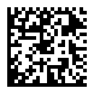
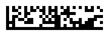
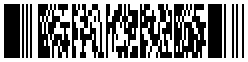
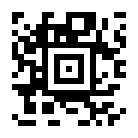

## Choose the symbology

[Barcode2D](cref:Meziantou.Framework.Barcodes.Barcode2D) holds the two-dimensional symbols that are not QR codes. Each symbology has its own method:

| Symbology | Method | Size in modules | Standard |
| --- | --- | --- | --- |
| Data Matrix (ECC 200) | [CreateDataMatrix](cref:Meziantou.Framework.Barcodes.Barcode2D.CreateDataMatrix) | 10×10 to 144×144, or rectangular from 8×18 to 16×48 | ISO/IEC 16022 |
| GS1 Data Matrix | [CreateGs1DataMatrix](cref:Meziantou.Framework.Barcodes.Barcode2D.CreateGs1DataMatrix) | Same as Data Matrix | GS1 General Specifications |
| PDF417 | [CreatePdf417](cref:Meziantou.Framework.Barcodes.Barcode2D.CreatePdf417) | 3 to 90 rows of 1 to 30 columns | ISO/IEC 15438 |
| Aztec | [CreateAztec](cref:Meziantou.Framework.Barcodes.Barcode2D.CreateAztec) | 15×15 to 27×27 (compact), 19×19 to 151×151 (full-range) | ISO/IEC 24778 |

The symbology is usually imposed by what reads it: Data Matrix marks small parts and healthcare products, GS1 Data
Matrix carries GS1 element strings on products, PDF417 is on identity cards and boarding passes, Aztec on transport
tickets. For a code that phones read, prefer a [QR code](03-QRCodes.md).

A text of ASCII characters only is encoded as it is. Another text is encoded as UTF-8, after an ECI designator that
tells readers so. Each method also has an overload that takes bytes, encoded as they are.

## Data Matrix

[CreateDataMatrix](cref:Meziantou.Framework.Barcodes.Barcode2D.CreateDataMatrix) encodes the data in the smallest square symbol that holds it. The encoder switches between
the encodation schemes of the standard (ASCII, C40, Text, X12, EDIFACT and Base 256) to keep the symbol small:

<!-- ref:../../tests/Meziantou.Framework.Barcodes.Tests/DataMatrixTests.cs;region=Barcode2D_DataMatrix;format=md-fenced-code-block;dedent=true -->
<!-- endref -->

[DataMatrixOptions](cref:Meziantou.Framework.Barcodes.DataMatrixOptions) sets the size:

- [Shape](cref:Meziantou.Framework.Barcodes.DataMatrixOptions.Shape): [Square](cref:Meziantou.Framework.Barcodes.DataMatrixShape.Square) (the default), [Rectangle](cref:Meziantou.Framework.Barcodes.DataMatrixShape.Rectangle) for a narrow space, or [Any](cref:Meziantou.Framework.Barcodes.DataMatrixShape.Any) for the one with the fewest
  modules.
- [Height](cref:Meziantou.Framework.Barcodes.DataMatrixOptions.Height) and [Width](cref:Meziantou.Framework.Barcodes.DataMatrixOptions.Width): an exact size. The shape is ignored when one of them is set, and data
  shorter than the capacity is padded.

Data that does not fit in the largest allowed size throws an `InvalidOperationException`. The largest symbol holds
3,116 digits, 2,335 uppercase letters or 1,556 bytes.

## GS1 Data Matrix

[CreateGs1DataMatrix](cref:Meziantou.Framework.Barcodes.Barcode2D.CreateGs1DataMatrix) takes [Gs1Element](cref:Meziantou.Framework.Barcodes.Gs1Element) values, like [GS1-128](04-LinearBarcodes.md). The symbol starts
with the FNC1 that identifies GS1 data, and a FNC1 separates an element of variable length from the next one:

<!-- ref:../../tests/Meziantou.Framework.Barcodes.Tests/DataMatrixTests.cs;region=Barcode2D_Gs1DataMatrix;format=md-fenced-code-block;dedent=true -->
<!-- endref -->

A reader returns the data with the separators as the group separator character (U+001D), and the symbology identifier
`]d2`. Put the elements of variable length last to save separators.

## PDF417

A PDF417 symbol is a stack of rows. [Pdf417Options](cref:Meziantou.Framework.Barcodes.Pdf417Options) sets the number of data columns, the error correction level,
and the height of the rows:

<!-- ref:../../tests/Meziantou.Framework.Barcodes.Tests/Pdf417Tests.cs;region=Barcode2D_Pdf417;format=md-fenced-code-block;dedent=true -->
<!-- endref -->

- [Columns](cref:Meziantou.Framework.Barcodes.Pdf417Options.Columns): 1 to 30. By default, the number of columns gives a symbol about three times wider
  than high. The number of rows is the smallest that holds the data.
- [SecurityLevel](cref:Meziantou.Framework.Barcodes.Pdf417Options.SecurityLevel): the error correction level, from 0 (2 codewords) to 8 (512 codewords). By default, the
  level ISO/IEC 15438 recommends for the length of the data, from 2 to 5.
- [RowHeight](cref:Meziantou.Framework.Barcodes.Pdf417Options.RowHeight): the height of each row, in modules. It is 3 by default, the minimum the standard
  recommends. The modules of [Barcode2D](cref:Meziantou.Framework.Barcodes.Barcode2D) are square, so each row of the symbol is this number of rows of the
  matrix: [Height](cref:Meziantou.Framework.Barcodes.Barcode2D.Height) is the number of rows times the row height.

The encoder switches between the text, byte and numeric compaction modes. A symbol holds at most 2,710 digits,
1,850 uppercase letters or 1,108 bytes, with error correction level 0.

## Aztec

An Aztec symbol has a bullseye at its center, so it needs no quiet zone. [AztecOptions](cref:Meziantou.Framework.Barcodes.AztecOptions) sets the error correction
and the size:

<!-- ref:../../tests/Meziantou.Framework.Barcodes.Tests/AztecTests.cs;region=Barcode2D_Aztec;format=md-fenced-code-block;dedent=true -->
<!-- endref -->

- [ErrorCorrectionPercent](cref:Meziantou.Framework.Barcodes.AztecOptions.ErrorCorrectionPercent): the minimum share of the codewords of the symbol used for error correction, from
  5 to 95. It is 23 by default, as the standard recommends, and the symbol gets 3 more error correction codewords.
- [Compact](cref:Meziantou.Framework.Barcodes.AztecOptions.Compact): `true` for a compact symbol (1 to 4 layers), `false` for a full-range one (1 to 32 layers), or
  `null` (the default) for the smallest of both.
- [Layers](cref:Meziantou.Framework.Barcodes.AztecOptions.Layers): an exact number of layers. The error correction codewords fill the space the data leaves.

With the default error correction, the largest symbol holds 3,832 digits, 3,067 uppercase letters or 1,754 bytes.

## Render

[Barcode2D](cref:Meziantou.Framework.Barcodes.Barcode2D) has its own renderers, with square modules: `ToSvg` gives an SVG document, `ToPng` and `WriteToPng`
a PNG file:

<!-- ref:../../tests/Meziantou.Framework.Barcodes.Tests/DataMatrixTests.cs;region=Barcode2D_Render;format=md-fenced-code-block;dedent=true -->
<!-- endref -->

- [ModuleSize](cref:Meziantou.Framework.Barcodes.Barcode2DPngOptions.ModuleSize) is 4 by default.
- [QuietZoneModules](cref:Meziantou.Framework.Barcodes.Barcode2DPngOptions.QuietZoneModules) is 2 by default: the minimum of PDF417, and more than Data Matrix (1) and Aztec (0)
  need.

`Meziantou.Framework.Imaging.Barcodes` renders them as images and draws them on a canvas, like QR codes: see
[Images](08-Images.md).
