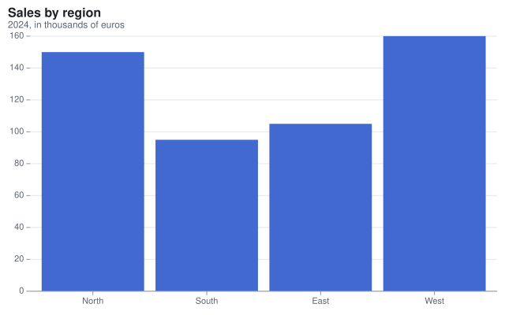

`Meziantou.Framework.Charts` creates charts and writes them as SVG. `Meziantou.Framework.Imaging.VectorGraphics` draws
the same charts as images (PNG, WebP, JPEG...) or on the canvas of [Meziantou.Framework.Imaging](../Imaging/01-Introduction.md).

There is no class per chart type. A chart is a [Plot](cref:Meziantou.Framework.Charts.Plot) made of layers called marks
(bars, lines, dots, arcs, rectangles, rules, texts...). The scales map the values of the data to positions, colors and
sizes, and the coordinates place the positions: Cartesian, polar or geographic. A pie is an arc mark in polar
coordinates, a horizontal bar chart is a bar mark with transposed coordinates, and a radar chart is a closed line in
polar coordinates. This approach is called the grammar of graphics; Vega-Lite and Observable Plot use it too.

The library covers:

- Cartesian charts: bars (grouped, stacked, normalized, horizontal), lines, steps, areas, streamgraphs, scatter plots,
  bubbles, reference lines, annotations, lollipops, dumbbells, combo charts, population pyramids, slope charts, error
  bars and Gantt charts.
- Radial charts: pies, donuts, polar areas, radial bars, radar charts and gauges.
- Hierarchical charts: packed circles, treemaps, sunbursts, icicles, tree diagrams and dendrograms.
- Flows: Sankey diagrams and chord diagrams.
- Networks: network graphs with a force-directed layout.
- Maps: choropleths and points on maps, from GeoJSON, TopoJSON, Shapefile and the other formats of
  `Meziantou.Framework.Geo`, in the equirectangular, Mercator, Equal Earth and Albers projections.
- Statistical charts: histograms, box plots, density plots, violin plots, ridgeline plots, hexbin plots, density
  contours, parallel coordinates, trend lines, moving averages, heatmaps, waterfalls, funnels, candlesticks, bullet
  charts, calendar heatmaps, Marimekko charts and sparklines.
- Small multiples: grids of charts that share their scales, and charts with two y axes.

The output is deterministic: the same plot gives the same SVG on every machine, so you can compare charts in snapshot
tests. Texts are measured with the metrics of Helvetica that the library embeds, so no font has to be installed.

## Next steps

- [Getting started](02-GettingStarted.md): install the package and create a first chart.
- [Concepts](03-Concepts.md): marks, channels, scales, coordinates and transforms.
- [Gallery](04-Gallery/01-Overview.md): an example of each chart type.
