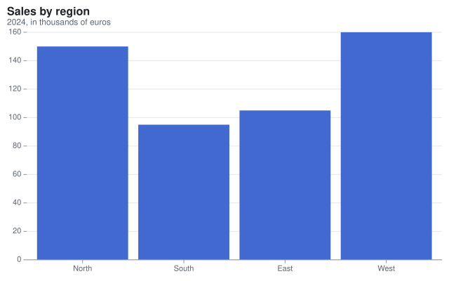

## Install the package

Add the `Meziantou.Framework.Charts` package to a project:

<InstallNuGetPackage Id="Meziantou.Framework.Charts" />

The types are in the [Meziantou.Framework.Charts](cref:Meziantou.Framework.Charts) namespace.

## Create a chart

The examples of this documentation chart records such as this one:

<!-- ref:../../tests/Meziantou.Framework.Charts.Tests/Samples/Sale.cs;region=Charts_SaleRecord;format=md-fenced-code-block;dedent=true -->
```csharp
public sealed record Sale(string Region, int Year, double Amount);
```
<!-- endref -->

Create a [Plot](cref:Meziantou.Framework.Charts.Plot), add a mark that draws the rows, and write the SVG:

<!-- ref:../../tests/Meziantou.Framework.Charts.Tests/CartesianChartTests.cs;region=Charts_BarChart;format=md-fenced-code-block;dedent=true -->
```csharp
Sale[] sales =
[
    new("North", 2024, 150),
    new("South", 2024, 95),
    new("East", 2024, 105),
    new("West", 2024, 160),
];

var plot = new Plot { Title = "Sales by region", Subtitle = "2024, in thousands of euros" };
plot.Add(new BarMark<Sale>(sales, x: sale => sale.Region, y: sale => sale.Amount));
var svg = plot.ToSvg();
```
<!-- endref -->



The constructor of a mark takes the rows and its main channels: here, the region on x and the amount on y. A channel
is a function of a row. The plot infers the rest: a band scale for the regions, a linear scale from zero for the
amounts, the ticks, the margins and the axes.

## Use the SVG

[ToSvg](cref:Meziantou.Framework.Charts.Plot.ToSvg) returns the SVG document as a string.
[WriteSvg](cref:Meziantou.Framework.Charts.Plot.WriteSvg) writes it to a `TextWriter` or to a `Stream`, in UTF-8. The
document can be saved as a `.svg` file, served with the `image/svg+xml` content type, or written inline in an HTML
page. When a page shows several charts, give each one its own
[SvgRenderOptions.IdPrefix](cref:Meziantou.Framework.Charts.SvgRenderOptions.IdPrefix), so the identifiers of their
gradients and clip paths do not collide.

To get an image instead, see [Image rendering](07-ImageRendering.md).

## Next steps

- [Concepts](03-Concepts.md): what the marks, channels, scales and coordinates are.
- [Gallery](04-Gallery/01-Overview.md): an example of each chart type.
