## Bar chart

A [BarMark\<T\>](cref:Meziantou.Framework.Charts.BarMark{T}) draws a bar per row, from zero to its value, in the band of its category.

<!-- ref:../../../tests/Meziantou.Framework.Charts.Tests/CartesianChartTests.cs;region=Charts_BarChart;format=md-fenced-code-block;dedent=true -->
```csharp
Sale[] sales =
[
    new("North", 2024, 150),
    new("South", 2024, 95),
    new("East", 2024, 105),
    new("West", 2024, 160),
];

var plot = new Plot { Title = "Sales by region", Subtitle = "2024, in thousands of euros" };
plot.Add(new BarMark<Sale>(sales, x: sale => sale.Region, y: sale => sale.Amount));
var svg = plot.ToSvg();
```
<!-- endref -->

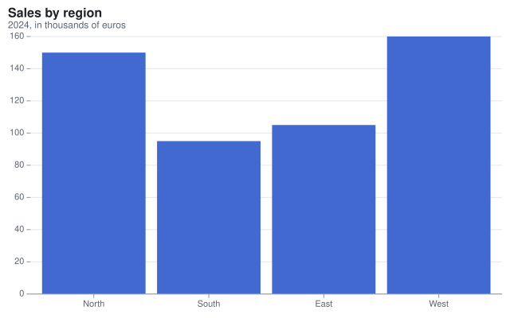

## Grouped bar chart

[Group](cref:Meziantou.Framework.Charts.BarMark{T}.Group) divides each band into side-by-side bars. A numeric channel that groups or stacks bars, such as a year, is used as a category.

<!-- ref:../../../tests/Meziantou.Framework.Charts.Tests/CartesianChartTests.cs;region=Charts_GroupedBarChart;format=md-fenced-code-block;dedent=true -->
```csharp
var plot = new Plot { Title = "Sales by region and year" };
plot.Add(new BarMark<Sale>(SampleData.Sales, x: sale => sale.Region, y: sale => sale.Amount)
{
    Group = sale => sale.Year,
    Fill = sale => sale.Year,
});
```
<!-- endref -->

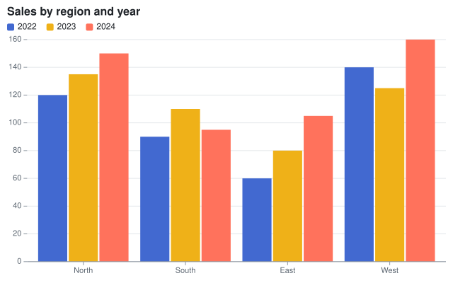

## Stacked bar chart

A [StackTransform](cref:Meziantou.Framework.Charts.StackTransform) stacks the bars of a category. By default, positive values go up from zero and negative values go down.

<!-- ref:../../../tests/Meziantou.Framework.Charts.Tests/CartesianChartTests.cs;region=Charts_StackedBarChart;format=md-fenced-code-block;dedent=true -->
```csharp
var plot = new Plot { Title = "Sales by region, stacked by year" };
plot.Add(new BarMark<Sale>(SampleData.Sales, x: sale => sale.Region, y: sale => sale.Amount)
{
    Fill = sale => sale.Year,
    Transform = new StackTransform(),
});
```
<!-- endref -->

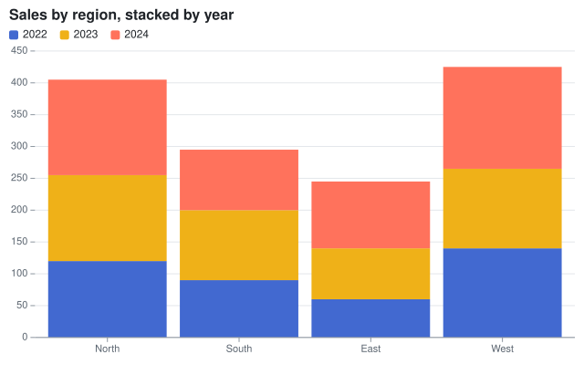

## 100% stacked bar chart

[StackOffset.Expand](cref:Meziantou.Framework.Charts.StackOffset.Expand) normalizes each stack from 0 to 1.

<!-- ref:../../../tests/Meziantou.Framework.Charts.Tests/CartesianChartTests.cs;region=Charts_NormalizedStackedBarChart;format=md-fenced-code-block;dedent=true -->
```csharp
var plot = new Plot
{
    Title = "Share of each year",
    YScale = new LinearScale { TickFormat = NumberFormats.Percent() },
};
plot.Add(new BarMark<Sale>(SampleData.Sales, x: sale => sale.Region, y: sale => sale.Amount)
{
    Fill = sale => sale.Year,
    Transform = new StackTransform { Offset = StackOffset.Expand },
});
```
<!-- endref -->

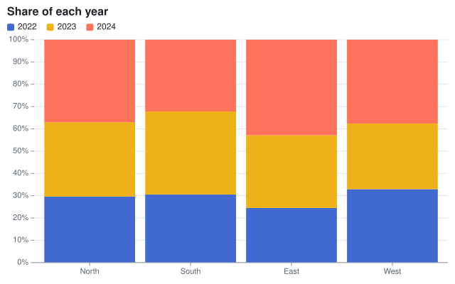

## Horizontal bar chart

Transposed coordinates draw the x scale vertically: the bars are horizontal. The categories read from the top down.

<!-- ref:../../../tests/Meziantou.Framework.Charts.Tests/CartesianChartTests.cs;region=Charts_HorizontalBarChart;format=md-fenced-code-block;dedent=true -->
```csharp
var plot = new Plot
{
    Title = "Sales by region",
    Coordinates = new CartesianCoordinates { Transposed = true },
    Height = 260,
};
plot.Add(new BarMark<Sale>(SampleData.Sales.Where(sale => sale.Year == 2024), x: sale => sale.Region, y: sale => sale.Amount)
{
    CornerRadius = 3,
});
plot.YAxis.Label = "Amount";
```
<!-- endref -->

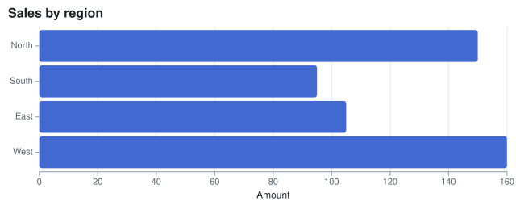

## Line chart

A [LineMark\<T\>](cref:Meziantou.Framework.Charts.LineMark{T}) joins the rows in their order. Times use a time scale, whose labels show the largest unit each tick does not fall on: the year, then the months.

<!-- ref:../../../tests/Meziantou.Framework.Charts.Tests/CartesianChartTests.cs;region=Charts_LineChart;format=md-fenced-code-block;dedent=true -->
```csharp
var paris = SampleData.Readings.Where(reading => reading.City == "Paris");
var plot = new Plot { Title = "Monthly temperature in Paris" };
plot.Add(new LineMark<Reading>(paris, x: reading => reading.Date, y: reading => reading.Temperature) { MarkerRadius = 3 });
plot.YAxis.Label = "°C";
```
<!-- endref -->

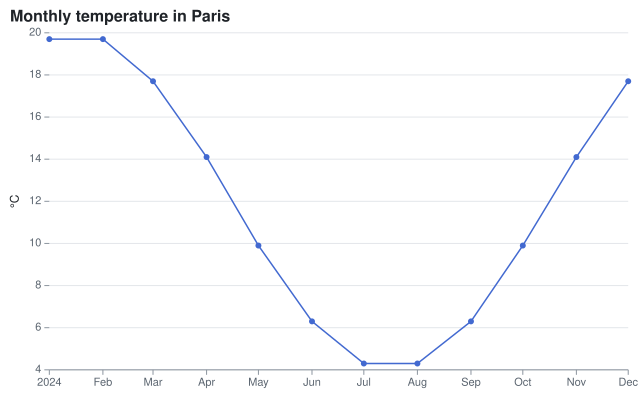

## Multi-series line chart

The [Stroke](cref:Meziantou.Framework.Charts.Mark{T}.Stroke) channel draws a line per value, in its color. [Curve.MonotoneX](cref:Meziantou.Framework.Charts.Curve.MonotoneX) smooths the lines without overshooting the data.

<!-- ref:../../../tests/Meziantou.Framework.Charts.Tests/CartesianChartTests.cs;region=Charts_MultiSeriesLineChart;format=md-fenced-code-block;dedent=true -->
```csharp
var plot = new Plot { Title = "Monthly temperature" };
plot.Add(new RuleYMark(0));
plot.Add(new LineMark<Reading>(SampleData.Readings, x: reading => reading.Date, y: reading => reading.Temperature)
{
    Stroke = reading => reading.City,
    Curve = Curve.MonotoneX,
});
```
<!-- endref -->

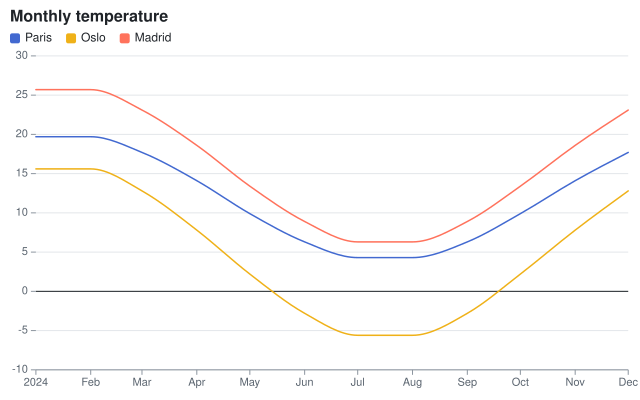

## Step line

[Curve.Step](cref:Meziantou.Framework.Charts.Curve.Step), [Curve.StepBefore](cref:Meziantou.Framework.Charts.Curve.StepBefore) and [Curve.StepAfter](cref:Meziantou.Framework.Charts.Curve.StepAfter) join the points with horizontal steps.

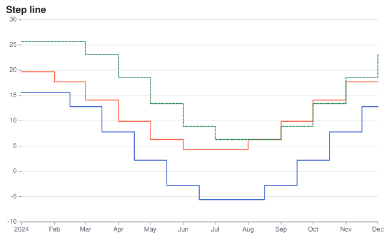

## Area chart

An [AreaMark\<T\>](cref:Meziantou.Framework.Charts.AreaMark{T}) fills the area between a line and zero, or another baseline (Y1).

<!-- ref:../../../tests/Meziantou.Framework.Charts.Tests/CartesianChartTests.cs;region=Charts_AreaChart;format=md-fenced-code-block;dedent=true -->
```csharp
var oslo = SampleData.Readings.Where(reading => reading.City == "Madrid");
var plot = new Plot { Title = "Monthly temperature in Madrid" };
plot.Add(new AreaMark<Reading>(oslo, x: reading => reading.Date, y: reading => reading.Temperature)
{
    FillOpacity = 0.3,
    StrokeColor = "#4269d0",
    Curve = Curve.MonotoneX,
});
```
<!-- endref -->

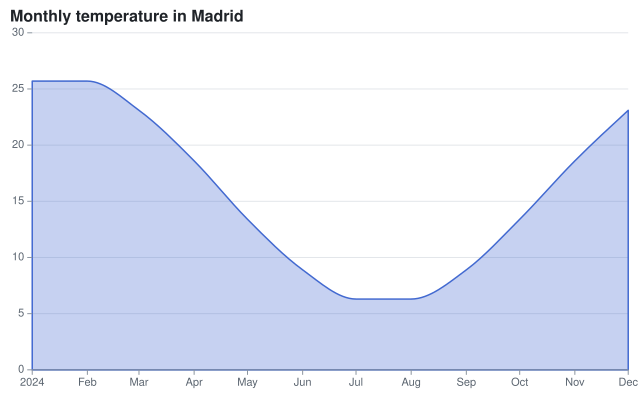

## Stacked area chart

A stack transform stacks the areas of the series.

<!-- ref:../../../tests/Meziantou.Framework.Charts.Tests/CartesianChartTests.cs;region=Charts_StackedAreaChart;format=md-fenced-code-block;dedent=true -->
```csharp
var plot = new Plot { Title = "Sales by year, stacked by region" };
plot.Add(new AreaMark<Sale>(SampleData.Sales, x: sale => sale.Year, y: sale => sale.Amount)
{
    Fill = sale => sale.Region,
    Transform = new StackTransform(),
});
plot.XScale = new LinearScale { Ticks = [2022, 2023, 2024], TickFormat = year => year.ToString("0", CultureInfo.InvariantCulture) };
```
<!-- endref -->

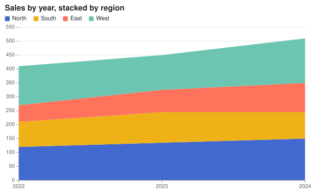

## Streamgraph

[StackOffset.Silhouette](cref:Meziantou.Framework.Charts.StackOffset.Silhouette) centers the stacks on zero, and [StackOrder.InsideOut](cref:Meziantou.Framework.Charts.StackOrder.InsideOut) puts the series that peak first in the middle.

<!-- ref:../../../tests/Meziantou.Framework.Charts.Tests/CartesianChartTests.cs;region=Charts_Streamgraph;format=md-fenced-code-block;dedent=true -->
```csharp
var plot = new Plot { Title = "Streamgraph" };
plot.Add(new AreaMark<Reading>(SampleData.Readings, x: reading => reading.Date, y: reading => reading.Temperature + 15)
{
    Fill = reading => reading.City,
    Curve = Curve.MonotoneX,
    Transform = new StackTransform { Offset = StackOffset.Silhouette, Order = StackOrder.InsideOut },
});
plot.YAxis.Visible = false;
```
<!-- endref -->

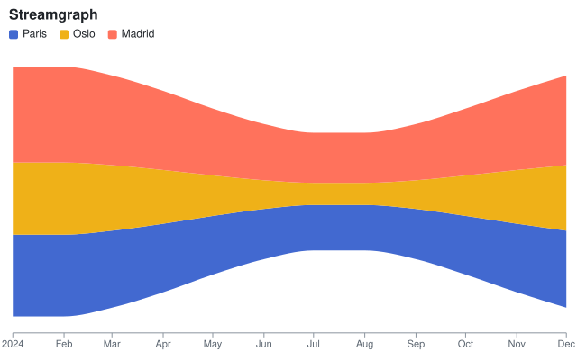

## Scatter plot

A [DotMark\<T\>](cref:Meziantou.Framework.Charts.DotMark{T}) draws a dot per row. The fill channel colors the dots and adds a legend; the title channel adds a tooltip.

<!-- ref:../../../tests/Meziantou.Framework.Charts.Tests/CartesianChartTests.cs;region=Charts_ScatterPlot;format=md-fenced-code-block;dedent=true -->
```csharp
var plot = new Plot { Title = "Fuel efficiency by weight" };
plot.Add(new DotMark<Car>(SampleData.Cars, x: car => car.Weight, y: car => car.Mpg)
{
    Fill = car => car.Origin,
    Title = car => car.Name,
});
plot.XAxis.Label = "Weight (kg)";
plot.YAxis.Label = "Miles per gallon";
plot.XAxis.Grid = true;
```
<!-- endref -->

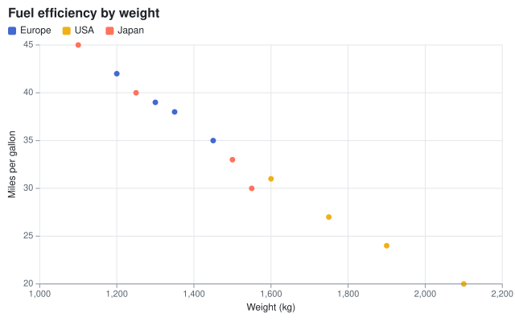

## Bubble chart

The [Size](cref:Meziantou.Framework.Charts.DotMark{T}.Size) channel goes through the size scale: the area of a dot is
proportional to its value. A legend of nested circles explains the sizes, next to the legend of the colors.

<!-- ref:../../../tests/Meziantou.Framework.Charts.Tests/CartesianChartTests.cs;region=Charts_BubbleChart;format=md-fenced-code-block;dedent=true -->
```csharp
var plot = new Plot { Title = "Power, weight and efficiency" };
plot.Add(new DotMark<Car>(SampleData.Cars, x: car => car.Weight, y: car => car.Mpg)
{
    Size = car => car.Horsepower,
    Fill = car => car.Origin,
    FillOpacity = 0.7,
    StrokeColor = ChartColor.White,
});
plot.SizeScale = new SizeScale { MaxRadius = 20 };
```
<!-- endref -->

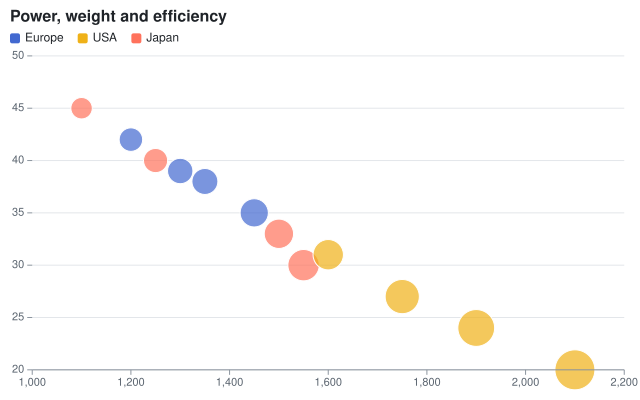

## Size legend

[Plot.SizeLegend](cref:Meziantou.Framework.Charts.Plot.SizeLegend) sets the title of the legend of the sizes, its values
(up to three round values of the domain by default) and its visibility. It follows the
[Position](cref:Meziantou.Framework.Charts.Legend.Position) of the legend of the colors: on the right, the two legends
are stacked; above or under the chart, they are side by side.

<!-- ref:../../../tests/Meziantou.Framework.Charts.Tests/CartesianChartTests.cs;region=Charts_SizeLegend;format=md-fenced-code-block;dedent=true -->
```csharp
var plot = new Plot { Title = "Power, weight and efficiency" };
plot.Add(new DotMark<Car>(SampleData.Cars, x: car => car.Weight, y: car => car.Mpg)
{
    Size = car => car.Horsepower,
    Fill = car => car.Origin,
    FillOpacity = 0.7,
    StrokeColor = ChartColor.White,
});
plot.SizeScale = new SizeScale { MaxRadius = 20 };
plot.Legend.Position = LegendPosition.Right;
plot.Legend.Title = "Origin";
plot.SizeLegend.Title = "Horsepower";
plot.SizeLegend.Values = [100, 150, 250];
```
<!-- endref -->

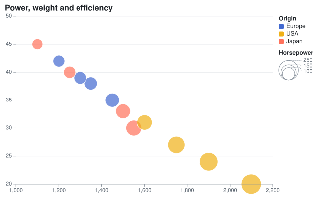

## Secondary axis

Marks that set [UseSecondaryYScale](cref:Meziantou.Framework.Charts.Mark.UseSecondaryYScale) use the secondary y scale ([Plot.SecondaryYScale](cref:Meziantou.Framework.Charts.Plot.SecondaryYScale)), whose axis is on the right: two measures of different units in one chart.

<!-- ref:../../../tests/Meziantou.Framework.Charts.Tests/CartesianChartTests.cs;region=Charts_SecondaryAxis;format=md-fenced-code-block;dedent=true -->
```csharp
Share[] revenue = [new("Q1", 120), new("Q2", 150), new("Q3", 140), new("Q4", 190)];
Share[] growth = [new("Q1", 0.04), new("Q2", 0.25), new("Q3", -0.07), new("Q4", 0.36)];

var plot = new Plot
{
    Title = "Revenue and growth",
    SecondaryYScale = new LinearScale { TickFormat = NumberFormats.Percent() },
};
plot.Add(new BarMark<Share>(revenue, x: quarter => quarter.Name, y: quarter => quarter.Value) { Fill = _ => "Revenue" });
plot.Add(new LineMark<Share>(growth, x: quarter => quarter.Name, y: quarter => quarter.Value)
{
    UseSecondaryYScale = true,
    Stroke = _ => "Growth",
    StrokeWidth = 2.5,
    MarkerRadius = 4,
});
plot.YAxis.Label = "Revenue (k€)";
plot.SecondaryYAxis.Label = "Growth";
```
<!-- endref -->

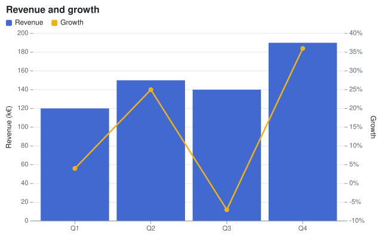

## Reference lines

[RuleYMark](cref:Meziantou.Framework.Charts.RuleYMark) draws horizontal lines and [RuleXMark\<T\>](cref:Meziantou.Framework.Charts.RuleXMark{T}) vertical lines, across the plot area.

<!-- ref:../../../tests/Meziantou.Framework.Charts.Tests/CartesianChartTests.cs;region=Charts_ReferenceLines;format=md-fenced-code-block;dedent=true -->
```csharp
var paris = SampleData.Readings.Where(reading => reading.City == "Paris");
var plot = new Plot { Title = "Months above 15 °C" };
plot.Add(new LineMark<Reading>(paris, x: reading => reading.Date, y: reading => reading.Temperature));
plot.Add(new RuleYMark(15) { StrokeColor = "#e5484d", StrokeDashArray = [4, 4] });
plot.Add(new RuleXMark<DateOnly>([new DateOnly(2024, 7, 1)], x: date => date) { StrokeColor = "#8c959f" });
```
<!-- endref -->

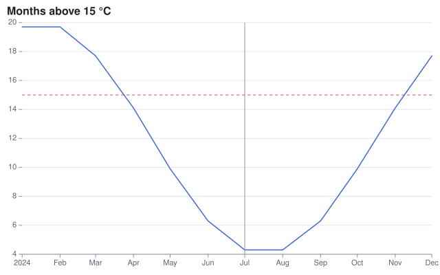

## Lollipop chart

A rule from zero to the value, then a dot at the value.

<!-- ref:../../../tests/Meziantou.Framework.Charts.Tests/CartesianChartTests.cs;region=Charts_LollipopChart;format=md-fenced-code-block;dedent=true -->
```csharp
var sales = SampleData.Sales.Where(sale => sale.Year == 2024).ToArray();
var plot = new Plot { Title = "Lollipop" };
plot.Add(new RuleXMark<Sale>(sales, x: sale => sale.Region) { Y1 = _ => 0, Y2 = sale => sale.Amount, StrokeColor = "#8c959f" });
plot.Add(new DotMark<Sale>(sales, x: sale => sale.Region, y: sale => sale.Amount) { Radius = 6 });
plot.YScale = new LinearScale { Zero = true };
```
<!-- endref -->

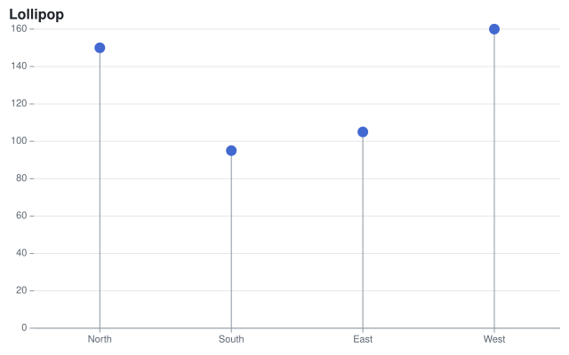

## Dumbbell chart

A rule between two values and a dot at each end, in transposed coordinates.

<!-- ref:../../../tests/Meziantou.Framework.Charts.Tests/CartesianChartTests.cs;region=Charts_DumbbellChart;format=md-fenced-code-block;dedent=true -->
```csharp
var start = SampleData.Sales.Where(sale => sale.Year == 2022).ToDictionary(sale => sale.Region, sale => sale.Amount);
var end = SampleData.Sales.Where(sale => sale.Year == 2024).ToArray();
var plot = new Plot { Title = "From 2022 to 2024", Coordinates = new CartesianCoordinates { Transposed = true }, Height = 240 };
plot.Add(new RuleXMark<Sale>(end, x: sale => sale.Region) { Y1 = sale => start[sale.Region], Y2 = sale => sale.Amount, StrokeColor = "#8c959f", StrokeWidth = 2 });
plot.Add(new DotMark<Sale>(end, x: sale => sale.Region, y: sale => start[sale.Region]) { FillColor = "#9498a0", Radius = 5 });
plot.Add(new DotMark<Sale>(end, x: sale => sale.Region, y: sale => sale.Amount) { Radius = 5 });
```
<!-- endref -->

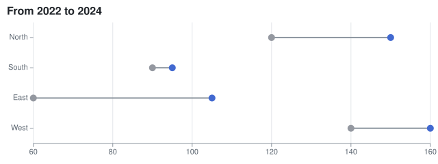

## Combo chart

Marks of different kinds share the scales of the plot: a line over bars puts its points in the middle of the bands. A constant category in a color channel names each layer in the legend.

<!-- ref:../../../tests/Meziantou.Framework.Charts.Tests/CartesianChartTests.cs;region=Charts_ComboChart;format=md-fenced-code-block;dedent=true -->
```csharp
var plot = new Plot { Title = "Sales in 2024, compared with 2023" };
plot.Add(new BarMark<Sale>(SampleData.Sales.Where(sale => sale.Year == 2024), x: sale => sale.Region, y: sale => sale.Amount)
{
    Fill = _ => "2024",
});
plot.Add(new LineMark<Sale>(SampleData.Sales.Where(sale => sale.Year == 2023), x: sale => sale.Region, y: sale => sale.Amount)
{
    Stroke = _ => "2023",
    MarkerRadius = 4,
    StrokeWidth = 2,
});
```
<!-- endref -->

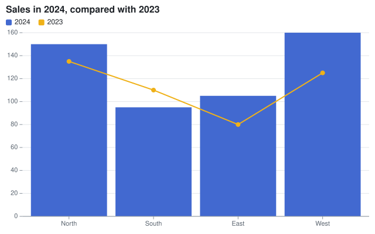

## Population pyramid

Transposed bars with negative values for one side. The tick format shows the absolute values.

<!-- ref:../../../tests/Meziantou.Framework.Charts.Tests/Samples/AgeGroup.cs;region=Charts_AgeGroupRecord;format=md-fenced-code-block;dedent=true -->
```csharp
public sealed record AgeGroup(string Age, string Sex, double Population);
```
<!-- endref -->

<!-- ref:../../../tests/Meziantou.Framework.Charts.Tests/CartesianChartTests.cs;region=Charts_PopulationPyramid;format=md-fenced-code-block;dedent=true -->
```csharp
string[] ages = ["80+", "60-79", "40-59", "20-39", "0-19"];
double[] men = [1.6, 7.1, 8.4, 7.9, 8.0];
double[] women = [2.7, 7.9, 8.6, 7.9, 7.6];
var groups = ages.SelectMany((age, i) => new[] { new AgeGroup(age, "Men", men[i]), new AgeGroup(age, "Women", women[i]) });

var plot = new Plot
{
    Title = "Population by age, in millions",
    Height = 280,
    Coordinates = new CartesianCoordinates { Transposed = true },
    YScale = new LinearScale { TickFormat = value => Math.Abs(value).ToString(CultureInfo.InvariantCulture) },
};

// The bars of the men go to the left: their values are negative
plot.Add(new BarMark<AgeGroup>(groups, x: group => group.Age, y: group => group.Sex == "Men" ? -group.Population : group.Population)
{
    Fill = group => group.Sex,
});
plot.Add(new RuleYMark(0));
```
<!-- endref -->

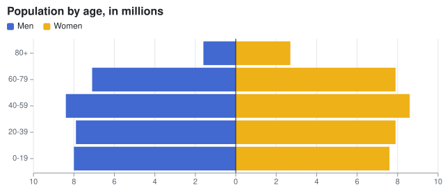

## Slope chart

Lines over two categories of a point scale, labeled at their end with a [TextMark\<T\>](cref:Meziantou.Framework.Charts.TextMark{T}).

<!-- ref:../../../tests/Meziantou.Framework.Charts.Tests/CartesianChartTests.cs;region=Charts_SlopeChart;format=md-fenced-code-block;dedent=true -->
```csharp
var sales = SampleData.Sales.Where(sale => sale.Year is 2022 or 2024).ToArray();
var plot = new Plot { Title = "From 2022 to 2024", Width = 360, Height = 380, XScale = new PointScale { Padding = 0.3 } };
plot.Add(new LineMark<Sale>(sales, x: sale => sale.Year.ToString(CultureInfo.InvariantCulture), y: sale => sale.Amount)
{
    Stroke = sale => sale.Region,
    MarkerRadius = 4,
});
plot.Add(new TextMark<Sale>(sales.Where(sale => sale.Year == 2024), text: sale => sale.Region, x: sale => "2024", y: sale => sale.Amount)
{
    Anchor = SceneTextAnchor.Start,
    OffsetX = 8,
    Fill = sale => sale.Region,
});
plot.Legend.Visible = false;
```
<!-- endref -->

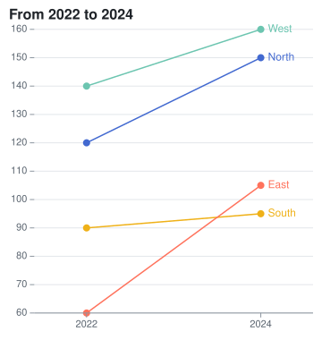

## Error bars

A rule from Y1 to Y2 at each category, and a dot at the mean.

<!-- ref:../../../tests/Meziantou.Framework.Charts.Tests/Samples/GroupSummary.cs;region=Charts_GroupSummaryRecord;format=md-fenced-code-block;dedent=true -->
```csharp
public sealed record GroupSummary(string Group, double Mean, double Deviation);
```
<!-- endref -->

<!-- ref:../../../tests/Meziantou.Framework.Charts.Tests/CartesianChartTests.cs;region=Charts_ErrorBars;format=md-fenced-code-block;dedent=true -->
```csharp
var summaries = SampleData.Measurements
    .GroupBy(measurement => measurement.Group)
    .Select(group =>
    {
        var mean = group.Average(measurement => measurement.Value);
        var deviation = Math.Sqrt(group.Average(measurement => Math.Pow(measurement.Value - mean, 2)));
        return new GroupSummary(group.Key, mean, deviation);
    })
    .ToArray();

var plot = new Plot { Title = "Mean and standard deviation", Height = 300 };
plot.Add(new RuleXMark<GroupSummary>(summaries, x: summary => summary.Group)
{
    Y1 = summary => summary.Mean - summary.Deviation,
    Y2 = summary => summary.Mean + summary.Deviation,
    StrokeWidth = 2,
});
plot.Add(new DotMark<GroupSummary>(summaries, x: summary => summary.Group, y: summary => summary.Mean) { Radius = 5 });
```
<!-- endref -->

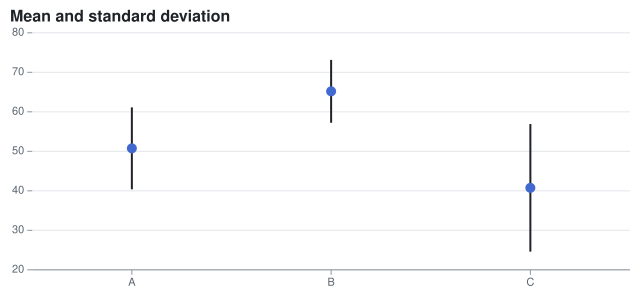

## Gantt chart

A [RectMark\<T\>](cref:Meziantou.Framework.Charts.RectMark{T}) from the start to the end of each task (X1 and X2, on a time scale), in the band of its name (Y).

<!-- ref:../../../tests/Meziantou.Framework.Charts.Tests/Samples/GanttTask.cs;region=Charts_GanttTaskRecord;format=md-fenced-code-block;dedent=true -->
```csharp
public sealed record GanttTask(string Name, string Team, DateOnly Start, DateOnly End);
```
<!-- endref -->

<!-- ref:../../../tests/Meziantou.Framework.Charts.Tests/CartesianChartTests.cs;region=Charts_GanttChart;format=md-fenced-code-block;dedent=true -->
```csharp
GanttTask[] tasks =
[
    new("Specification", "Product", new(2024, 1, 8), new(2024, 1, 26)),
    new("Design", "Design", new(2024, 1, 22), new(2024, 2, 16)),
    new("Backend", "Engineering", new(2024, 2, 5), new(2024, 3, 22)),
    new("Frontend", "Engineering", new(2024, 2, 19), new(2024, 4, 5)),
    new("Testing", "Quality", new(2024, 3, 18), new(2024, 4, 19)),
    new("Release", "Product", new(2024, 4, 15), new(2024, 4, 26)),
];

var plot = new Plot { Title = "Project plan", Height = 300 };
plot.Add(new RectMark<GanttTask>(tasks)
{
    X1 = task => task.Start,
    X2 = task => task.End,
    Y = task => task.Name,
    Fill = task => task.Team,
    Inset = 4,
    CornerRadius = 3,
    Title = task => $"{task.Name}: {task.Start:MMM d} - {task.End:MMM d}",
});
plot.Add(new RuleXMark<DateOnly>([new DateOnly(2024, 3, 1)], x: today => today) { StrokeColor = "#e5484d", StrokeDashArray = [4, 3] });
plot.XAxis.Grid = true;
```
<!-- endref -->

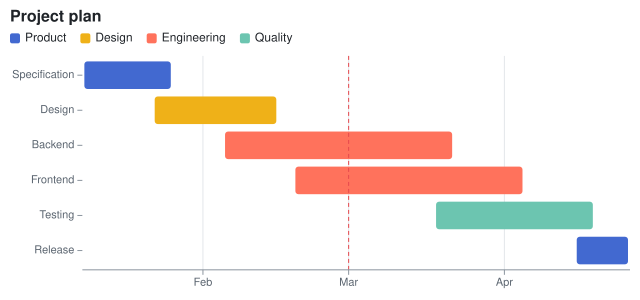
