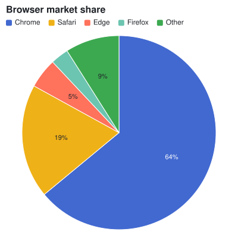
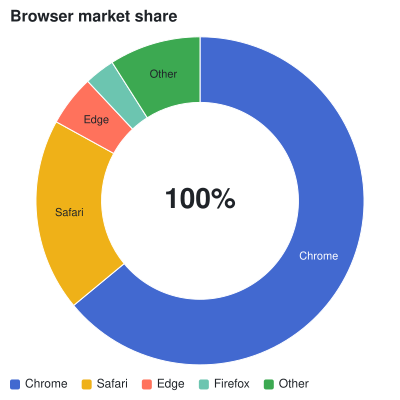
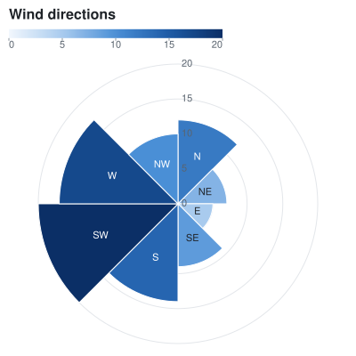
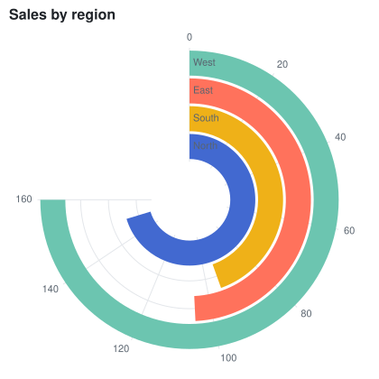
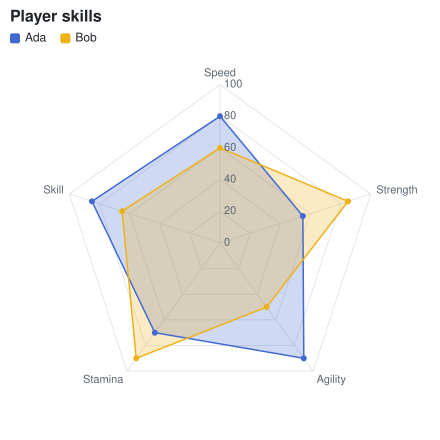
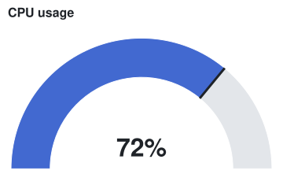

## Pie chart

An [ArcMark\<T\>](cref:Meziantou.Framework.Charts.ArcMark{T}) draws slices whose angles are proportional to the values. A label is drawn when it fits its slice.

<!-- ref:../../../tests/Meziantou.Framework.Charts.Tests/RadialChartTests.cs;region=Charts_PieChart;format=md-fenced-code-block;dedent=true -->
```csharp
Share[] shares = [new("Chrome", 64), new("Safari", 19), new("Edge", 5), new("Firefox", 3), new("Other", 9)];
var plot = new Plot { Title = "Browser market share", Width = 400, Height = 400 };
plot.Add(new ArcMark<Share>(shares, value: share => share.Value)
{
    Fill = share => share.Name,
    Label = share => share.Value.ToString(CultureInfo.InvariantCulture) + "%",
});
```
<!-- endref -->



## Donut chart

[InnerRadius](cref:Meziantou.Framework.Charts.PolarCoordinates.InnerRadius) leaves a hole in the middle. A [TextMark\<T\>](cref:Meziantou.Framework.Charts.TextMark{T}) without positions is drawn at the center.

<!-- ref:../../../tests/Meziantou.Framework.Charts.Tests/RadialChartTests.cs;region=Charts_DonutChart;format=md-fenced-code-block;dedent=true -->
```csharp
var plot = new Plot
{
    Title = "Browser market share",
    Width = 400,
    Height = 400,
    Coordinates = new PolarCoordinates { InnerRadius = 0.6 },
};
plot.Add(new ArcMark<Share>(Browsers, value: share => share.Value) { Fill = share => share.Name, Label = share => share.Name });
plot.Add(new TextMark<string>(["100%"], text: text => text) { FontSize = 28, Bold = true });
plot.Legend.Position = LegendPosition.Bottom;
```
<!-- endref -->



## Polar area chart

With [Radius](cref:Meziantou.Framework.Charts.ArcMark{T}.Radius), the slices have equal angles and radii from the values: a rose chart.

<!-- ref:../../../tests/Meziantou.Framework.Charts.Tests/RadialChartTests.cs;region=Charts_PolarAreaChart;format=md-fenced-code-block;dedent=true -->
```csharp
Share[] winds = [new("N", 12), new("NE", 7), new("E", 5), new("SE", 9), new("S", 14), new("SW", 20), new("W", 17), new("NW", 10)];
var plot = new Plot { Title = "Wind directions", Width = 400, Height = 400 };
plot.Add(new ArcMark<Share>(winds, value: _ => 1)
{
    Radius = wind => wind.Value,
    Fill = wind => wind.Value,
    Label = wind => wind.Name,
});
plot.ColorScale = new SequentialColorScale { Scheme = ColorScheme.Blues, Minimum = 0 };
```
<!-- endref -->



## Radial bar chart

Bars in transposed polar coordinates: the categories are rings and the values are angles.

<!-- ref:../../../tests/Meziantou.Framework.Charts.Tests/RadialChartTests.cs;region=Charts_RadialBarChart;format=md-fenced-code-block;dedent=true -->
```csharp
var plot = new Plot
{
    Title = "Sales by region",
    Width = 420,
    Height = 420,
    Coordinates = new PolarCoordinates { Transposed = true, EndAngle = 270, InnerRadius = 0.25 },
};
plot.Add(new BarMark<Sale>(SampleData.Sales.Where(sale => sale.Year == 2024), x: sale => sale.Region, y: sale => sale.Amount)
{
    Fill = sale => sale.Region,
});
plot.Legend.Visible = false;
```
<!-- endref -->



## Radar chart

Closed lines and areas in polar coordinates, over a point scale. The grid is made of polygons when the angular scale has categories.

<!-- ref:../../../tests/Meziantou.Framework.Charts.Tests/RadialChartTests.cs;region=Charts_RadarChart;format=md-fenced-code-block;dedent=true -->
```csharp
var plot = new Plot
{
    Title = "Player skills",
    Width = 440,
    Height = 440,
    Coordinates = new PolarCoordinates(),
    XScale = new PointScale(),
    YScale = new LinearScale { Minimum = 0, Maximum = 100 },
};
plot.Add(new AreaMark<Score>(SampleData.Scores, x: score => score.Skill, y: score => score.Value)
{
    Fill = score => score.Player,
    FillOpacity = 0.25,
    Closed = true,
});
plot.Add(new LineMark<Score>(SampleData.Scores, x: score => score.Skill, y: score => score.Value)
{
    Stroke = score => score.Player,
    Closed = true,
    MarkerRadius = 3,
});
```
<!-- endref -->



## Gauge

Polar coordinates from -90 to 90 degrees, two arcs, a marker and a text.

<!-- ref:../../../tests/Meziantou.Framework.Charts.Tests/RadialChartTests.cs;region=Charts_Gauge;format=md-fenced-code-block;dedent=true -->
```csharp
const double Value = 72;
var plot = new Plot
{
    Title = "CPU usage",
    Width = 360,
    Height = 240,
    Coordinates = new PolarCoordinates { StartAngle = -90, EndAngle = 90, InnerRadius = 0.7 },
};
plot.Add(new ArcMark<Share>([new("Used", Value), new("Free", 100 - Value)], value: part => part.Value)
{
    Fill = part => part.Name,
});
plot.Add(new RuleXMark(Value / 100) { Y1 = _ => 0, Y2 = _ => 1, StrokeWidth = 3 }); // The slices span 0 to 1
plot.Add(new TextMark<double>([Value], text: value => value.ToString(CultureInfo.InvariantCulture) + "%") { FontSize = 32, Bold = true, OffsetY = -24 });
plot.ColorScale = new OrdinalColorScale { Palette = ["#4269d0", "#e3e6ea"] };
plot.Legend.Visible = false;
```
<!-- endref -->



