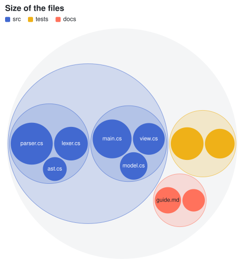
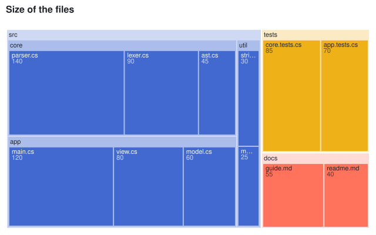
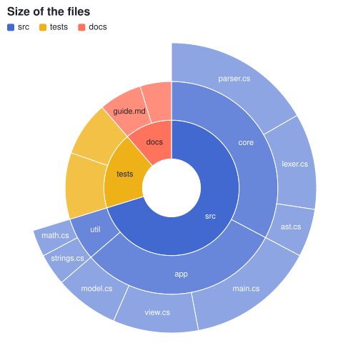
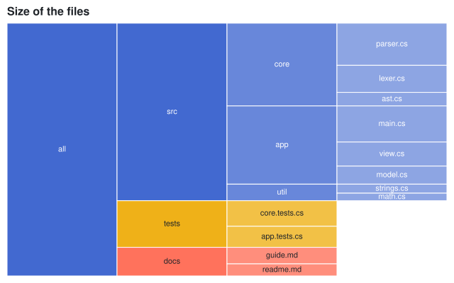
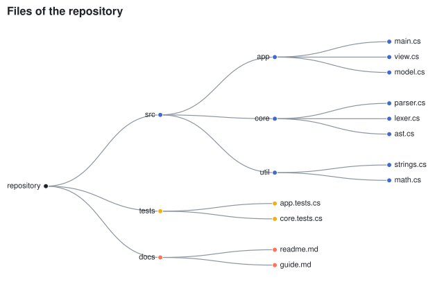
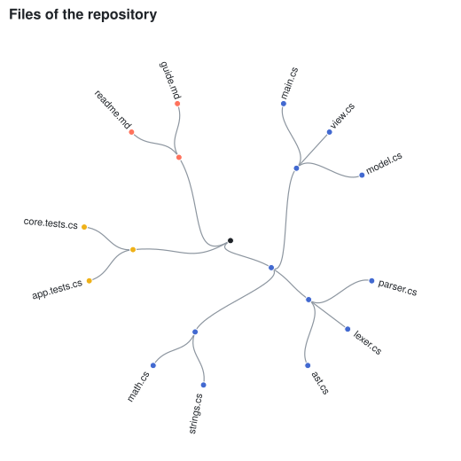

## Build a tree

The hierarchical marks draw a tree of [HierarchyNode\<T\>](cref:Meziantou.Framework.Charts.HierarchyNode{T}).
[Hierarchy](cref:Meziantou.Framework.Charts.Hierarchy) builds one from nested objects, from rows that give the identifier
of their parent, or from paths. Pass a value to compute the value of every node: its own value plus the values of its
descendants. [SortByValue](cref:Meziantou.Framework.Charts.HierarchyNode{T}.SortByValue) sorts the children by
decreasing value, which gives better treemaps and packings.

<!-- ref:../../../tests/Meziantou.Framework.Charts.Tests/Samples/Department.cs;region=Charts_DepartmentRecord;format=md-fenced-code-block;dedent=true -->
```csharp
public sealed record Department(string Name, double People, IReadOnlyList<Department> Teams);
```
<!-- endref -->

<!-- ref:../../../tests/Meziantou.Framework.Charts.Tests/HierarchyChartTests.cs;region=Charts_HierarchyFromTree;format=md-fenced-code-block;dedent=true -->
```csharp
var tree = new Department("Company", 0,
[
    new("Engineering", 0, [new("Platform", 12, []), new("Product", 18, []), new("Data", 7, [])]),
    new("Sales", 0, [new("Europe", 9, []), new("Americas", 11, [])]),
    new("Support", 6, []),
]);

var root = Hierarchy.FromTree(tree, children: department => department.Teams, name: department => department.Name, value: department => department.People);
Assert.Equal(63, root.Value);

var plot = new Plot { Title = "People by team", Width = 400, Height = 440 };
plot.Add(new PackMark<Department>(root) { Padding = 4 });
```
<!-- endref -->

<!-- ref:../../../tests/Meziantou.Framework.Charts.Tests/PlotTests.cs;region=Charts_HierarchyStratify;format=md-fenced-code-block;dedent=true -->
```csharp
var rows = new[]
{
    (Id: "root", Parent: (string?)null, Size: 0.0),
    (Id: "a", Parent: "root", Size: 0.0),
    (Id: "a1", Parent: "a", Size: 3.0),
    (Id: "a2", Parent: "a", Size: 5.0),
    (Id: "b", Parent: "root", Size: 4.0),
};
var root = Hierarchy.Stratify(rows, row => row.Id, row => row.Parent, row => row.Size);
```
<!-- endref -->

The examples below build the tree from file paths:

<!-- ref:../../../tests/Meziantou.Framework.Charts.Tests/Samples/FileEntry.cs;region=Charts_FileEntryRecord;format=md-fenced-code-block;dedent=true -->
```csharp
public sealed record FileEntry(string Path, double Size);
```
<!-- endref -->

The nodes are colored by their top-level group, unless the `Fill` channel of the mark says otherwise.

## Packed circles

A [PackMark\<T\>](cref:Meziantou.Framework.Charts.PackMark{T}) packs the leaves as circles whose areas are proportional to their values. The layout is deterministic.

<!-- ref:../../../tests/Meziantou.Framework.Charts.Tests/HierarchyChartTests.cs;region=Charts_PackedCircles;format=md-fenced-code-block;dedent=true -->
```csharp
FileEntry[] files =
[
    new("src/app/main.cs", 120), new("src/app/view.cs", 80), new("src/app/model.cs", 60),
    new("src/core/parser.cs", 140), new("src/core/lexer.cs", 90), new("src/core/ast.cs", 45),
    new("tests/app.tests.cs", 70), new("tests/core.tests.cs", 85),
    new("docs/readme.md", 40), new("docs/guide.md", 55),
];

var root = Hierarchy.FromPaths(files, file => file.Path, value: file => file.Size).SortByValue();
var plot = new Plot { Title = "Size of the files", Width = 480, Height = 520 };
plot.Add(new PackMark<FileEntry?>(root));
```
<!-- endref -->



## Treemap

A [TreemapMark\<T\>](cref:Meziantou.Framework.Charts.TreemapMark{T}) divides the area into rectangles. [PaddingTop](cref:Meziantou.Framework.Charts.TreemapMark{T}.PaddingTop) leaves room for the names of the groups. The default tiling is squarified; [TreemapTiling](cref:Meziantou.Framework.Charts.TreemapTiling) has the others.

<!-- ref:../../../tests/Meziantou.Framework.Charts.Tests/HierarchyChartTests.cs;region=Charts_Treemap;format=md-fenced-code-block;dedent=true -->
```csharp
var root = Hierarchy.FromPaths(SampleData.Files, file => file.Path, value: file => file.Size).SortByValue();
var plot = new Plot { Title = "Size of the files" };
plot.Add(new TreemapMark<FileEntry?>(root) { PaddingTop = 18, PaddingOuter = 2, PaddingInner = 2 });
plot.Legend.Visible = false;
```
<!-- endref -->



## Sunburst

A [PartitionMark\<T\>](cref:Meziantou.Framework.Charts.PartitionMark{T}) in polar coordinates draws a ring per depth.

<!-- ref:../../../tests/Meziantou.Framework.Charts.Tests/HierarchyChartTests.cs;region=Charts_Sunburst;format=md-fenced-code-block;dedent=true -->
```csharp
var root = Hierarchy.FromPaths(SampleData.Files, file => file.Path, value: file => file.Size).SortByValue();
var plot = new Plot
{
    Title = "Size of the files",
    Width = 480,
    Height = 480,
    Coordinates = new PolarCoordinates { InnerRadius = 0.2 },
};
plot.Add(new PartitionMark<FileEntry?>(root));
```
<!-- endref -->



## Icicle

The same mark in Cartesian coordinates draws a layer per depth: from the top down, or from the left when transposed.

<!-- ref:../../../tests/Meziantou.Framework.Charts.Tests/HierarchyChartTests.cs;region=Charts_Icicle;format=md-fenced-code-block;dedent=true -->
```csharp
var root = Hierarchy.FromPaths(SampleData.Files, file => file.Path, value: file => file.Size).SortByValue();
var plot = new Plot { Title = "Size of the files", Coordinates = new CartesianCoordinates { Transposed = true } };
plot.Add(new PartitionMark<FileEntry?>(root) { ShowRoot = true, Label = node => node.Depth is 0 ? "all" : node.Name });
plot.Legend.Visible = false;
```
<!-- endref -->



## Tree diagram

A [TreeMark\<T\>](cref:Meziantou.Framework.Charts.TreeMark{T}) draws a node-link diagram with the tidy tree layout. The root is at the top in Cartesian coordinates, and on the left when they are transposed.

<!-- ref:../../../tests/Meziantou.Framework.Charts.Tests/HierarchyChartTests.cs;region=Charts_TreeDiagram;format=md-fenced-code-block;dedent=true -->
```csharp
var root = Hierarchy.FromPaths(SampleData.Files, file => file.Path);
var plot = new Plot { Title = "Files of the repository", Height = 420, Coordinates = new CartesianCoordinates { Transposed = true } };
plot.Add(new TreeMark<FileEntry?>(root) { Label = node => node.Depth is 0 ? "repository" : node.Name });
plot.Legend.Visible = false;
```
<!-- endref -->



## Radial dendrogram

With [TreeLayoutKind.Cluster](cref:Meziantou.Framework.Charts.TreeLayoutKind.Cluster), the leaves are all at the deepest level: a dendrogram. In polar coordinates, the tree is radial.

<!-- ref:../../../tests/Meziantou.Framework.Charts.Tests/HierarchyChartTests.cs;region=Charts_RadialDendrogram;format=md-fenced-code-block;dedent=true -->
```csharp
var root = Hierarchy.FromPaths(SampleData.Files, file => file.Path);
var plot = new Plot { Title = "Files of the repository", Width = 520, Height = 520, Coordinates = new PolarCoordinates() };
plot.Add(new TreeMark<FileEntry?>(root) { Layout = TreeLayoutKind.Cluster });
plot.Legend.Visible = false;
```
<!-- endref -->



## Layouts

The layouts are public, to draw trees yourself: [PackLayout](cref:Meziantou.Framework.Charts.PackLayout),
[TreemapLayout](cref:Meziantou.Framework.Charts.TreemapLayout) and [PartitionLayout](cref:Meziantou.Framework.Charts.PartitionLayout)
return the circle or the rectangle of every node, [TreeLayout](cref:Meziantou.Framework.Charts.TreeLayout) and
[ClusterLayout](cref:Meziantou.Framework.Charts.ClusterLayout) its point.

<!-- ref:../../../tests/Meziantou.Framework.Charts.Tests/LayoutTests.cs;region=Charts_TreemapLayout;format=md-fenced-code-block;dedent=true -->
```csharp
var root = Hierarchy.FromPaths(["a/x", "a/y", "b"], path => path, value: path => path.Length).SortByValue();
var layout = new TreemapLayout { Width = 300, Height = 200, Tiling = tiling };
var rectangles = layout.Layout(root);
```
<!-- endref -->

<!-- ref:../../../tests/Meziantou.Framework.Charts.Tests/LayoutTests.cs;region=Charts_TreeLayout;format=md-fenced-code-block;dedent=true -->
```csharp
var root = Hierarchy.FromPaths(["a/1", "a/2", "a/3", "b", "c/1/x", "c/1/y", "c/2"], path => path);
var points = new TreeLayout { Width = 600, Height = 300 }.Layout(root);
```
<!-- endref -->
