## Histogram

A [BinTransform](cref:Meziantou.Framework.Charts.BinTransform) counts the values in bins with round edges; a [RectMark\<T\>](cref:Meziantou.Framework.Charts.RectMark{T}) draws them. The number of bins follows Sturges' rule by default; Scott's rule, the Freedman–Diaconis rule, a count or explicit edges are options.

<!-- ref:../../../tests/Meziantou.Framework.Charts.Tests/StatisticalChartTests.cs;region=Charts_Histogram;format=md-fenced-code-block;dedent=true -->
```csharp
var values = SampleData.Normal(500, mean: 170, deviation: 8, seed: 42);
var plot = new Plot { Title = "Height of 500 people" };
plot.Add(new RectMark<double>(values) { X = height => height, Transform = new BinTransform() });
plot.XAxis.Label = "Height (cm)";
plot.YAxis.Label = "People";
```
<!-- endref -->

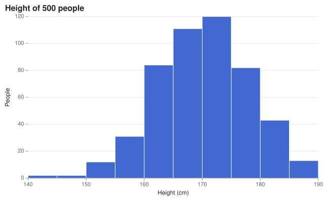

## Box plot

A [BoxMark\<T\>](cref:Meziantou.Framework.Charts.BoxMark{T}) draws the quartiles, the median, Tukey's whiskers (1.5 times the interquartile range) and the outliers of each category. [BoxStatistics](cref:Meziantou.Framework.Charts.BoxStatistics) computes them.

<!-- ref:../../../tests/Meziantou.Framework.Charts.Tests/StatisticalChartTests.cs;region=Charts_BoxPlot;format=md-fenced-code-block;dedent=true -->
```csharp
var plot = new Plot { Title = "Distribution by group" };
plot.Add(new BoxMark<Measurement>(SampleData.Measurements, x: measurement => measurement.Group, y: measurement => measurement.Value)
{
    Fill = measurement => measurement.Group,
});
plot.Legend.Visible = false;
```
<!-- endref -->

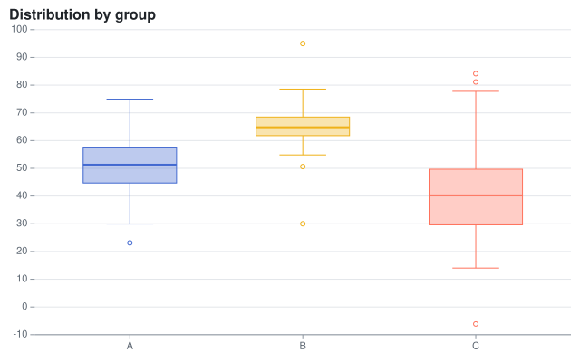

## Density plot

A [DensityTransform](cref:Meziantou.Framework.Charts.DensityTransform) estimates the density of the x values of each series with a Gaussian kernel. The bandwidth follows Silverman's rule unless it is set. The y channel of the mark is ignored.

<!-- ref:../../../tests/Meziantou.Framework.Charts.Tests/StatisticalChartTests.cs;region=Charts_DensityPlot;format=md-fenced-code-block;dedent=true -->
```csharp
var plot = new Plot { Title = "Distribution by group" };
plot.Add(new AreaMark<Measurement>(SampleData.Measurements, x: measurement => measurement.Value, y: _ => null)
{
    Fill = measurement => measurement.Group,
    FillOpacity = 0.35,
    Curve = Curve.MonotoneX,
    Transform = new DensityTransform(),
});
plot.YAxis.Label = "Density";
```
<!-- endref -->

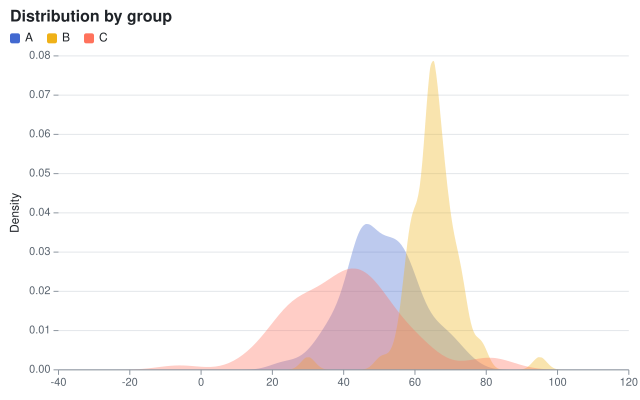

## Violin plot

A [ViolinMark\<T\>](cref:Meziantou.Framework.Charts.ViolinMark{T}) mirrors the density of each category, from its smallest value to its largest, with a box of its quartiles and a dot at its median.

<!-- ref:../../../tests/Meziantou.Framework.Charts.Tests/StatisticalChartTests.cs;region=Charts_ViolinPlot;format=md-fenced-code-block;dedent=true -->
```csharp
var plot = new Plot { Title = "Distribution by group" };
plot.Add(new ViolinMark<Measurement>(SampleData.Measurements, x: measurement => measurement.Group, y: measurement => measurement.Value)
{
    Fill = measurement => measurement.Group,
});
plot.Legend.Visible = false;
```
<!-- endref -->

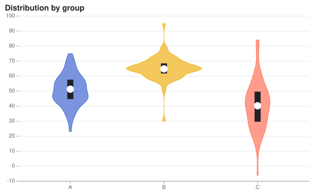

## Ridgeline plot

A [RidgelineMark\<T\>](cref:Meziantou.Framework.Charts.RidgelineMark{T}) draws the density of the x values of each
category of y as an area that rises from the line of its category and overlaps the categories above it. The tallest
area is [Overlap](cref:Meziantou.Framework.Charts.RidgelineMark{T}.Overlap) times the space between two categories, and
the others are scaled with it, so their heights compare. The inferred y scale leaves room for it above the first category.

<!-- ref:../../../tests/Meziantou.Framework.Charts.Tests/StatisticalChartTests.cs;region=Charts_Ridgeline;format=md-fenced-code-block;dedent=true -->
```csharp
string[] months = ["January", "February", "March", "April", "May", "June", "July", "August", "September", "October", "November", "December"];
var days = months
    .SelectMany((month, index) => SampleData.Normal(90, mean: 12 - (9 * Math.Cos(index * Math.PI / 6)), deviation: 2.5 + (index % 3), seed: index)
        .Select(temperature => (Month: month, Temperature: temperature)))
    .ToArray();

var plot = new Plot { Title = "Daily temperatures by month", Height = 480 };
plot.Add(new RidgelineMark<(string Month, double Temperature)>(days, x: day => day.Temperature, y: day => day.Month) { FillOpacity = 0.85 });
plot.XAxis.Label = "Temperature (°C)";
```
<!-- endref -->

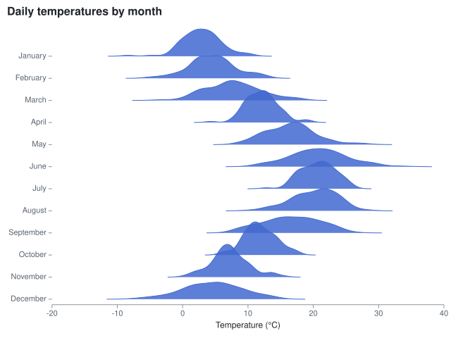

## Hexbin plot

A [HexbinMark\<T\>](cref:Meziantou.Framework.Charts.HexbinMark{T}) tiles the plot area with hexagons of
[Radius](cref:Meziantou.Framework.Charts.HexbinMark{T}.Radius) pixels, as d3-hexbin does, and colors each hexagon by the
number of its points with the color scale. It shows where a scatter plot with too many points is dense. The hexagons are
regular on the screen, so the points are binned once the chart is laid out, and the legend shows the counts.

<!-- ref:../../../tests/Meziantou.Framework.Charts.Tests/StatisticalChartTests.cs;region=Charts_Hexbin;format=md-fenced-code-block;dedent=true -->
```csharp
var xs = SampleData.Normal(2000, mean: 50, deviation: 12, seed: 1);
var ys = SampleData.Normal(2000, mean: 30, deviation: 8, seed: 2);
var points = xs.Zip(ys, (x, y) => (X: x + (y / 2), Y: y)).ToArray();

var plot = new Plot { Title = "2,000 points in hexagonal bins" };
plot.Add(new HexbinMark<(double X, double Y)>(points, x: point => point.X, y: point => point.Y) { Radius = 8 });
plot.Legend.Title = "Points";
```
<!-- endref -->

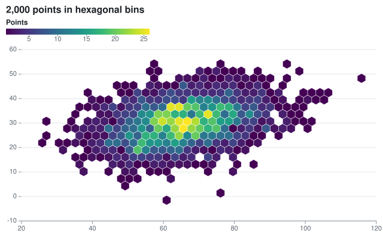

## Density contours

A [ContourMark\<T\>](cref:Meziantou.Framework.Charts.ContourMark{T}) estimates the density of the points on a grid,
with a Gaussian kernel along each axis, and cuts it at round thresholds with the marching squares of d3-contour. The
region above each threshold is filled with its color, or outlined when
[Filled](cref:Meziantou.Framework.Charts.ContourMark{T}.Filled) is off.

<!-- ref:../../../tests/Meziantou.Framework.Charts.Tests/StatisticalChartTests.cs;region=Charts_Contour;format=md-fenced-code-block;dedent=true -->
```csharp
var first = SampleData.Normal(300, mean: 2, deviation: 0.8, seed: 3).Zip(SampleData.Normal(300, mean: 3, deviation: 0.6, seed: 4));
var second = SampleData.Normal(200, mean: 5, deviation: 1, seed: 5).Zip(SampleData.Normal(200, mean: 6, deviation: 0.9, seed: 6));
var points = first.Concat(second).Select(point => (X: point.First, Y: point.Second)).ToArray();

var plot = new Plot { Title = "Density of two clusters", ColorScale = new SequentialColorScale { Scheme = ColorScheme.Blues } };
plot.Add(new ContourMark<(double X, double Y)>(points, x: point => point.X, y: point => point.Y));
plot.Add(new DotMark<(double X, double Y)>(points, x: point => point.X, y: point => point.Y) { Radius = 1.2, FillColor = "#1f2328", FillOpacity = 0.5 });
plot.Legend.Title = "Density";
```
<!-- endref -->

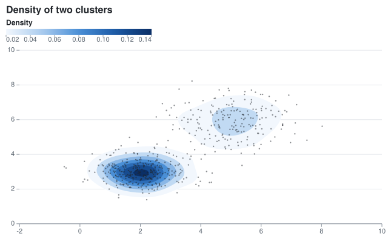

## Trend line

A [RegressionTransform](cref:Meziantou.Framework.Charts.RegressionTransform) replaces each series with the points of a polynomial fitted by least squares: a straight line by default, a curve with a higher [Degree](cref:Meziantou.Framework.Charts.RegressionTransform.Degree). The tooltip of a line is its equation. [Regression.Fit](cref:Meziantou.Framework.Charts.Regression.Fit) gives the coefficients and R²:

<!-- ref:../../../tests/Meziantou.Framework.Charts.Tests/StatisticalChartTests.cs;region=Charts_TrendLine;format=md-fenced-code-block;dedent=true -->
```csharp
var plot = new Plot { Title = "Fuel efficiency by weight" };
plot.Add(new DotMark<Car>(SampleData.Cars, x: car => car.Weight, y: car => car.Mpg) { FillOpacity = 0.7 });
plot.Add(new LineMark<Car>(SampleData.Cars, x: car => car.Weight, y: car => car.Mpg)
{
    Transform = new RegressionTransform(),
    StrokeColor = "#e5484d",
    StrokeWidth = 2,
});
plot.Add(new LineMark<Car>(SampleData.Cars, x: car => car.Weight, y: car => car.Mpg)
{
    Transform = new RegressionTransform { Degree = 2 },
    StrokeColor = "#8c959f",
    StrokeDashArray = [4, 4],
});
```
<!-- endref -->

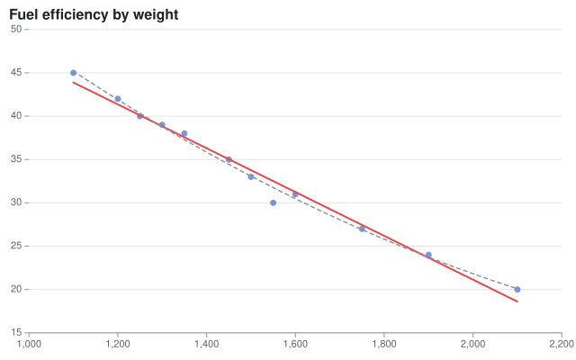

<!-- ref:../../../tests/Meziantou.Framework.Charts.Tests/TransformTests.cs;region=Charts_RegressionFit;format=md-fenced-code-block;dedent=true -->
```csharp
// The textbook example: a slope of 0.6, an intercept of 2.2, and 60% of the variance explained
var fit = Regression.Fit([(1, 2), (2, 4), (3, 5), (4, 4), (5, 5)]);
Assert.Equal(2.2, fit.Coefficients[0], 1e-12);
Assert.Equal(0.6, fit.Coefficients[1], 1e-12);
Assert.Equal(0.6, fit.RSquared, 1e-12);
Assert.Equal(5.2, fit.Evaluate(5), 1e-12);
Assert.Equal("y = 0.6x + 2.2 (R² = 0.6)", fit.ToString());
```
<!-- endref -->

## Moving average

A [WindowTransform](cref:Meziantou.Framework.Charts.WindowTransform) reduces the values of a window of rows around each row: here the mean of the last 7 days. The window can be centered, trailing or leading, and reduce with a sum, a median, a minimum...

<!-- ref:../../../tests/Meziantou.Framework.Charts.Tests/StatisticalChartTests.cs;region=Charts_MovingAverage;format=md-fenced-code-block;dedent=true -->
```csharp
var start = new DateOnly(2024, 1, 1);
var visits = Enumerable.Range(0, 90).Select(day => (Date: start.AddDays(day), Count: 200 + day + (60 * Math.Sin(day / 8.0)) + (day % 7 is 5 or 6 ? -70 : 15 * Math.Cos(day * 2.3)))).ToArray();

var plot = new Plot { Title = "Daily visits and their 7-day average", Height = 300 };
plot.Add(new LineMark<(DateOnly Date, double Count)>(visits, x: day => day.Date, y: day => day.Count) { StrokeColor = "#c3cbd5", StrokeWidth = 1 });
plot.Add(new LineMark<(DateOnly Date, double Count)>(visits, x: day => day.Date, y: day => day.Count)
{
    Transform = new WindowTransform { Size = 7, Anchor = WindowAnchor.End },
    StrokeWidth = 2.5,
});
```
<!-- endref -->

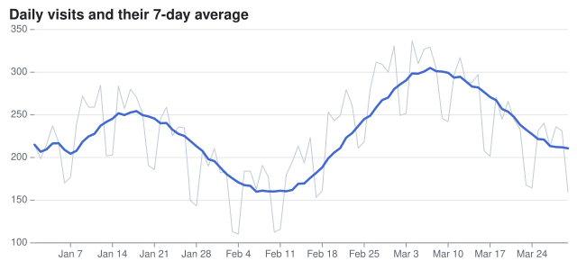

## Heatmap

A rect mark on two band scales, with a numeric fill: the color scale is sequential, and the legend is a ramp.

<!-- ref:../../../tests/Meziantou.Framework.Charts.Tests/StatisticalChartTests.cs;region=Charts_Heatmap;format=md-fenced-code-block;dedent=true -->
```csharp
string[] days = ["Mon", "Tue", "Wed", "Thu", "Fri", "Sat", "Sun"];
var cells = days.SelectMany((day, d) => Enumerable.Range(8, 12).Select(hour => new HeatCell(
    day,
    hour.ToString("00", CultureInfo.InvariantCulture) + "h",
    Math.Round((d < 5 ? 40 : 15) + (30 * Math.Sin((hour - 8) * Math.PI / 11)), MidpointRounding.AwayFromZero))));

var plot = new Plot { Title = "Visits by hour", Height = 320 };
plot.Add(new RectMark<HeatCell>(cells)
{
    X = cell => cell.Hour,
    Y = cell => cell.Day,
    Fill = cell => cell.Value,
    Text = cell => cell.Value.ToString(CultureInfo.InvariantCulture),
});
plot.ColorScale = new SequentialColorScale { Scheme = ColorScheme.Blues };
plot.Legend.Title = "Visits";
```
<!-- endref -->

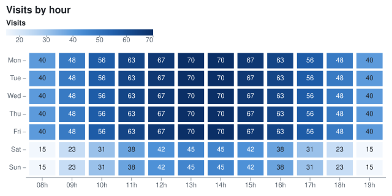

## Waterfall

A [WaterfallMark\<T\>](cref:Meziantou.Framework.Charts.WaterfallMark{T}) draws the running total: increases in the positive color of the theme, decreases in its negative color, totals in its neutral color.

<!-- ref:../../../tests/Meziantou.Framework.Charts.Tests/StatisticalChartTests.cs;region=Charts_Waterfall;format=md-fenced-code-block;dedent=true -->
```csharp
Step[] steps =
[
    new("Revenue", 420), new("Cost of sales", -180), new("Gross profit", 0, IsTotal: true),
    new("Marketing", -60), new("Salaries", -90), new("Other income", 25), new("Net profit", 0, IsTotal: true),
];

var plot = new Plot { Title = "From revenue to net profit" };
plot.Add(new WaterfallMark<Step>(steps, x: step => step.Label, y: step => step.Change) { IsTotal = step => step.IsTotal });
```
<!-- endref -->

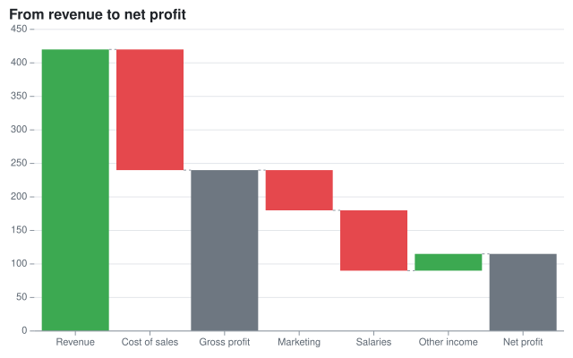

## Funnel

A [FunnelMark\<T\>](cref:Meziantou.Framework.Charts.FunnelMark{T}) draws a centered bar per stage, joined by trapezoids.

<!-- ref:../../../tests/Meziantou.Framework.Charts.Tests/StatisticalChartTests.cs;region=Charts_Funnel;format=md-fenced-code-block;dedent=true -->
```csharp
Share[] stages = [new("Visits", 12000), new("Sign-ups", 4200), new("Trials", 1800), new("Purchases", 650)];
var plot = new Plot { Title = "Conversion funnel", Height = 300 };
plot.Add(new FunnelMark<Share>(stages, stage: stage => stage.Name, value: stage => stage.Value));
```
<!-- endref -->

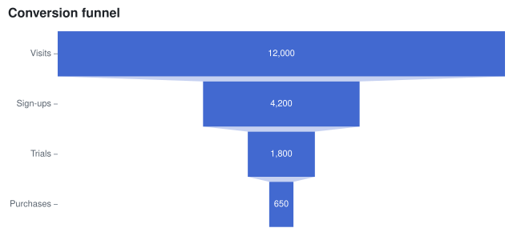

## Candlestick

A [CandlestickMark\<T\>](cref:Meziantou.Framework.Charts.CandlestickMark{T}) draws the open, high, low and close prices of each row.

<!-- ref:../../../tests/Meziantou.Framework.Charts.Tests/StatisticalChartTests.cs;region=Charts_Candlestick;format=md-fenced-code-block;dedent=true -->
```csharp
var plot = new Plot { Title = "Daily prices" };
plot.Add(new CandlestickMark<Candle>(
    SampleData.Candles,
    x: candle => candle.Date,
    open: candle => candle.Open,
    high: candle => candle.High,
    low: candle => candle.Low,
    close: candle => candle.Close));
```
<!-- endref -->

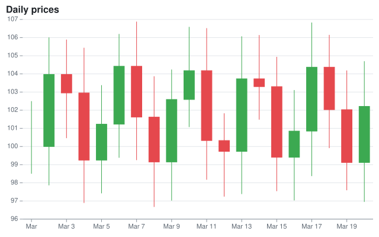

## Bullet chart

Bars of the qualitative ranges, a narrower bar of the value ([BarWidth](cref:Meziantou.Framework.Charts.BarMark{T}.BarWidth)), and a rule at the target across the band of its category ([X](cref:Meziantou.Framework.Charts.RuleYMark{T}.X)).

<!-- ref:../../../tests/Meziantou.Framework.Charts.Tests/Samples/Kpi.cs;region=Charts_KpiRecord;format=md-fenced-code-block;dedent=true -->
```csharp
public sealed record Kpi(string Name, double Value, double Target);
```
<!-- endref -->

<!-- ref:../../../tests/Meziantou.Framework.Charts.Tests/StatisticalChartTests.cs;region=Charts_BulletChart;format=md-fenced-code-block;dedent=true -->
```csharp
Kpi[] kpis = [new("Revenue", 82, 90), new("Profit", 64, 60), new("New customers", 91, 85), new("Satisfaction", 48, 75)];
var plot = new Plot
{
    Title = "Results, in % of the year's goal",
    Height = 240,
    Coordinates = new CartesianCoordinates { Transposed = true },
    YScale = new LinearScale { Minimum = 0, Maximum = 100 },
};

// The qualitative ranges, the value as a narrower bar, and the target as a line across the band
plot.Add(new BarMark<Kpi>(kpis, x: kpi => kpi.Name, y: _ => 100) { FillColor = "#eceef1" });
plot.Add(new BarMark<Kpi>(kpis, x: kpi => kpi.Name, y: _ => 70) { FillColor = "#d5d9de" });
plot.Add(new BarMark<Kpi>(kpis, x: kpi => kpi.Name, y: kpi => kpi.Value) { BarWidth = 0.35, FillColor = "#2f3740" });
plot.Add(new RuleYMark<Kpi>(kpis, y: kpi => kpi.Target) { X = kpi => kpi.Name, StrokeWidth = 3, StrokeColor = "#e5484d" });
```
<!-- endref -->

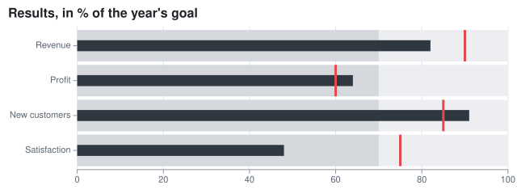

## Calendar heatmap

A rect mark with the week on x and the day on y. The band scale of y sets the order of the days.

<!-- ref:../../../tests/Meziantou.Framework.Charts.Tests/StatisticalChartTests.cs;region=Charts_CalendarHeatmap;format=md-fenced-code-block;dedent=true -->
```csharp
string[] dayNames = ["Mon", "Tue", "Wed", "Thu", "Fri", "Sat", "Sun"];
var start = new DateOnly(2024, 1, 1); // a Monday
var days = Enumerable.Range(0, 91).Select(start.AddDays).ToArray();

var plot = new Plot { Title = "Commits per day", Height = 220 };
plot.Add(new RectMark<DateOnly>(days)
{
    X = day => "W" + ((day.DayNumber - start.DayNumber) / 7 + 1).ToString(CultureInfo.InvariantCulture),
    Y = day => dayNames[((int)day.DayOfWeek + 6) % 7],
    Fill = day => day.DayOfWeek is DayOfWeek.Saturday or DayOfWeek.Sunday ? day.Day % 3 : (day.DayNumber * 7 % 11) + 2,
    Inset = 2,
    CornerRadius = 2,
    Title = day => day.ToString("yyyy-MM-dd", CultureInfo.InvariantCulture),
});
plot.YScale = new BandScale { Domain = dayNames };
plot.ColorScale = new SequentialColorScale { Scheme = ColorScheme.Greens };
```
<!-- endref -->

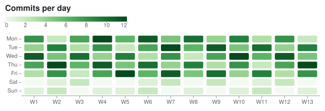

## Marimekko chart

Rectangles whose X1 and X2 are the cumulative shares of the regions, stacked by a [StackTransform](cref:Meziantou.Framework.Charts.StackTransform), which groups rectangles by their X1.

<!-- ref:../../../tests/Meziantou.Framework.Charts.Tests/StatisticalChartTests.cs;region=Charts_MarimekkoChart;format=md-fenced-code-block;dedent=true -->
```csharp
// The width of a region is its share of the total; its height is split by year
var totals = SampleData.Sales.GroupBy(sale => sale.Region).ToDictionary(group => group.Key, group => group.Sum(sale => sale.Amount));
var grandTotal = totals.Values.Sum();
var starts = new Dictionary<string, double>();
var cursor = 0.0;
foreach (var (region, total) in totals)
{
    starts[region] = cursor;
    cursor += total / grandTotal;
}

var plot = new Plot
{
    Title = "Sales by region and year",
    XScale = new LinearScale { TickFormat = NumberFormats.Percent() },
    YScale = new LinearScale { TickFormat = NumberFormats.Percent() },
};
plot.Add(new RectMark<Sale>(SampleData.Sales)
{
    X1 = sale => starts[sale.Region],
    X2 = sale => starts[sale.Region] + (totals[sale.Region] / grandTotal),
    Y = sale => sale.Amount,
    Fill = sale => sale.Year.ToString(CultureInfo.InvariantCulture),
    Transform = new StackTransform { Offset = StackOffset.Expand },
    Text = sale => sale.Region,
});
```
<!-- endref -->

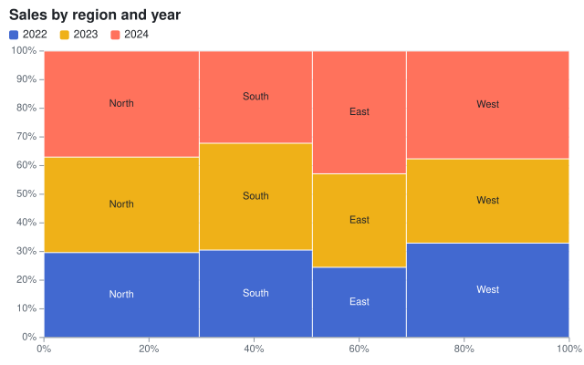

## Sparkline

A small plot without axes and with fixed margins.

<!-- ref:../../../tests/Meziantou.Framework.Charts.Tests/StatisticalChartTests.cs;region=Charts_Sparkline;format=md-fenced-code-block;dedent=true -->
```csharp
double[] values = [3, 5, 4, 6, 8, 7, 9, 12, 10, 11, 14, 13];
var plot = new Plot { Width = 120, Height = 32, Margin = new ChartMargin(4), Theme = ChartTheme.Light with { Background = null } };
plot.Add(new LineMark<int>(Enumerable.Range(0, values.Length), x: i => i, y: i => values[i]) { Curve = Curve.MonotoneX });
plot.Add(new DotMark<int>([values.Length - 1], x: i => i, y: i => values[i]) { Radius = 2, FillColor = "#e5484d" });
plot.XAxis.Visible = false;
plot.YAxis.Visible = false;
```
<!-- endref -->


