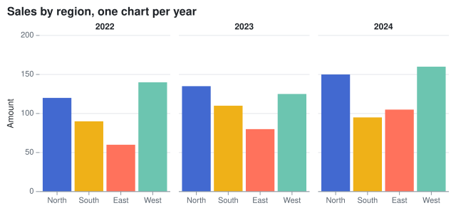
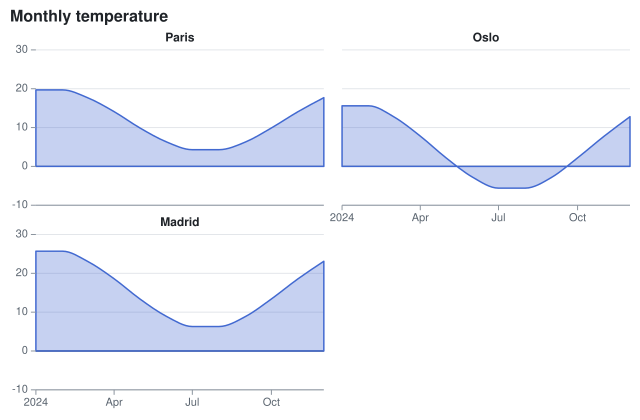
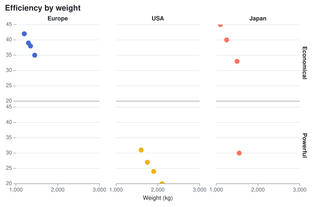
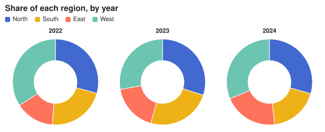

Facets split a chart into a grid of small charts, one per value of the `FacetX` channel (the columns) and of the
`FacetY` channel (the rows) of the marks ([Mark\<T\>.FacetX](cref:Meziantou.Framework.Charts.Mark{T}.FacetX),
[Mark\<T\>.FacetY](cref:Meziantou.Framework.Charts.Mark{T}.FacetY)). The charts share the scales, so they compare at a
glance. The rows of each facet are prepared apart: stacks, bins and pie totals apply to each facet. A mark without facet
channels, such as a reference line, is drawn in every chart. The axes are drawn on the outer charts, and the facets are
the headers of the columns and the labels of the rows.

## Facets

A column per value of FacetX.

<!-- ref:../../../tests/Meziantou.Framework.Charts.Tests/CartesianChartTests.cs;region=Charts_Facets;format=md-fenced-code-block;dedent=true -->
```csharp
var plot = new Plot { Title = "Sales by region, one chart per year", Height = 300 };
plot.Add(new BarMark<Sale>(SampleData.Sales, x: sale => sale.Region, y: sale => sale.Amount)
{
    FacetX = sale => sale.Year,
    Fill = sale => sale.Region,
});
plot.Legend.Visible = false;
plot.YAxis.Label = "Amount";
```
<!-- endref -->



## Wrapped facets

With [Columns](cref:Meziantou.Framework.Charts.FacetOptions.Columns), the facets of x wrap onto rows, each chart with its header. The axis of x is drawn under the last chart of each column.

<!-- ref:../../../tests/Meziantou.Framework.Charts.Tests/CartesianChartTests.cs;region=Charts_FacetWrap;format=md-fenced-code-block;dedent=true -->
```csharp
var plot = new Plot { Title = "Monthly temperature", Height = 420, Facets = { Columns = 2 } };
plot.Add(new RuleYMark(0));
plot.Add(new AreaMark<Reading>(SampleData.Readings, x: reading => reading.Date, y: reading => reading.Temperature)
{
    FacetX = reading => reading.City,
    FillOpacity = 0.3,
    StrokeColor = "#4269d0",
    Curve = Curve.MonotoneX,
});
```
<!-- endref -->



## Grid of facets

FacetX and FacetY together make a grid. [XDomain](cref:Meziantou.Framework.Charts.FacetOptions.XDomain) and [YDomain](cref:Meziantou.Framework.Charts.FacetOptions.YDomain) set the order of the facets.

<!-- ref:../../../tests/Meziantou.Framework.Charts.Tests/CartesianChartTests.cs;region=Charts_FacetGrid;format=md-fenced-code-block;dedent=true -->
```csharp
var plot = new Plot { Title = "Efficiency by weight", Height = 420, Clip = true };
plot.Add(new DotMark<Car>(SampleData.Cars, x: car => car.Weight, y: car => car.Mpg)
{
    FacetX = car => car.Origin,
    FacetY = car => car.Horsepower >= 150 ? "Powerful" : "Economical",
    Fill = car => car.Origin,
    Radius = 5,
});
plot.Facets.YDomain = ["Economical", "Powerful"];
plot.XAxis.Label = "Weight (kg)";
plot.Legend.Visible = false;
```
<!-- endref -->



## Faceted pies

Facets work in polar coordinates too: each pie is a full circle of its own total.

<!-- ref:../../../tests/Meziantou.Framework.Charts.Tests/RadialChartTests.cs;region=Charts_FacetedPies;format=md-fenced-code-block;dedent=true -->
```csharp
var plot = new Plot
{
    Title = "Share of each region, by year",
    Height = 260,
    Coordinates = new PolarCoordinates { InnerRadius = 0.5 },
};
plot.Add(new ArcMark<Sale>(SampleData.Sales, value: sale => sale.Amount)
{
    FacetX = sale => sale.Year,
    Fill = sale => sale.Region,
});
```
<!-- endref -->



