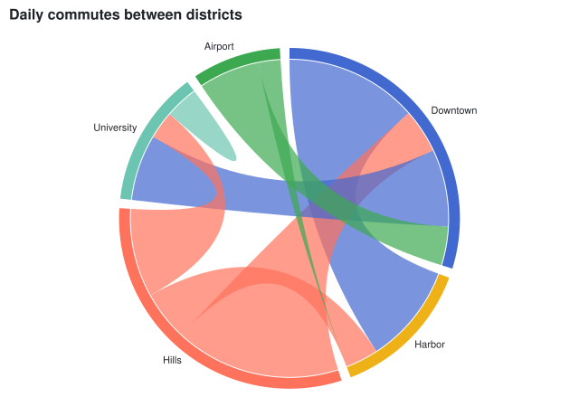

## Sankey diagram

A [SankeyMark\<T\>](cref:Meziantou.Framework.Charts.SankeyMark{T}) draws a row per link: the nodes are bars in columns, as tall as their values, and the links are bands as wide as their values. [Alignment](cref:Meziantou.Framework.Charts.SankeyMark{T}.Alignment) sets the column of each node. The links must not form a cycle. Missing, infinite and negative values count as zero, and the layout keeps the ratios of huge values whose sum is larger than `double.MaxValue`.

<!-- ref:../../../tests/Meziantou.Framework.Charts.Tests/Samples/Flow.cs;region=Charts_FlowRecord;format=md-fenced-code-block;dedent=true -->
```csharp
public sealed record Flow(string Source, string Target, double Value);
```
<!-- endref -->

<!-- ref:../../../tests/Meziantou.Framework.Charts.Tests/StatisticalChartTests.cs;region=Charts_Sankey;format=md-fenced-code-block;dedent=true -->
```csharp
Flow[] flows =
[
    new("Coal", "Electricity", 25), new("Gas", "Electricity", 30), new("Nuclear", "Electricity", 20), new("Solar", "Electricity", 10),
    new("Gas", "Heating", 35), new("Oil", "Transport", 45),
    new("Electricity", "Homes", 30), new("Electricity", "Industry", 25), new("Electricity", "Losses", 30),
    new("Heating", "Homes", 25), new("Heating", "Losses", 10), new("Transport", "Losses", 30), new("Transport", "Mobility", 15),
];

var plot = new Plot { Title = "Energy flows", Height = 420 };
plot.Add(new SankeyMark<Flow>(flows, source: flow => flow.Source, target: flow => flow.Target, value: flow => flow.Value));
```
<!-- endref -->


## Chord diagram

A [ChordMark\<T\>](cref:Meziantou.Framework.Charts.ChordMark{T}) draws a row per flow, like a Sankey diagram, but
around a circle: each node is an arc as long as the total of the flows that leave it, and each pair of nodes is joined
by a ribbon whose two ends are as wide as the flows in each direction. A ribbon takes the color of the node of its
larger flow. Unlike a Sankey diagram, the flows may form cycles, and a node may flow to itself. The rows that have the
same source and target add up, and the values count as in a Sankey diagram.

<!-- ref:../../../tests/Meziantou.Framework.Charts.Tests/StatisticalChartTests.cs;region=Charts_Chord;format=md-fenced-code-block;dedent=true -->
```csharp
Flow[] commutes =
[
    new("Downtown", "Harbor", 120), new("Harbor", "Downtown", 90), new("Downtown", "Hills", 40), new("Hills", "Downtown", 150),
    new("Downtown", "University", 70), new("University", "Downtown", 60), new("Harbor", "Hills", 30), new("Hills", "Harbor", 45),
    new("University", "Hills", 25), new("Hills", "University", 80), new("Airport", "Downtown", 55), new("Downtown", "Airport", 35),
    new("Airport", "Harbor", 20), new("University", "University", 30),
];

var plot = new Plot { Title = "Daily commutes between districts", Height = 460 };
plot.Add(new ChordMark<Flow>(commutes, source: flow => flow.Source, target: flow => flow.Target, value: flow => flow.Value));
```
<!-- endref -->


