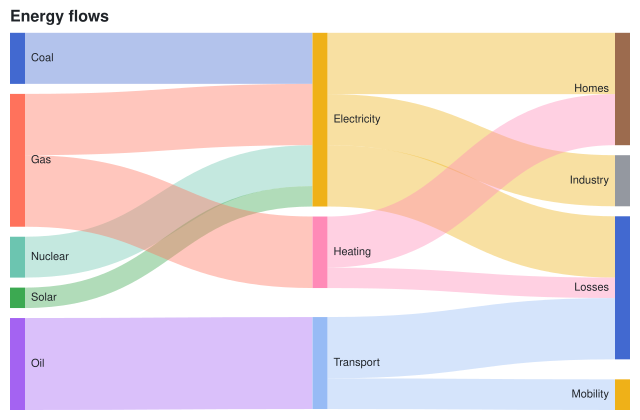

## Sankey diagram

A [SankeyMark\<T\>](cref:Meziantou.Framework.Charts.SankeyMark{T}) draws a row per link: the nodes are bars in columns, as tall as their values, and the links are bands as wide as their values. [Alignment](cref:Meziantou.Framework.Charts.SankeyMark{T}.Alignment) sets the column of each node. The links must not form a cycle.

<!-- ref:../../../tests/Meziantou.Framework.Charts.Tests/Samples/Flow.cs;region=Charts_FlowRecord;format=md-fenced-code-block;dedent=true -->
```csharp
public sealed record Flow(string Source, string Target, double Value);
```
<!-- endref -->

<!-- ref:../../../tests/Meziantou.Framework.Charts.Tests/StatisticalChartTests.cs;region=Charts_Sankey;format=md-fenced-code-block;dedent=true -->
```csharp
Flow[] flows =
[
    new("Coal", "Electricity", 25), new("Gas", "Electricity", 30), new("Nuclear", "Electricity", 20), new("Solar", "Electricity", 10),
    new("Gas", "Heating", 35), new("Oil", "Transport", 45),
    new("Electricity", "Homes", 30), new("Electricity", "Industry", 25), new("Electricity", "Losses", 30),
    new("Heating", "Homes", 25), new("Heating", "Losses", 10), new("Transport", "Losses", 30), new("Transport", "Mobility", 15),
];

var plot = new Plot { Title = "Energy flows", Height = 420 };
plot.Add(new SankeyMark<Flow>(flows, source: flow => flow.Source, target: flow => flow.Target, value: flow => flow.Value));
```
<!-- endref -->



