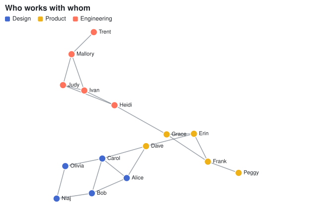

## Network graph

A [NetworkMark\<T\>](cref:Meziantou.Framework.Charts.NetworkMark{T}) draws a row per link: the nodes are the names the
links reference, placed by a force-directed layout where the links are springs of
[LinkDistance](cref:Meziantou.Framework.Charts.NetworkMark{T}.LinkDistance) and the nodes repel each other with
[Charge](cref:Meziantou.Framework.Charts.NetworkMark{T}.Charge), as in d3-force. The drawing is then scaled to fit the
plot area. [NodeFill](cref:Meziantou.Framework.Charts.NetworkMark{T}.NodeFill) colors the nodes with the color scale.

The layout is deterministic: the nodes start on a spiral, the simulation runs a fixed number of
[Iterations](cref:Meziantou.Framework.Charts.NetworkMark{T}.Iterations), and the random jiggle that separates nodes at
the same position comes from a seeded generator. The same links always give the same drawing.

<!-- ref:../../../tests/Meziantou.Framework.Charts.Tests/StatisticalChartTests.cs;region=Charts_Network;format=md-fenced-code-block;dedent=true -->
```csharp
(string From, string To)[] collaborations =
[
    ("Alice", "Bob"), ("Alice", "Carol"), ("Bob", "Carol"), ("Carol", "Dave"), ("Alice", "Dave"),
    ("Dave", "Erin"), ("Erin", "Frank"), ("Frank", "Grace"), ("Erin", "Grace"), ("Grace", "Heidi"),
    ("Heidi", "Ivan"), ("Ivan", "Judy"), ("Heidi", "Judy"), ("Judy", "Mallory"), ("Ivan", "Mallory"),
    ("Bob", "Niaj"), ("Niaj", "Olivia"), ("Carol", "Olivia"), ("Frank", "Peggy"), ("Mallory", "Trent"),
];
var teams = new Dictionary<string, string>(StringComparer.Ordinal)
{
    ["Alice"] = "Design", ["Bob"] = "Design", ["Carol"] = "Design", ["Niaj"] = "Design", ["Olivia"] = "Design",
    ["Dave"] = "Product", ["Erin"] = "Product", ["Frank"] = "Product", ["Grace"] = "Product", ["Peggy"] = "Product",
    ["Heidi"] = "Engineering", ["Ivan"] = "Engineering", ["Judy"] = "Engineering", ["Mallory"] = "Engineering", ["Trent"] = "Engineering",
};

var plot = new Plot { Title = "Who works with whom", Height = 420 };
plot.Add(new NetworkMark<(string From, string To)>(collaborations, source: link => link.From, target: link => link.To)
{
    NodeFill = name => teams[name],
    NodeRadius = 7,
});
```
<!-- endref -->


