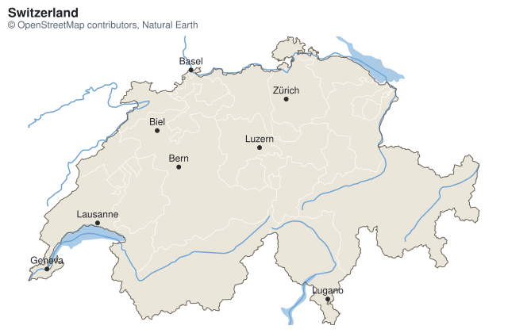
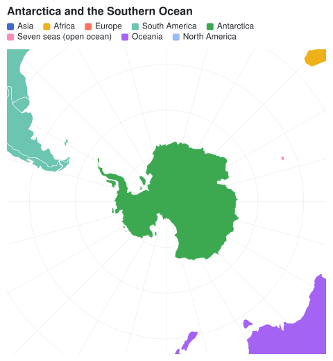

## Choropleth

A choropleth colors regions by a value. Read the regions with the `Meziantou.Framework.Geo` package, a dependency of
the charts: [GeoJson.Parse](cref:Meziantou.Framework.Geo.GeoJson.Parse) returns the features of a GeoJSON document, and
the package reads [other formats](../../Geo/01-Introduction.md) too, such as TopoJSON and Shapefile. Draw the features
with a [GeoMark\<T\>](cref:Meziantou.Framework.Charts.GeoMark{T}): its
[Fill](cref:Meziantou.Framework.Charts.Mark{T}.Fill) channel is mapped by the color scale, as for any mark. The
[Properties](cref:Meziantou.Framework.Geo.GeoFeature.Properties) of a feature hold the values of its GeoJSON
properties: a JSON number is a `double` and a string is a `string`. The examples need
`using Meziantou.Framework.Geo;`.

<!-- ref:../../../tests/Meziantou.Framework.Charts.Tests/StatisticalChartTests.cs;region=Charts_Choropleth;format=md-fenced-code-block;dedent=true -->
```csharp
var path = Path.Combine(AppContext.BaseDirectory, "TestData", "countries-110m.geojson");
var countries = GeoJson.Parse(File.ReadAllText(path))
    .Where(country => country.Properties["continent"] is not "Antarctica")
    .ToList();

var plot = new Plot
{
    Title = "GDP per person",
    Subtitle = "Natural Earth, 2019 estimates",
    Height = 380,
    Coordinates = new GeoCoordinates { Projection = new EqualEarthProjection(), Outline = true },

    // The fill is the logarithm of the GDP per person: one step of the scale per factor of 10, labeled in
    // dollars rounded to the hundreds
    ColorScale = new SequentialColorScale
    {
        Minimum = 3,
        Maximum = 5,
        TickFormat = value => "$" + NumberFormats.Si(Math.Round(Math.Pow(10, value) / 100, MidpointRounding.AwayFromZero) * 100),
    },
};
plot.Add(new GeoMark<GeoFeature>(countries, country => country.Geometry)
{
    Fill = country => Math.Log10((double)country.Properties["gdp_md"]! * 1_000_000 / (double)country.Properties["pop_est"]!),
    Title = country => (string?)country.Properties["name"],
});
```
<!-- endref -->


The countries of this example are those of [Natural Earth](https://www.naturalearthdata.com/) (public domain), at the
scale of 1:110m. A region whose fill value is missing is light gray, and so are the regions of a geo mark without a fill:
a base map.

## Points on a map

A plot with a geo mark uses [GeoCoordinates](cref:Meziantou.Framework.Charts.GeoCoordinates): x is the longitude and y
the latitude, in degrees. The other marks draw on the map with their usual channels: a
[DotMark\<T\>](cref:Meziantou.Framework.Charts.DotMark{T}) places its dots at their longitudes and latitudes, and a
[TextMark\<T\>](cref:Meziantou.Framework.Charts.TextMark{T}) labels them. The
[LabelPosition](cref:Meziantou.Framework.Geo.GeoGeometry.LabelPosition) of a geometry is a position to label a region. The
cities of this example are records like this:

<!-- ref:../../../tests/Meziantou.Framework.Charts.Tests/Samples/City.cs;region=Charts_CityRecord;format=md-fenced-code-block;dedent=true -->
```csharp
public sealed record City(string Name, double Longitude, double Latitude, double Population);
```
<!-- endref -->

<!-- ref:../../../tests/Meziantou.Framework.Charts.Tests/StatisticalChartTests.cs;region=Charts_MapPoints;format=md-fenced-code-block;dedent=true -->
```csharp
var path = Path.Combine(AppContext.BaseDirectory, "TestData", "countries-110m.geojson");
var countries = GeoJson.Parse(File.ReadAllText(path));
City[] cities =
[
    new("London", -0.13, 51.51, 9.0), new("Paris", 2.35, 48.86, 11.1), new("Madrid", -3.70, 40.42, 6.7),
    new("Berlin", 13.40, 52.52, 3.7), new("Rome", 12.50, 41.90, 4.3), new("Warsaw", 21.01, 52.23, 1.8),
    new("Stockholm", 18.07, 59.33, 1.7), new("Athens", 23.73, 37.98, 3.2), new("Lisbon", -9.14, 38.72, 2.9),
    new("Vienna", 16.37, 48.21, 2.0), new("Kyiv", 30.52, 50.45, 3.0), new("Bucharest", 26.10, 44.43, 1.8),
];

var plot = new Plot
{
    Title = "Capitals of Europe",
    Height = 440,
    Clip = true,
    Coordinates = new GeoCoordinates
    {
        Projection = new MercatorProjection(),
        Extent = new GeoBounds(West: -12, South: 35, East: 34, North: 62),
        GraticuleStep = 10,
    },
};
plot.SizeLegend.Title = "Population (millions)";
plot.Add(new GeoMark<GeoFeature>(countries, country => country.Geometry));

// On a map, x is the longitude and y the latitude
plot.Add(new DotMark<City>(cities, x: city => city.Longitude, y: city => city.Latitude)
{
    Size = city => city.Population,
    FillColor = "#e5484d",
    FillOpacity = 0.8,
});
plot.Add(new TextMark<City>(cities, text: city => city.Name, x: city => city.Longitude, y: city => city.Latitude) { OffsetY = -12 });
```
<!-- endref -->


The map fits the shapes of the geo marks and the positions of the other marks. Set
[Extent](cref:Meziantou.Framework.Charts.GeoCoordinates.Extent) to show a region instead, and
[Plot.Clip](cref:Meziantou.Framework.Charts.Plot.Clip) to hide what is outside of it.
[GraticuleStep](cref:Meziantou.Framework.Charts.GeoCoordinates.GraticuleStep) draws the meridians and the parallels, and
[Outline](cref:Meziantou.Framework.Charts.GeoCoordinates.Outline) the edge of the globe.

## Map of a region

A map of a country or a continent shows its outline and what is inside: its subdivisions, lakes, rivers and cities.
Take them from a map bundle of [Meziantou.Framework.Geo.Maps](../../GeoMaps/01-Introduction.md):
[MapCatalog.GetMap](cref:Meziantou.Framework.Geo.Maps.MapCatalog.GetMap) returns the map of a region, and
[Load](cref:Meziantou.Framework.Geo.Maps.Map.Load) reads each of its layers. Draw a geo mark per layer, from the bottom
to the top: the marks are drawn in the order they are added. The example needs `using Meziantou.Framework.Geo.Maps;`.

<!-- ref:../../../tests/Meziantou.Framework.Charts.Tests/StatisticalChartTests.cs;region=Charts_RegionMap;format=md-fenced-code-block;dedent=true -->
```csharp
// The map bundle of Switzerland, in the maps folder next to the application
var map = MapCatalog.Default.GetMap("Switzerland");
var cantons = map.Load(MapLayer.StatesProvinces);
var lakes = map.Load(MapLayer.Lakes);
var rivers = map.Load(MapLayer.Rivers);
var borders = map.Load(MapLayer.Borders);

// The largest cities: the rank (0 to 14) orders the places, then their population
var cities = map.Load(MapLayer.Cities)
    .OrderByDescending(city => (int)city.Properties["rank"]!)
    .ThenByDescending(city => (long)city.Properties["population"]!)
    .Take(8)
    .Select(city => (Name: (string)city.Properties["name"]!, Position: ((GeoPoint)city.Geometry!).Position))
    .ToList();

var plot = new Plot
{
    Title = map.Name,
    Subtitle = "© OpenStreetMap contributors, Natural Earth",
    Height = 420,
    Clip = true,
    Coordinates = new GeoCoordinates { Projection = new MercatorProjection(), Extent = map.Bounds },
};

// The layers from the bottom: the cantons, the lakes and rivers, then the border of the country
plot.Add(new GeoMark<GeoFeature>(cantons, canton => canton.Geometry)
{
    FillColor = "#ebe6da",
    StrokeColor = "#ffffff",
    Title = canton => (string?)canton.Properties["name"],
});
plot.Add(new GeoMark<GeoFeature>(lakes, lake => lake.Geometry) { FillColor = "#a9cbe8", StrokeColor = ChartColor.Transparent });
plot.Add(new GeoMark<GeoFeature>(rivers, river => river.Geometry) { StrokeColor = "#6fa5d6" });
plot.Add(new GeoMark<GeoFeature>(borders, border => border.Geometry) { FillColor = ChartColor.Transparent, StrokeColor = "#6b6255", StrokeWidth = 1 });
plot.Add(new DotMark<(string Name, GeoPosition Position)>(cities, x: city => city.Position.Longitude, y: city => city.Position.Latitude) { FillColor = "#2b2b2b", Radius = 3 });
plot.Add(new TextMark<(string Name, GeoPosition Position)>(cities, text: city => city.Name, x: city => city.Position.Longitude, y: city => city.Position.Latitude) { OffsetY = -10 });
```
<!-- endref -->



- **Fit the map to the region**: set [Extent](cref:Meziantou.Framework.Charts.GeoCoordinates.Extent) to
  [Map.Bounds](cref:Meziantou.Framework.Geo.Maps.Map.Bounds), the box of the region, and
  [Plot.Clip](cref:Meziantou.Framework.Charts.Plot.Clip) to `true`: the rivers and lakes that cross the border, and the
  neighbors of a continent, are cut at the edge of the map.
- **Choose the projection**: Mercator keeps the shapes of a country. For a continent, an equal-area projection such as
  [AlbersProjection](cref:Meziantou.Framework.Geo.AlbersProjection), centered on the region, keeps the areas comparable.
  For Antarctica or the Arctic, use a [map of a polar region](#map-of-a-polar-region).
- **Style each layer**: [FillColor](cref:Meziantou.Framework.Charts.Mark{T}.FillColor) and
  [StrokeColor](cref:Meziantou.Framework.Charts.Mark{T}.StrokeColor) set the colors of a geo mark;
  `ChartColor.Transparent` draws a border without fill, or a lake without outline. A
  [Fill](cref:Meziantou.Framework.Charts.Mark{T}.Fill) channel makes a choropleth of the subdivisions, as above.
- **Label the largest cities**: the text marks do not move the labels that overlap. Keep a few cities, ordered by the
  `rank` of the bundle (from 0 to 14, larger for larger places) and their `population`, or keep the capitals with the
  `capital` property.
- **Credit the data**: the borders come from OpenStreetMap, whose license requires the attribution
  [Map.Attribution](cref:Meziantou.Framework.Geo.Maps.Map.Attribution) gives.

Without a bundle, filter the features of any file to the region, and use the bounds of its outline as the extent:
`Extent = countries.Single(country => country.Properties["name"] is "Switzerland").Geometry!.GetBounds()`.
[Clip](cref:Meziantou.Framework.Geo.GeoGeometry.Clip) cuts the other features to the region, so that the map does not
draw the whole world outside of it. Render the map as an image with
[ToImage](../07-ImageRendering.md).

## Map of a polar region

[AzimuthalEquidistantProjection](cref:Meziantou.Framework.Geo.AzimuthalEquidistantProjection) centers the map on a
pole: Antarctica, which the other projections stretch along the bottom of the map, is drawn as it is on a globe. Set
[SouthPole](cref:Meziantou.Framework.Geo.AzimuthalEquidistantProjection.SouthPole) for the South Pole, and an
[Extent](cref:Meziantou.Framework.Charts.GeoCoordinates.Extent) from the pole to the latitude the map stops at:

<!-- ref:../../../tests/Meziantou.Framework.Charts.Tests/StatisticalChartTests.cs;region=Charts_PolarMap;format=md-fenced-code-block;dedent=true -->
```csharp
var path = Path.Combine(AppContext.BaseDirectory, "TestData", "countries-110m.geojson");
var countries = GeoJson.Parse(File.ReadAllText(path));

var plot = new Plot
{
    Title = "Antarctica and the Southern Ocean",
    Width = 480,
    Height = 520,
    Clip = true,
    Coordinates = new GeoCoordinates
    {
        // Centered on the South Pole: the meridians are lines from the pole and the parallels circles around it
        Projection = new AzimuthalEquidistantProjection { SouthPole = true },
        Extent = new GeoBounds(West: -180, South: -90, East: 180, North: -40),
        GraticuleStep = 15,
    },
};
plot.Add(new GeoMark<GeoFeature>(countries, country => country.Geometry) { Fill = country => country.Properties["continent"] });
```
<!-- endref -->



- The meridians are lines from the pole and the parallels are circles around it, so a box of longitudes and latitudes
  from the pole is a disc: the frame of the plot shows the parts of the neighbors in its corners, which
  [Plot.Clip](cref:Meziantou.Framework.Charts.Plot.Clip) cuts at the edge of the frame.
- The data cuts the shapes that cross the antimeridian, such as Antarctica, along 180°. On the map of a pole, 180°W and
  180°E are the same line: the mark fills the two sides as one shape, and does not outline the cut.
- The map of the Antarctica bundle of [Meziantou.Framework.Geo.Maps](../../GeoMaps/01-Introduction.md) has the land,
  coastline, seas and physical regions south of 60°S: use its
  [Bounds](cref:Meziantou.Framework.Geo.Maps.Map.Bounds) as the extent.

## Projections

[Projection](cref:Meziantou.Framework.Charts.GeoCoordinates.Projection) sets how the globe is flattened:

| Projection | Use it for |
|---|---|
| [EquirectangularProjection](cref:Meziantou.Framework.Geo.EquirectangularProjection) | the default: the longitude is x and the latitude is y |
| [MercatorProjection](cref:Meziantou.Framework.Geo.MercatorProjection) | the maps of web sites: it keeps the shapes, and enlarges the areas far from the equator |
| [EqualEarthProjection](cref:Meziantou.Framework.Geo.EqualEarthProjection) | world choropleths: the areas are in proportion to the areas of the regions |
| [AlbersProjection](cref:Meziantou.Framework.Geo.AlbersProjection) | the choropleths of a country or a continent: equal-area, centered on its [CentralMeridian](cref:Meziantou.Framework.Geo.AlbersProjection.CentralMeridian) |
| [AzimuthalEquidistantProjection](cref:Meziantou.Framework.Geo.AzimuthalEquidistantProjection) | the maps of a polar region: centered on a pole, see [map of a polar region](#map-of-a-polar-region) |

The Albers projection measures the longitudes from its central meridian, and does not cut the shapes that cross the
opposite meridian: give it the regions of the map, not the whole world. The projections are part of the
`Meziantou.Framework.Geo` package: see [projections](../../Geo/05-Projections.md) to use them without a chart.
