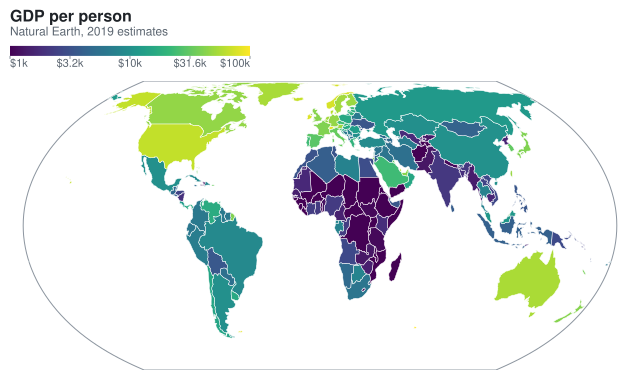
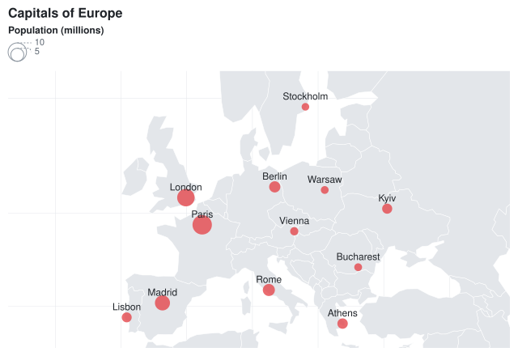

## Choropleth

A choropleth colors regions by a value. Read the regions with the `Meziantou.Framework.Geo` package, a dependency of
the charts: [GeoJson.Parse](cref:Meziantou.Framework.Geo.GeoJson.Parse) returns the features of a GeoJSON document, and
the package reads [other formats](../../Geo/01-Introduction.md) too, such as TopoJSON and Shapefile. Draw the features
with a [GeoMark\<T\>](cref:Meziantou.Framework.Charts.GeoMark{T}): its
[Fill](cref:Meziantou.Framework.Charts.Mark{T}.Fill) channel is mapped by the color scale, as for any mark. The
[Properties](cref:Meziantou.Framework.Geo.GeoFeature.Properties) of a feature hold the values of its GeoJSON
properties: a JSON number is a `double` and a string is a `string`. The examples need
`using Meziantou.Framework.Geo;`.

<!-- ref:../../../tests/Meziantou.Framework.Charts.Tests/StatisticalChartTests.cs;region=Charts_Choropleth;format=md-fenced-code-block;dedent=true -->
```csharp
var path = Path.Combine(AppContext.BaseDirectory, "TestData", "countries-110m.geojson");
var countries = GeoJson.Parse(File.ReadAllText(path))
    .Where(country => country.Properties["continent"] is not "Antarctica")
    .ToList();

var plot = new Plot
{
    Title = "GDP per person",
    Subtitle = "Natural Earth, 2019 estimates",
    Height = 380,
    Coordinates = new GeoCoordinates { Projection = new EqualEarthProjection(), Outline = true },

    // The fill is the logarithm of the GDP per person: one step of the scale per factor of 10, labeled in
    // dollars rounded to the hundreds
    ColorScale = new SequentialColorScale
    {
        Minimum = 3,
        Maximum = 5,
        TickFormat = value => "$" + NumberFormats.Si(Math.Round(Math.Pow(10, value) / 100, MidpointRounding.AwayFromZero) * 100),
    },
};
plot.Add(new GeoMark<GeoFeature>(countries, country => country.Geometry)
{
    Fill = country => Math.Log10((double)country.Properties["gdp_md"]! * 1_000_000 / (double)country.Properties["pop_est"]!),
    Title = country => (string?)country.Properties["name"],
});
```
<!-- endref -->



The countries of this example are those of [Natural Earth](https://www.naturalearthdata.com/) (public domain), at the
scale of 1:110m. A region whose fill value is missing is light gray, and so are the regions of a geo mark without a fill:
a base map.

## Points on a map

A plot with a geo mark uses [GeoCoordinates](cref:Meziantou.Framework.Charts.GeoCoordinates): x is the longitude and y
the latitude, in degrees. The other marks draw on the map with their usual channels: a
[DotMark\<T\>](cref:Meziantou.Framework.Charts.DotMark{T}) places its dots at their longitudes and latitudes, and a
[TextMark\<T\>](cref:Meziantou.Framework.Charts.TextMark{T}) labels them. The
[LabelPosition](cref:Meziantou.Framework.Geo.GeoGeometry.LabelPosition) of a geometry is a position to label a region. The
cities of this example are records like this:

<!-- ref:../../../tests/Meziantou.Framework.Charts.Tests/Samples/City.cs;region=Charts_CityRecord;format=md-fenced-code-block;dedent=true -->
```csharp
public sealed record City(string Name, double Longitude, double Latitude, double Population);
```
<!-- endref -->

<!-- ref:../../../tests/Meziantou.Framework.Charts.Tests/StatisticalChartTests.cs;region=Charts_MapPoints;format=md-fenced-code-block;dedent=true -->
```csharp
var path = Path.Combine(AppContext.BaseDirectory, "TestData", "countries-110m.geojson");
var countries = GeoJson.Parse(File.ReadAllText(path));
City[] cities =
[
    new("London", -0.13, 51.51, 9.0), new("Paris", 2.35, 48.86, 11.1), new("Madrid", -3.70, 40.42, 6.7),
    new("Berlin", 13.40, 52.52, 3.7), new("Rome", 12.50, 41.90, 4.3), new("Warsaw", 21.01, 52.23, 1.8),
    new("Stockholm", 18.07, 59.33, 1.7), new("Athens", 23.73, 37.98, 3.2), new("Lisbon", -9.14, 38.72, 2.9),
    new("Vienna", 16.37, 48.21, 2.0), new("Kyiv", 30.52, 50.45, 3.0), new("Bucharest", 26.10, 44.43, 1.8),
];

var plot = new Plot
{
    Title = "Capitals of Europe",
    Height = 440,
    Clip = true,
    Coordinates = new GeoCoordinates
    {
        Projection = new MercatorProjection(),
        Extent = new GeoBounds(West: -12, South: 35, East: 34, North: 62),
        GraticuleStep = 10,
    },
};
plot.SizeLegend.Title = "Population (millions)";
plot.Add(new GeoMark<GeoFeature>(countries, country => country.Geometry));

// On a map, x is the longitude and y the latitude
plot.Add(new DotMark<City>(cities, x: city => city.Longitude, y: city => city.Latitude)
{
    Size = city => city.Population,
    FillColor = "#e5484d",
    FillOpacity = 0.8,
});
plot.Add(new TextMark<City>(cities, text: city => city.Name, x: city => city.Longitude, y: city => city.Latitude) { OffsetY = -12 });
```
<!-- endref -->



The map fits the shapes of the geo marks and the positions of the other marks. Set
[Extent](cref:Meziantou.Framework.Charts.GeoCoordinates.Extent) to show a region instead, and
[Plot.Clip](cref:Meziantou.Framework.Charts.Plot.Clip) to hide what is outside of it.
[GraticuleStep](cref:Meziantou.Framework.Charts.GeoCoordinates.GraticuleStep) draws the meridians and the parallels, and
[Outline](cref:Meziantou.Framework.Charts.GeoCoordinates.Outline) the edge of the globe.

## Projections

[Projection](cref:Meziantou.Framework.Charts.GeoCoordinates.Projection) sets how the globe is flattened:

| Projection | Use it for |
|---|---|
| [EquirectangularProjection](cref:Meziantou.Framework.Geo.EquirectangularProjection) | the default: the longitude is x and the latitude is y |
| [MercatorProjection](cref:Meziantou.Framework.Geo.MercatorProjection) | the maps of web sites: it keeps the shapes, and enlarges the areas far from the equator |
| [EqualEarthProjection](cref:Meziantou.Framework.Geo.EqualEarthProjection) | world choropleths: the areas are in proportion to the areas of the regions |
| [AlbersProjection](cref:Meziantou.Framework.Geo.AlbersProjection) | the choropleths of a country or a continent: equal-area, centered on its [CentralMeridian](cref:Meziantou.Framework.Geo.AlbersProjection.CentralMeridian) |

The Albers projection measures the longitudes from its central meridian, and does not cut the shapes that cross the
opposite meridian: give it the regions of the map, not the whole world. The projections are part of the
`Meziantou.Framework.Geo` package: see [projections](../../Geo/05-Projections.md) to use them without a chart.
