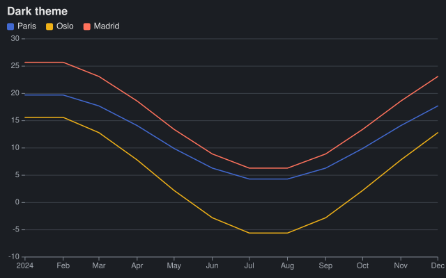

## Themes

A [ChartTheme](cref:Meziantou.Framework.Charts.ChartTheme) holds the colors, the fonts and the stroke widths of a chart.
[ChartTheme.Light](cref:Meziantou.Framework.Charts.ChartTheme.Light) is the default, and
[ChartTheme.Dark](cref:Meziantou.Framework.Charts.ChartTheme.Dark) draws light text on a dark background:

<!-- ref:../../tests/Meziantou.Framework.Charts.Tests/CartesianChartTests.cs;region=Charts_DarkTheme;format=md-fenced-code-block;dedent=true -->
```csharp
var plot = new Plot { Title = "Dark theme", Theme = ChartTheme.Dark };
plot.Add(new LineMark<Reading>(SampleData.Readings, x: reading => reading.Date, y: reading => reading.Temperature)
{
    Stroke = reading => reading.City,
});
```
<!-- endref -->



A theme is a record: change it with a `with` expression. The palette colors the categories, in order, and a
background set to `null` makes the chart transparent:

<!-- ref:../../tests/Meziantou.Framework.Charts.Tests/CartesianChartTests.cs;region=Charts_CustomTheme;format=md-fenced-code-block;dedent=true -->
```csharp
var theme = ChartTheme.Light with
{
    FontFamily = "Georgia, serif",
    Palette = ["#264653", "#2a9d8f", "#e9c46a", "#f4a261", "#e76f51"],
    Background = null,
};
var plot = new Plot { Title = "Custom theme", Theme = theme };
plot.Add(new BarMark<Sale>(SampleData.Sales, x: sale => sale.Region, y: sale => sale.Amount)
{
    Fill = sale => sale.Year,
    Transform = new StackTransform(),
});
```
<!-- endref -->

The continuous color scales take a [ColorScheme](cref:Meziantou.Framework.Charts.ColorScheme): viridis, magma, blues,
greens, oranges, reds, greys, and the diverging red-blue and red-yellow-green ramps, or your own stops. The colors are
interpolated in OKLab, so the steps of a ramp look even.

## Accessibility and styling

The SVG has `role="img"`. The title of the plot is its accessible name (a `title` element), and
[Plot.Description](cref:Meziantou.Framework.Charts.Plot.Description) adds a `desc` element that describes the chart
for screen readers. The `Title` channel of the marks adds a tooltip to each shape, and
[CssClass](cref:Meziantou.Framework.Charts.Mark.CssClass) a class to the group of a mark, to style it from the page:

<!-- ref:../../tests/Meziantou.Framework.Charts.Tests/CartesianChartTests.cs;region=Charts_Accessibility;format=md-fenced-code-block;dedent=true -->
```csharp
var plot = new Plot
{
    Title = "Sales by region",
    Description = "North sold 150, South 95, East 105 and West 160 thousand euros in 2024.",
};
plot.Add(new BarMark<Sale>(SampleData.Sales.Where(sale => sale.Year == 2024), x: sale => sale.Region, y: sale => sale.Amount)
{
    Title = sale => $"{sale.Region}: {sale.Amount}",
    CssClass = "sales",
});
var svg = plot.ToSvg(new SvgRenderOptions { IdPrefix = "sales", IncludeNamespace = false });
```
<!-- endref -->

The [DataAttributes](cref:Meziantou.Framework.Charts.Mark{T}.DataAttributes) channel adds `data-*` attributes to each
shape, for the scripts of a web page: see [tooltips in a web page](08-WebPageTooltips.md).

Texts from users are safe to chart: the markup characters are escaped, and the characters XML forbids are removed.
