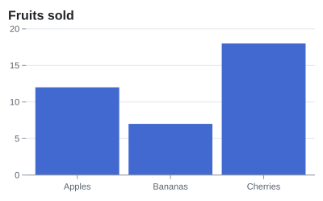

`Meziantou.Framework.Imaging.Charts` draws the charts with [Meziantou.Framework.Imaging](../Imaging/01-Introduction.md):
as images in any format the library writes, or as vector shapes on an existing image.

<InstallNuGetPackage Id="Meziantou.Framework.Imaging.Charts" />

The types are in the [Meziantou.Framework.Imaging.Charts](cref:Meziantou.Framework.Imaging.Charts) namespace, and the
options and the fonts in [Meziantou.Framework.Imaging.VectorGraphics](cref:Meziantou.Framework.Imaging.VectorGraphics),
which draws the scenes of charts and diagrams (see [Vector graphics](../VectorGraphics/03-ImageRendering.md)). The
examples also use the [Meziantou.Framework.Charts](cref:Meziantou.Framework.Charts),
[Meziantou.Framework.Imaging](cref:Meziantou.Framework.Imaging) and
[Meziantou.Framework.Imaging.Formats](cref:Meziantou.Framework.Imaging.Formats) namespaces.

## Render a chart as an image

[ToImage](cref:Meziantou.Framework.Imaging.Charts.ChartImageRenderer.ToImage) renders a plot as an image of its size.
[Scale](cref:Meziantou.Framework.Imaging.VectorGraphics.SceneImageOptions.Scale) multiplies the pixels, for high-density screens:

<!-- ref:../../tests/Meziantou.Framework.Imaging.Charts.Tests/ChartImageRendererTests.cs;region=ImagingCharts_ToImage;format=md-fenced-code-block;dedent=true -->
```csharp
Fruit[] fruits = [new("Apples", 12), new("Bananas", 7), new("Cherries", 18)];
var plot = new Plot { Title = "Fruits sold", Width = 400, Height = 250 };
plot.Add(new BarMark<Fruit>(fruits, x: fruit => fruit.Name, y: fruit => fruit.Count));

using var image = plot.ToImage();
Assert.Equal((400, 250), (image.Width, image.Height));

// Save to a file (image.Save("fruits.png")) or to a stream, in any format
using var png = new MemoryStream();
image.Save(png, new PngEncoder());

// Twice the pixels, for high-density screens
using var retina = plot.ToImage(new SceneImageOptions { Scale = 2 });
Assert.Equal((800, 500), (retina.Width, retina.Height));
```
<!-- endref -->



The image renderer and the SVG renderer draw the same layout
([Scene](cref:Meziantou.Framework.VectorGraphics.Scene)), so an image looks like the SVG of the same plot.

## Draw a chart on a canvas

[DrawChart](cref:Meziantou.Framework.Imaging.Charts.ChartImageRenderer.DrawChart) draws a plot on a canvas at a position:
the transform, the clip and the layers of the canvas apply.
[MeasureChart](cref:Meziantou.Framework.Imaging.Charts.ChartImageRenderer.MeasureChart) gives its size first:

<!-- ref:../../tests/Meziantou.Framework.Imaging.Charts.Tests/ChartImageRendererTests.cs;region=ImagingCharts_DrawChart;format=md-fenced-code-block;dedent=true -->
```csharp
using var report = new Image<Rgba32>(500, 300, Colors.White); // or Image.Load<Rgba32>("report.png")
var plot = new Plot { Width = 300, Height = 200, Theme = ChartTheme.Light with { Background = null } };
plot.Add(new ArcMark<Fruit>([new("Apples", 12), new("Bananas", 7)], value: fruit => fruit.Count) { Fill = fruit => fruit.Name });

var size = ChartImageRenderer.MeasureChart(plot);
Assert.Equal((300, 200), (size.Width, size.Height));

// Drawn as vector shapes and text: the transform and the clip of the canvas apply
report.Draw(canvas => canvas.DrawChart(plot, new PointD(180, 80)));
```
<!-- endref -->

## Fonts

The plot is laid out with the font that draws it, so the margins, the rotated labels and the truncated labels fit. The
package embeds Liberation Sans ([SceneFonts](cref:Meziantou.Framework.Imaging.VectorGraphics.SceneFonts)), subset to the Latin
characters. Its widths are those of Helvetica and Arial, the widths the SVG renderer uses by default; their kerning
differs a little, so a text can be slightly narrower or wider in an image than in an SVG.

For other scripts, pass a font that has them in [SceneImageOptions.Font](cref:Meziantou.Framework.Imaging.VectorGraphics.SceneImageOptions.Font),
for instance a font installed on the machine, from `SystemFontCollection`.
[BoldFont](cref:Meziantou.Framework.Imaging.VectorGraphics.SceneImageOptions.BoldFont) sets the font of the bold texts,
[ItalicFont](cref:Meziantou.Framework.Imaging.VectorGraphics.SceneImageOptions.ItalicFont) and
[BoldItalicFont](cref:Meziantou.Framework.Imaging.VectorGraphics.SceneImageOptions.BoldItalicFont) the ones of the italic texts.
