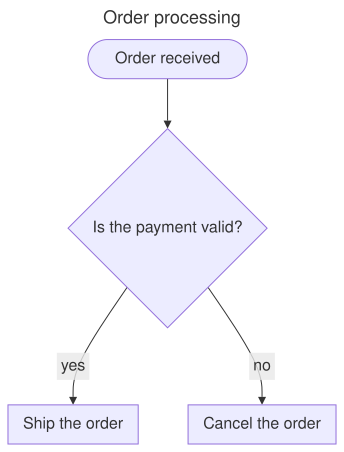

`Meziantou.Framework.Diagrams` draws diagrams as SVG: you describe the nodes and the edges, and the library lays them
out and draws them. `Meziantou.Framework.Mermaid` reads the text format of [Mermaid](https://mermaid.js.org)
into these diagrams, and writes them back as Mermaid text.

The diagrams follow Mermaid: the same shapes, the same kinds of edges, the same themes and the same layout algorithm
(the layered layout of dagre), so a Mermaid diagram looks familiar. The output is not identical to Mermaid's: the
library measures and draws its own texts, and does not run a browser.

## What you can do with it

- **Draw diagrams** in C#: flowcharts with 53 shapes of nodes, swimlanes, class, state, entity relationship,
  requirement, use case, C4, block, architecture and sequence diagrams, Gantt charts, timelines, git graphs, kanban
  boards, packet diagrams, user journeys, event models, railroad diagrams, mind maps, tree views, Ishikawa diagrams,
  treemaps, pie charts, XY charts, quadrant charts, sankey diagrams, radar charts, Venn diagrams, Wardley maps and
  Cynefin diagrams. See [diagram types](04-DiagramTypes/01-Overview.md).
- **Read Mermaid text**, with its front matter, its directives and its themes, and **write diagrams as Mermaid**, for
  instance to embed them in a Markdown page of GitHub. See [Mermaid](../Mermaid/01-Introduction.md).
- **Theme the diagrams** with the themes of Mermaid, or your own colors. See [themes](05-Theming.md).
- **Render images**: PNG, WebP, JPEG, or drawing on an existing image. See [image rendering](06-ImageRendering.md).

The output is deterministic: the same diagram gives the same SVG on every machine, so you can compare diagrams in
snapshot tests. The texts are measured with the metrics of Helvetica that the library embeds, so no font has to be
installed.

## Namespaces

The diagrams are in the [Meziantou.Framework.Diagrams](cref:Meziantou.Framework.Diagrams) namespace, and the Mermaid
reader and writer in [Meziantou.Framework.Mermaid](cref:Meziantou.Framework.Mermaid).

## Next steps

- [Getting started](02-GettingStarted.md): install the package and draw a first flowchart.
- [Diagram types](04-DiagramTypes/01-Overview.md): the diagrams the library draws.
