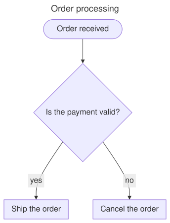

## Install the package

Add the `Meziantou.Framework.Diagrams` package to a project:

<InstallNuGetPackage Id="Meziantou.Framework.Diagrams" />

The types are in the [Meziantou.Framework.Diagrams](cref:Meziantou.Framework.Diagrams) namespace.

## Draw a flowchart

Create a [FlowchartDiagram](cref:Meziantou.Framework.Diagrams.FlowchartDiagram), add nodes and edges, and write the SVG:

<!-- ref:../../tests/Meziantou.Framework.Diagrams.Tests/FlowchartTests.cs;region=Diagrams_Flowchart;format=md-fenced-code-block;dedent=true -->
```csharp
var flowchart = new FlowchartDiagram { Title = "Order processing" };
var start = flowchart.AddNode("start", "Order received", FlowchartNodeShape.Stadium);
var check = flowchart.AddNode("check", "Is the payment valid?", FlowchartNodeShape.Diamond);
var ship = flowchart.AddNode("ship", "Ship the order");
var cancel = flowchart.AddNode("cancel", "Cancel the order");

flowchart.AddEdge(start, check);
flowchart.AddEdge(check, ship, "yes");
flowchart.AddEdge(check, cancel, "no");

var svg = flowchart.ToSvg();
```
<!-- endref -->



The layout places the nodes in ranks, in the [Direction](cref:Meziantou.Framework.Diagrams.FlowchartDiagram.Direction)
of the flow, and routes the edges between them. [WriteSvg](cref:Meziantou.Framework.Diagrams.Diagram.WriteSvg) writes
the SVG to a stream or a writer, and [CreateScene](cref:Meziantou.Framework.Diagrams.Diagram.CreateScene) returns the
layout as drawing primitives (see [vector graphics](../VectorGraphics/01-Introduction.md)).

## From Mermaid text

To draw a diagram written in Mermaid, add the `Meziantou.Framework.Mermaid` package and parse the text:

<InstallNuGetPackage Id="Meziantou.Framework.Mermaid" />

<!-- ref:../../tests/Meziantou.Framework.Mermaid.Tests/MermaidDocumentTests.cs;region=Mermaid_Parse;format=md-fenced-code-block;dedent=true -->
```csharp
var text = """
    ---
    title: Order processing
    config:
      theme: forest
    ---
    flowchart LR
        start([Order received]) --> check{Payment valid?}
        check -->|yes| ship[Ship the order]
        check -->|no| cancel[Cancel the order]
    """;

var document = MermaidDocument.Parse(text);
var flowchart = (FlowchartDiagram)document.Diagram;
var svg = flowchart.ToSvg();
```
<!-- endref -->

See [Mermaid](../Mermaid/01-Introduction.md) for the supported syntax.
