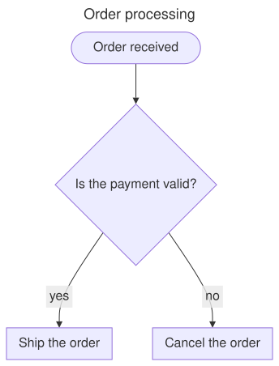
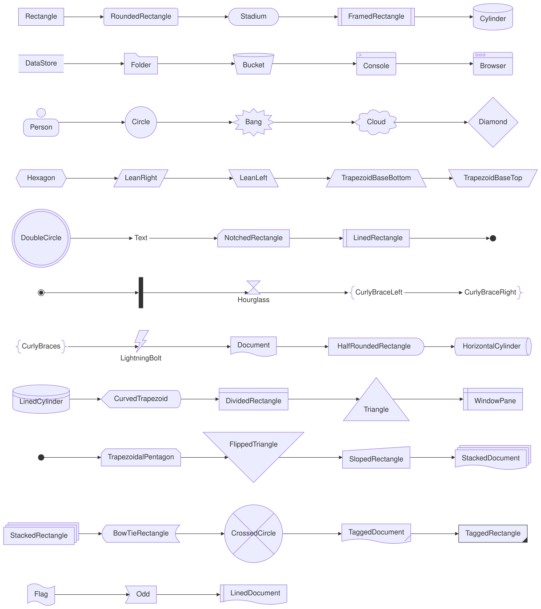
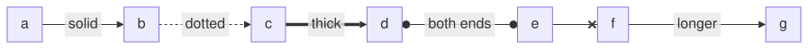
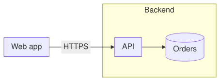
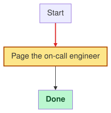

A [FlowchartDiagram](cref:Meziantou.Framework.Diagrams.FlowchartDiagram) is made of nodes linked by edges, laid out in
ranks in the direction of the flow (Mermaid `flowchart`).

<!-- ref:../../../tests/Meziantou.Framework.Diagrams.Tests/FlowchartTests.cs;region=Diagrams_Flowchart;format=md-fenced-code-block;dedent=true -->
```csharp
var flowchart = new FlowchartDiagram { Title = "Order processing" };
var start = flowchart.AddNode("start", "Order received", FlowchartNodeShape.Stadium);
var check = flowchart.AddNode("check", "Is the payment valid?", FlowchartNodeShape.Diamond);
var ship = flowchart.AddNode("ship", "Ship the order");
var cancel = flowchart.AddNode("cancel", "Cancel the order");

flowchart.AddEdge(start, check);
flowchart.AddEdge(check, ship, "yes");
flowchart.AddEdge(check, cancel, "no");

var svg = flowchart.ToSvg();
```
<!-- endref -->



## Nodes

A [FlowchartNode](cref:Meziantou.Framework.Diagrams.FlowchartNode) has an identifier, a
[Label](cref:Meziantou.Framework.Diagrams.FlowchartElement.Label) (its identifier when there is none) and a
[Shape](cref:Meziantou.Framework.Diagrams.FlowchartNode.Shape): the 53 shapes of Mermaid, from
[Rectangle](cref:Meziantou.Framework.Diagrams.FlowchartNodeShape.Rectangle) to the shapes of the flowcharts of processes
(documents, databases, decisions, manual inputs...).



A label is a [DiagramText](cref:Meziantou.Framework.Diagrams.DiagramText): plain text, where a line feed starts a new line,
or markdown with bold and italic parts ([DiagramText.Markdown](cref:Meziantou.Framework.Diagrams.DiagramText.Markdown)).
The labels wrap at [WrappingWidth](cref:Meziantou.Framework.Diagrams.FlowchartDiagram.WrappingWidth), 200 pixels by default.

## Edges

A [FlowchartEdge](cref:Meziantou.Framework.Diagrams.FlowchartEdge) goes from a node or a subgraph to another. Its
[LineStyle](cref:Meziantou.Framework.Diagrams.FlowchartEdge.LineStyle) is solid, dotted, thick or invisible; its ends
have an arrow, a circle, a cross or nothing; and its [Length](cref:Meziantou.Framework.Diagrams.FlowchartEdge.Length)
makes it span more ranks:

<!-- ref:../../../tests/Meziantou.Framework.Diagrams.Tests/FlowchartTests.cs;region=Diagrams_FlowchartEdges;format=md-fenced-code-block;dedent=true -->
```csharp
var flowchart = new FlowchartDiagram { Direction = DiagramDirection.LeftToRight };
flowchart.AddEdge("a", "b", "solid");
flowchart.AddEdge("b", "c", "dotted").LineStyle = FlowchartLineStyle.Dotted;
flowchart.AddEdge("c", "d", "thick").LineStyle = FlowchartLineStyle.Thick;

var both = flowchart.AddEdge("d", "e", "both ends");
both.StartArrowHead = FlowchartArrowHead.Circle;
both.EndArrowHead = FlowchartArrowHead.Circle;

flowchart.AddEdge("e", "f").EndArrowHead = FlowchartArrowHead.Cross;
flowchart.AddEdge("f", "g", "longer").Length = 2;
```
<!-- endref -->



[Curve](cref:Meziantou.Framework.Diagrams.FlowchartDiagram.Curve) sets how the edges go through the points of the
layout: a smooth B-spline by default, or straight segments, steps, and the other curves of Mermaid.

## Subgraphs

A [FlowchartSubgraph](cref:Meziantou.Framework.Diagrams.FlowchartSubgraph) groups nodes in a frame with a title. Edges can
link a subgraph itself:

<!-- ref:../../../tests/Meziantou.Framework.Diagrams.Tests/FlowchartTests.cs;region=Diagrams_FlowchartSubgraphs;format=md-fenced-code-block;dedent=true -->
```csharp
var flowchart = new FlowchartDiagram { Direction = DiagramDirection.LeftToRight };
var backend = flowchart.AddSubgraph("backend", "Backend");
var api = new FlowchartNode("api", "API");
var database = new FlowchartNode("db", "Orders", FlowchartNodeShape.Cylinder);
backend.Nodes.Add(api);
backend.Nodes.Add(database);

var client = flowchart.AddNode("client", "Web app");
flowchart.AddEdge(client, api, "HTTPS");
flowchart.AddEdge(api, database);
```
<!-- endref -->



A subgraph can have its own [Direction](cref:Meziantou.Framework.Diagrams.FlowchartSubgraph.Direction). As in Mermaid, it
applies only when no edge links a node of the subgraph to a node outside of it: the subgraph is then laid out on its own.

## Styles and classes

A [DiagramStyle](cref:Meziantou.Framework.Diagrams.DiagramStyle) changes the fill, the outline, the text and the opacity
of a node, a subgraph or an edge. Define named styles in
[ClassDefinitions](cref:Meziantou.Framework.Diagrams.FlowchartDiagram.ClassDefinitions) and add their names to the
[CssClasses](cref:Meziantou.Framework.Diagrams.FlowchartElement.CssClasses) of the elements; the class `default`
applies to every node. The style of an element takes precedence over the styles of its classes:

<!-- ref:../../../tests/Meziantou.Framework.Diagrams.Tests/FlowchartTests.cs;region=Diagrams_FlowchartStyles;format=md-fenced-code-block;dedent=true -->
```csharp
var flowchart = new FlowchartDiagram();
flowchart.ClassDefinitions["important"] = new DiagramStyle { Fill = (SceneColor)"#fde68a", Stroke = (SceneColor)"#b45309", StrokeWidth = 2 };

var start = flowchart.AddNode("start", "Start");
var alert = flowchart.AddNode("alert", "Page the on-call engineer");
alert.CssClasses.Add("important");
var done = flowchart.AddNode("done", "Done");
done.Style = new DiagramStyle { Fill = (SceneColor)"#bbf7d0", TextColor = (SceneColor)"#14532d", Bold = true };

flowchart.AddEdge(start, alert).Style = new DiagramStyle { Stroke = (SceneColor)"#dc2626", StrokeWidth = 2 };
flowchart.AddEdge(alert, done);
```
<!-- endref -->



The classes are also CSS classes of the SVG, and every node has a `data-id` attribute with its identifier, for the
styles and the scripts of a web page. A node or a subgraph links to an address with
[Link](cref:Meziantou.Framework.Diagrams.FlowchartElement.Link), and shows a
[Tooltip](cref:Meziantou.Framework.Diagrams.FlowchartElement.Tooltip) when hovered.

## Mermaid syntax

The parser reads the whole syntax of the flowcharts of Mermaid: the shapes (`A[text]`, `A{text}`, `A@{ shape: cyl }`...),
the edges (`-->`, `---`, `-.->`, `==>`, `~~~`, `<-->`, `--o`, `--x`, with more dashes for longer edges, and a text
`-- text -->` or `-->|text|`), chains (`A & B --> C`), subgraphs and their `direction`, `classDef`, `class`, `:::class`,
`style`, `linkStyle` (with `interpolate`), `click` with `href`, and the identifiers and the data of the edges
(`e1@-->`, `e1@{ curve: linear }`). The labels decode the entity codes (`#quot;`), `<br>` and the markdown strings.
