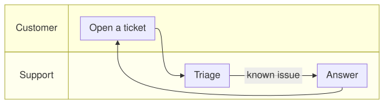

A swimlane diagram is a [flowchart](02-Flowcharts.md) whose top-level subgraphs are lanes: bands across the diagram,
in their order, that hold the steps of an actor, a team or a system (Mermaid `swimlane-beta`). Set
[Swimlanes](cref:Meziantou.Framework.Diagrams.FlowchartDiagram.Swimlanes) on a flowchart:

<!-- ref:../../../tests/Meziantou.Framework.Diagrams.Tests/FlowchartTests.cs;region=Diagrams_Swimlanes;format=md-fenced-code-block;dedent=true -->
```csharp
var flowchart = new FlowchartDiagram { Direction = DiagramDirection.LeftToRight, Swimlanes = true };
var customer = flowchart.AddSubgraph("customer", "Customer");
var support = flowchart.AddSubgraph("support", "Support");
var request = new FlowchartNode("request", "Open a ticket");
var triage = new FlowchartNode("triage", "Triage");
var answer = new FlowchartNode("answer", "Answer");
customer.Nodes.Add(request);
support.Nodes.Add(triage);
support.Nodes.Add(answer);

flowchart.AddEdge(request, triage);
flowchart.AddEdge(triage, answer, "known issue");
flowchart.AddEdge(answer, request);
```
<!-- endref -->



The lanes follow the flow: from left to right, they are rows with their title on the left; from top to bottom, they are
columns with their title on top. The steps keep their order along the flow, and the edges turn halfway between their
ends to go from a lane to another. A subgraph nested in a lane is a box in the lane, and its nodes belong to the lane.

In Mermaid, write `swimlane-beta` instead of `flowchart`; the rest is the syntax of the flowcharts.
