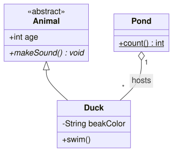
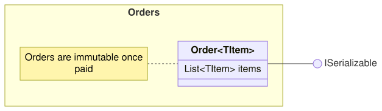

A [ClassDiagram](cref:Meziantou.Framework.Diagrams.ClassDiagram) draws classes linked by relations (Mermaid `classDiagram`):

<!-- ref:../../../tests/Meziantou.Framework.Diagrams.Tests/ClassDiagramTests.cs;region=Diagrams_ClassDiagram;format=md-fenced-code-block;dedent=true -->
```csharp
var diagram = new ClassDiagram();
var animal = diagram.AddClass("Animal");
animal.Annotations.Add("abstract");
animal.AddMember("int age", ClassMemberVisibility.Public);
animal.AddMember("makeSound() void", ClassMemberVisibility.Public).IsAbstract = true;

var duck = diagram.AddClass("Duck");
duck.AddMember("String beakColor", ClassMemberVisibility.Private);
duck.AddMember("swim()", ClassMemberVisibility.Public);

var pond = diagram.AddClass("Pond");
pond.AddMember("count() int", ClassMemberVisibility.Public).IsStatic = true;

// Duck inherits from Animal; a Pond is made of Ducks
diagram.AddRelation(animal, duck, fromEnd: ClassRelationEnd.Inheritance);
var relation = diagram.AddRelation(pond, duck, fromEnd: ClassRelationEnd.Aggregation, label: "hosts");
relation.FromCardinality = "1";
relation.ToCardinality = "*";
```
<!-- endref -->



## Classes

A [ClassDiagramClass](cref:Meziantou.Framework.Diagrams.ClassDiagramClass) is a box of three compartments: its
[Annotations](cref:Meziantou.Framework.Diagrams.ClassDiagramClass.Annotations) (`«interface»`) and its name, its
attributes, and its methods. A [ClassMember](cref:Meziantou.Framework.Diagrams.ClassMember) whose text has parentheses
is a method; its [Visibility](cref:Meziantou.Framework.Diagrams.ClassMember.Visibility) is shown with the characters of
UML (`+`, `-`, `#`, `~`), a static member is underlined and an abstract one is in italic. The generic types are written
`List~int~`, as in Mermaid, and shown `List<int>`; [GenericType](cref:Meziantou.Framework.Diagrams.ClassDiagramClass.GenericType)
is the generic parameter of the class. [HideEmptyMembersBox](cref:Meziantou.Framework.Diagrams.ClassDiagram.HideEmptyMembersBox)
hides the empty compartments.

## Relations

A [ClassRelation](cref:Meziantou.Framework.Diagrams.ClassRelation) has a decoration at each end: an
[Inheritance](cref:Meziantou.Framework.Diagrams.ClassRelationEnd.Inheritance) triangle, a
[Composition](cref:Meziantou.Framework.Diagrams.ClassRelationEnd.Composition) or an
[Aggregation](cref:Meziantou.Framework.Diagrams.ClassRelationEnd.Aggregation) diamond, an
[Arrow](cref:Meziantou.Framework.Diagrams.ClassRelationEnd.Arrow); a dashed line ([IsDashed](cref:Meziantou.Framework.Diagrams.ClassRelation.IsDashed))
makes a dependency or a realization. The multiplicities are drawn next to the ends, and the label in the middle.

| Mermaid | Relation |
| --- | --- |
| `A <\|-- B` | B inherits from A |
| `A *-- B` | A is composed of B |
| `A o-- B` | A aggregates B |
| `A --> B` | A is associated with B |
| `A ..> B` | A depends on B |
| `A ..\|> B` | A realizes B |
| `A -- B`, `A .. B` | A link |

## Namespaces, interfaces and notes

A [ClassDiagramNamespace](cref:Meziantou.Framework.Diagrams.ClassDiagramNamespace) groups classes in a frame, and can
nest. A [ClassDiagramInterface](cref:Meziantou.Framework.Diagrams.ClassDiagramInterface) is drawn as a lollipop: a small
circle linked to the classes that provide it (Mermaid `bar ()-- Foo`). A [ClassDiagramNote](cref:Meziantou.Framework.Diagrams.ClassDiagramNote)
is alone or attached to a class:

<!-- ref:../../../tests/Meziantou.Framework.Diagrams.Tests/ClassDiagramTests.cs;region=Diagrams_ClassDiagramNamespaces;format=md-fenced-code-block;dedent=true -->
```csharp
var diagram = new ClassDiagram { Direction = DiagramDirection.LeftToRight };
var orders = diagram.AddNamespace("Orders");
var order = new ClassDiagramClass("Order") { GenericType = "TItem" };
order.AddMember("List~TItem~ items");
orders.Classes.Add(order);

var serializable = new ClassDiagramInterface("ISerializable");
diagram.Interfaces.Add(serializable);
diagram.AddRelation(order, serializable, toEnd: ClassRelationEnd.Lollipop);
diagram.AddNote("Orders are immutable once paid", order);
```
<!-- endref -->



In Mermaid, the dotted names of the namespaces nest them (`Company.Engineering` is in `Company`), unless the
configuration sets `class.hierarchicalNamespaces` to `false`.

## Mermaid syntax

The parser reads the classes (`class Name`, `class Name~T~["label"]`, ``class `Name with spaces` ``, with their members
between braces or as `Name : +member`), the annotations (`<<interface>> Name`), the relations with their
multiplicities and labels (`A "1" --> "*" B : label`), the lollipops, the namespaces, the notes (`note "text"`,
`note for Name "text"`), `direction`, `classDef`, `cssClass`, `:::class`, `style`, and the links of `click` and `link`.
