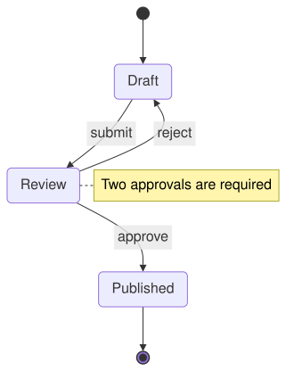
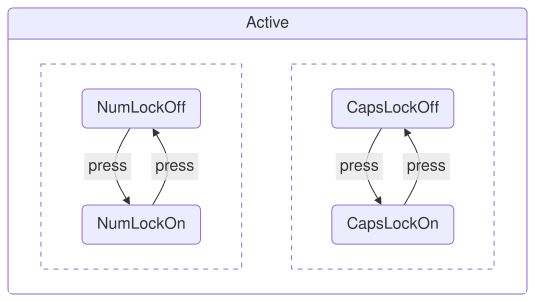

A [StateDiagram](cref:Meziantou.Framework.Diagrams.StateDiagram) draws states linked by transitions (Mermaid `stateDiagram-v2`):

<!-- ref:../../../tests/Meziantou.Framework.Diagrams.Tests/StateDiagramTests.cs;region=Diagrams_StateDiagram;format=md-fenced-code-block;dedent=true -->
```csharp
var diagram = new StateDiagram();
var start = diagram.AddState("start", kind: StateKind.Start);
var draft = diagram.AddState("Draft");
var review = diagram.AddState("Review");
var published = diagram.AddState("Published");
var end = diagram.AddState("end", kind: StateKind.End);

diagram.AddTransition(start, draft);
diagram.AddTransition(draft, review, "submit");
diagram.AddTransition(review, draft, "reject");
diagram.AddTransition(review, published, "approve");
diagram.AddTransition(published, end);
diagram.AddNote(review, "Two approvals are required");
```
<!-- endref -->



## States

The [Kind](cref:Meziantou.Framework.Diagrams.StateDiagramState.Kind) of a [StateDiagramState](cref:Meziantou.Framework.Diagrams.StateDiagramState)
sets its shape: a rounded rectangle, a start (a filled circle) or an end (a filled circle in a ring), a choice (a small
diamond), a fork or a join (a bar across the flow). A [StateNote](cref:Meziantou.Framework.Diagrams.StateNote) is drawn
on the left or the right of its state.

## Composite states

A state with [Regions](cref:Meziantou.Framework.Diagrams.StateDiagramState.Regions) is a composite state: a frame with
its name, around its states. [AddState](cref:Meziantou.Framework.Diagrams.StateDiagramState.AddState) adds a state to its
last region. Several regions are concurrent parts, drawn side by side in dashed frames:

<!-- ref:../../../tests/Meziantou.Framework.Diagrams.Tests/StateDiagramTests.cs;region=Diagrams_StateDiagramComposite;format=md-fenced-code-block;dedent=true -->
```csharp
var diagram = new StateDiagram();
var active = diagram.AddState("Active");

// A composite state with two concurrent regions
var numLockOff = active.AddState("NumLockOff");
var numLockOn = active.AddState("NumLockOn");
active.Regions.Add(new StateDiagramRegion());
var capsLockOff = active.AddState("CapsLockOff");
var capsLockOn = active.AddState("CapsLockOn");

diagram.AddTransition(numLockOff, numLockOn, "press");
diagram.AddTransition(numLockOn, numLockOff, "press");
diagram.AddTransition(capsLockOff, capsLockOn, "press");
diagram.AddTransition(capsLockOn, capsLockOff, "press");
```
<!-- endref -->



A composite state can have its own [Direction](cref:Meziantou.Framework.Diagrams.StateDiagramState.Direction), which
applies when no transition crosses its border, as for the subgraphs of a flowchart.

## Mermaid syntax

<!-- ref:../../../tests/Meziantou.Framework.Mermaid.Tests/StateDiagramParserTests.cs;region=Mermaid_StateDiagram;format=md-fenced-code-block;dedent=true -->
```csharp
var diagram = (StateDiagram)MermaidDocument.Parse("""
    stateDiagram-v2
        [*] --> Still
        Still --> Moving : push
        Moving --> Still
        Moving --> Crash
        Crash --> [*]
    """).Diagram;
```
<!-- endref -->

`[*]` is the start state of the region when a transition leaves it, and its end state when a transition enters it; each
region of a composite state has its own. The parser also reads the descriptions (`state "Description" as id`,
`id : description`), the kinds (`state id <<choice>>`, `<<fork>>`, `<<join>>`), the composite states
(`state id { ... }`, with `--` between concurrent regions), the notes (`note right of id : text`, or on several lines
up to `end note`), `direction`, `classDef`, `class`, `:::class` and `style`.
