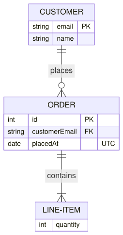
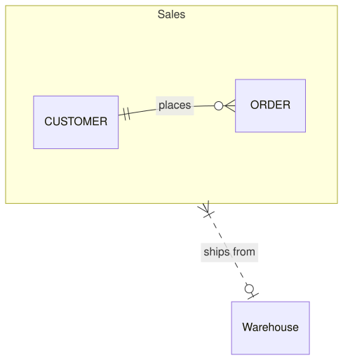

An [ErDiagram](cref:Meziantou.Framework.Diagrams.ErDiagram) draws entities linked by relationships (Mermaid `erDiagram`):

<!-- ref:../../../tests/Meziantou.Framework.Diagrams.Tests/ErDiagramTests.cs;region=Diagrams_ErDiagram;format=md-fenced-code-block;dedent=true -->
```csharp
var diagram = new ErDiagram();
var customer = diagram.AddEntity("CUSTOMER");
customer.AddAttribute("string", "email", ErAttributeKeys.PrimaryKey);
customer.AddAttribute("string", "name");

var order = diagram.AddEntity("ORDER");
order.AddAttribute("int", "id", ErAttributeKeys.PrimaryKey);
order.AddAttribute("string", "customerEmail", ErAttributeKeys.ForeignKey);
order.AddAttribute("date", "placedAt", comment: "UTC");

var lineItem = diagram.AddEntity("LINE-ITEM");
lineItem.AddAttribute("int", "quantity");

diagram.AddRelationship(customer, order, ErCardinality.ExactlyOne, ErCardinality.ZeroOrMore, "places");
diagram.AddRelationship(order, lineItem, ErCardinality.ExactlyOne, ErCardinality.OneOrMore, "contains");
```
<!-- endref -->



## Entities and attributes

An [ErEntity](cref:Meziantou.Framework.Diagrams.ErEntity) is a box with its name, or its
[Label](cref:Meziantou.Framework.Diagrams.ErElement.Label) (a Mermaid alias), above the table of its
[Attributes](cref:Meziantou.Framework.Diagrams.ErEntity.Attributes). An [ErAttribute](cref:Meziantou.Framework.Diagrams.ErAttribute)
is a row with its type, its name, its [Keys](cref:Meziantou.Framework.Diagrams.ErAttribute.Keys) (`PK`, `FK`, `UK`) and
its comment. A type ending with `?` is optional, and the generic types are written `List~int~`, as in Mermaid, and shown
`List<int>`.

## Relationships

The ends of an [ErRelationship](cref:Meziantou.Framework.Diagrams.ErRelationship) show how many instances of each entity
take part, in crow's foot notation. [FromCardinality](cref:Meziantou.Framework.Diagrams.ErRelationship.FromCardinality)
is drawn at the first entity, and [ToCardinality](cref:Meziantou.Framework.Diagrams.ErRelationship.ToCardinality) at the
second one:

| Cardinality | Left | Right | Aliases |
| --- | --- | --- | --- |
| [ExactlyOne](cref:Meziantou.Framework.Diagrams.ErCardinality.ExactlyOne) | `\|\|` | `\|\|` | `one`, `only one`, `1` |
| [ZeroOrOne](cref:Meziantou.Framework.Diagrams.ErCardinality.ZeroOrOne) | `\|o` | `o\|` | `zero or one`, `one or zero` |
| [OneOrMore](cref:Meziantou.Framework.Diagrams.ErCardinality.OneOrMore) | `}\|` | `\|{` | `one or more`, `one or many`, `many(1)`, `1+` |
| [ZeroOrMore](cref:Meziantou.Framework.Diagrams.ErCardinality.ZeroOrMore) | `}o` | `o{` | `zero or more`, `zero or many`, `many(0)`, `many`, `0+` |

A relationship is identifying by default: a solid line, written `--` (or `to`). A non-identifying relationship
([IsIdentifying](cref:Meziantou.Framework.Diagrams.ErRelationship.IsIdentifying) set to `false`) is dashed, written `..`
(or `optionally to`). The label reads from the first entity: `CUSTOMER ||--o{ ORDER : places`.

## Subgraphs

An [ErSubgraph](cref:Meziantou.Framework.Diagrams.ErSubgraph) groups entities in a frame, can nest, and can have its own
[Direction](cref:Meziantou.Framework.Diagrams.ErSubgraph.Direction). A relationship can link a subgraph:

<!-- ref:../../../tests/Meziantou.Framework.Diagrams.Tests/ErDiagramTests.cs;region=Diagrams_ErDiagramSubgraphs;format=md-fenced-code-block;dedent=true -->
```csharp
var diagram = new ErDiagram { Direction = DiagramDirection.LeftToRight };
var sales = diagram.AddSubgraph("sales", "Sales");
var customer = diagram.AddEntity("CUSTOMER");
var order = diagram.AddEntity("ORDER");
sales.Entities.Add(customer);
sales.Entities.Add(order);

var warehouse = diagram.AddEntity("WAREHOUSE", "Warehouse");
diagram.AddRelationship(customer, order, ErCardinality.ExactlyOne, ErCardinality.ZeroOrMore, "places");

// A relationship can link a subgraph; a non-identifying one is dashed
var relationship = diagram.AddRelationship(sales, warehouse, ErCardinality.OneOrMore, ErCardinality.ZeroOrOne, "ships from");
relationship.IsIdentifying = false;
```
<!-- endref -->



## Mermaid syntax

<!-- ref:../../../tests/Meziantou.Framework.Mermaid.Tests/ErDiagramParserTests.cs;region=Mermaid_ErDiagram;format=md-fenced-code-block;dedent=true -->
```csharp
var diagram = (ErDiagram)MermaidDocument.Parse("""
    erDiagram
        CUSTOMER ||--o{ ORDER : places
        ORDER ||--|{ LINE-ITEM : contains
        CUSTOMER }|..|{ DELIVERY-ADDRESS : uses
        CUSTOMER {
            string email PK
            string name "Full name"
        }
    """).Diagram;
```
<!-- endref -->

The parser reads the entities (`NAME`, `"name with spaces"`, `NAME[alias]`), their attribute blocks, the relationships
with the symbols and the aliases of the cardinalities, `direction`, the subgraphs (`subgraph id [title]` ... `end`),
`classDef`, `class`, `:::class` and `style`. As in Mermaid, an entity belongs to the first subgraph that closes and
mentions it, and a relationship names a subgraph when the subgraph is closed before it.
