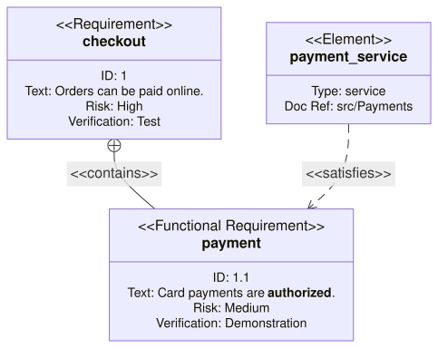

A [RequirementDiagram](cref:Meziantou.Framework.Diagrams.RequirementDiagram) draws requirements and elements linked by
relationships, in the style of SysML (Mermaid `requirementDiagram`):

<!-- ref:../../../tests/Meziantou.Framework.Diagrams.Tests/RequirementDiagramTests.cs;region=Diagrams_RequirementDiagram;format=md-fenced-code-block;dedent=true -->
```csharp
var diagram = new RequirementDiagram();
var checkout = diagram.AddRequirement("checkout");
checkout.RequirementId = "1";
checkout.Text = "Orders can be paid online.";
checkout.Risk = RequirementRisk.High;
checkout.VerificationMethod = RequirementVerificationMethod.Test;

var payment = diagram.AddRequirement("payment", RequirementKind.FunctionalRequirement);
payment.RequirementId = "1.1";
payment.Text = DiagramText.Markdown("Card payments are **authorized**.");
payment.Risk = RequirementRisk.Medium;
payment.VerificationMethod = RequirementVerificationMethod.Demonstration;

var service = diagram.AddElement("payment_service");
service.Type = "service";
service.DocumentReference = "src/Payments";

diagram.AddRelationship(checkout, payment, RequirementRelationshipKind.Contains);
diagram.AddRelationship(service, payment, RequirementRelationshipKind.Satisfies);
```
<!-- endref -->



## Requirements and elements

A [RequirementDiagramRequirement](cref:Meziantou.Framework.Diagrams.RequirementDiagramRequirement) is a box with its
[Kind](cref:Meziantou.Framework.Diagrams.RequirementDiagramRequirement.Kind) (requirement, functional, interface,
performance, physical requirement or design constraint) and its name, above its identifier, its text, its
[Risk](cref:Meziantou.Framework.Diagrams.RequirementDiagramRequirement.Risk) and its
[VerificationMethod](cref:Meziantou.Framework.Diagrams.RequirementDiagramRequirement.VerificationMethod). A
[RequirementDiagramElement](cref:Meziantou.Framework.Diagrams.RequirementDiagramElement) is a part of another document,
with its type and the reference of the document. The texts can be markdown.

## Relationships

A [RequirementRelationship](cref:Meziantou.Framework.Diagrams.RequirementRelationship) shows its kind on the line:
`contains` is a solid line with a circled cross at the source; `copies`, `derives`, `satisfies`, `verifies`, `refines`
and `traces` are dashed arrows from the source to the target.

## Mermaid syntax

<!-- ref:../../../tests/Meziantou.Framework.Diagrams.Mermaid.Tests/RequirementDiagramParserTests.cs;region=Mermaid_RequirementDiagram;format=md-fenced-code-block;dedent=true -->
```csharp
var diagram = (RequirementDiagram)MermaidDocument.Parse("""
    requirementDiagram
        requirement test_req {
            id: 1
            text: the test text.
            risk: high
            verifymethod: test
        }
        element test_entity {
            type: simulation
        }
        test_entity - satisfies -> test_req
    """).Diagram;
```
<!-- endref -->

The parser reads the requirements and the elements with their fields, the relationships in both directions
(`source - satisfies -> target` and `target <- satisfies - source`), `direction`, `classDef`, `class`, `:::class` and
`style`. The keywords ignore the case, a quoted text is markdown, and `#` starts a comment. As in Mermaid, the first
definition of a name wins, and a relationship to a name that is not defined is ignored, with a warning.
