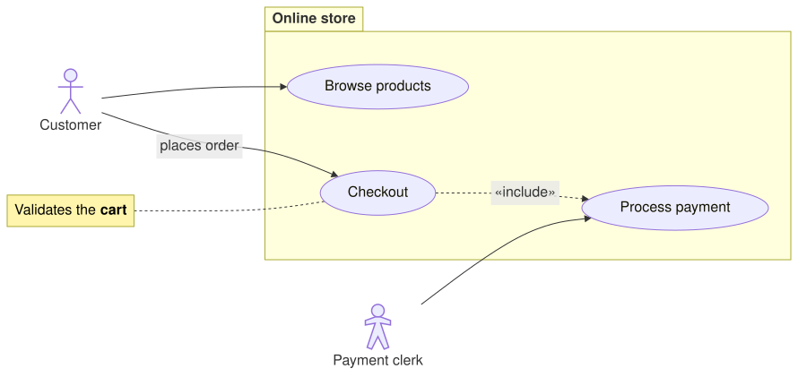

A [UseCaseDiagram](cref:Meziantou.Framework.Diagrams.UseCaseDiagram) draws how actors take part in the use cases of a
system (Mermaid `usecase-beta`):

<!-- ref:../../../tests/Meziantou.Framework.Diagrams.Tests/UseCaseDiagramTests.cs;region=Diagrams_UseCaseDiagram;format=md-fenced-code-block;dedent=true -->
```csharp
var diagram = new UseCaseDiagram();
var customer = diagram.AddActor("customer", "Customer");
var clerk = diagram.AddActor("clerk", "Payment clerk");
clerk.Kind = UseCaseActorKind.Hollow;

var store = diagram.AddBoundary("store", "Online store");
store.Kind = UseCaseBoundaryKind.Package;
var browse = diagram.AddUseCase("browse", "Browse products");
var checkout = diagram.AddUseCase("checkout", "Checkout");
var pay = diagram.AddUseCase("pay", "Process payment");
store.Elements.Add(browse);
store.Elements.Add(checkout);
store.Elements.Add(pay);

diagram.AddRelationship(customer, browse);
diagram.AddRelationship(customer, checkout, label: "places order");
diagram.AddRelationship(checkout, pay, UseCaseRelationshipKind.Include);
diagram.AddRelationship(clerk, pay);
diagram.AddNote(checkout, DiagramText.Markdown("Validates the **cart**"));
```
<!-- endref -->



## Elements

- A [UseCaseActor](cref:Meziantou.Framework.Diagrams.UseCaseActor) is a figure with its name below: a stick figure, an
  outline ([Hollow](cref:Meziantou.Framework.Diagrams.UseCaseActorKind.Hollow)) or a silhouette
  ([Awesome](cref:Meziantou.Framework.Diagrams.UseCaseActorKind.Awesome)).
- A [UseCase](cref:Meziantou.Framework.Diagrams.UseCase) is an ellipse or a rectangle.
- A business actor or use case ([IsBusiness](cref:Meziantou.Framework.Diagrams.UseCase.IsBusiness)) has a slash, and both
  can show a [Stereotype](cref:Meziantou.Framework.Diagrams.UseCase.Stereotype) between guillemets.
- A [UseCaseBoundary](cref:Meziantou.Framework.Diagrams.UseCaseBoundary) frames the actors and the use cases of a system,
  with its title at the top or in the tab of a [Package](cref:Meziantou.Framework.Diagrams.UseCaseBoundaryKind.Package).
- A [UseCaseJsonTable](cref:Meziantou.Framework.Diagrams.UseCaseJsonTable) shows a JSON object as a table, a row per
  value with its path, such as `items[0].name`.
- A [UseCaseNote](cref:Meziantou.Framework.Diagrams.UseCaseNote) is attached to an actor or a use case.

## Relationships

An [Association](cref:Meziantou.Framework.Diagrams.UseCaseRelationshipKind.Association) is a solid line with an
arrowhead, a circle or a cross at one end, and an optional label. An
[Include](cref:Meziantou.Framework.Diagrams.UseCaseRelationshipKind.Include) or an
[Extend](cref:Meziantou.Framework.Diagrams.UseCaseRelationshipKind.Extend) is a dashed arrow between two use cases,
labeled «include» or «extend». A [Generalization](cref:Meziantou.Framework.Diagrams.UseCaseRelationshipKind.Generalization)
links two actors or two use cases with a hollow triangle at the general one.

## Mermaid syntax

<!-- ref:../../../tests/Meziantou.Framework.Diagrams.Mermaid.Tests/UseCaseDiagramParserTests.cs;region=Mermaid_UseCaseDiagram;format=md-fenced-code-block;dedent=true -->
```csharp
var diagram = (UseCaseDiagram)MermaidDocument.Parse("""
    usecase-beta
    direction LR
    actor Customer("Customer")
    systemBoundary "Order system"
      Checkout("Place order")
      Pay[Pay online]
    end
    Customer --> Checkout
    Checkout ..> : include Pay
    """).Diagram;
```
<!-- endref -->

The parser reads the actors (`actor id("label")`), the use cases (`id(label)`, `id[label]`, `"label"`), their metadata
(`@{ type: hollow, business: true }`), their stereotypes (`<<text>>`), the system boundaries, the JSON tables
(`json id@{ ... }`), the notes (`note for id "text"`), the relationships with their labels, their identifiers
(`id@-->`) and their lengths (`--->`), `classDef`, `class`, `:::class` and `style`. Each statement is on its own line.
An element can be used before its declaration, and an element that is only used is an ellipse use case. The icons of
the actors and the animations of the relationships are not supported: they are ignored, with a warning.
