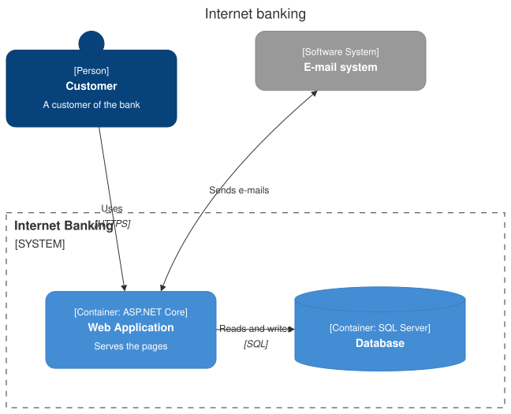

A [C4Diagram](cref:Meziantou.Framework.Diagrams.C4Diagram) draws a software architecture with the C4 model: system
context, container, component, dynamic and deployment diagrams (Mermaid `C4Context`, `C4Container`, `C4Component`,
`C4Dynamic` and `C4Deployment`):

<!-- ref:../../../tests/Meziantou.Framework.Diagrams.Tests/C4DiagramTests.cs;region=Diagrams_C4Diagram;format=md-fenced-code-block;dedent=true -->
```csharp
var diagram = new C4Diagram { Kind = C4DiagramKind.Container, Title = "Internet banking" };
var customer = diagram.AddElement("customer", C4ElementKind.Person, "Customer", "A customer of the bank");
var bank = diagram.AddBoundary("bank", "Internet Banking", C4BoundaryKind.System);
var webApp = new C4Element("web", C4ElementKind.Container, "Web Application") { Technology = "ASP.NET Core", Description = "Serves the pages" };
var database = new C4Element("db", C4ElementKind.Container, "Database") { Shape = C4ElementShape.Database, Technology = "SQL Server" };
bank.Elements.Add(webApp);
bank.Elements.Add(database);
var mail = diagram.AddElement("mail", C4ElementKind.System, "E-mail system");
mail.IsExternal = true;

diagram.AddRelationship(customer, webApp, "Uses", "HTTPS");
diagram.AddRelationship(webApp, database, "Reads and writes", "SQL");
diagram.AddRelationship(webApp, mail, "Sends e-mails").Kind = C4RelationshipKind.Bidirectional;
```
<!-- endref -->



## Layout

As in Mermaid, the C4 diagrams have no automatic layout: the elements of a boundary are placed in rows, in the order they
are declared, [ShapesPerRow](cref:Meziantou.Framework.Diagrams.C4Diagram.ShapesPerRow) per row (4 by default), and its
boundaries follow, [BoundariesPerRow](cref:Meziantou.Framework.Diagrams.C4Diagram.BoundariesPerRow) per row (2 by
default). Reorder the declarations to move the elements. The relationships are lines between the borders of the items;
[LabelOffsetX](cref:Meziantou.Framework.Diagrams.C4Relationship.LabelOffsetX) and
[LabelOffsetY](cref:Meziantou.Framework.Diagrams.C4Relationship.LabelOffsetY) move their text.

## Elements and boundaries

A [C4Element](cref:Meziantou.Framework.Diagrams.C4Element) has a [Kind](cref:Meziantou.Framework.Diagrams.C4Element.Kind)
(person, software system, container, component), shown between brackets with its technology, a name and a description,
in the colors of C4. An [external](cref:Meziantou.Framework.Diagrams.C4Element.IsExternal) element is gray. A system, a
container or a component can be a database or a queue ([Shape](cref:Meziantou.Framework.Diagrams.C4Element.Shape)).

A [C4Boundary](cref:Meziantou.Framework.Diagrams.C4Boundary) frames elements and other boundaries: a dashed frame for a
boundary of an enterprise, a system or a container, a solid frame for a deployment node.
[Style](cref:Meziantou.Framework.Diagrams.C4Item.Style) changes the colors of an item, and of a relationship.

## Mermaid syntax

<!-- ref:../../../tests/Meziantou.Framework.Mermaid.Tests/C4DiagramParserTests.cs;region=Mermaid_C4Diagram;format=md-fenced-code-block;dedent=true -->
```csharp
var diagram = (C4Diagram)MermaidDocument.Parse("""
    C4Container
        title Internet banking
        Person(customer, "Customer", "A customer of the bank")
        System_Boundary(bank, "Internet Banking") {
            Container(web, "Web Application", "ASP.NET Core", "Serves the pages")
            ContainerDb(db, "Database", "SQL Server")
        }
        System_Ext(mail, "E-mail system")
        Rel(customer, web, "Uses", "HTTPS")
        Rel(web, db, "Reads and writes")
        BiRel(web, mail, "Sends e-mails")
    """).Content;
```
<!-- endref -->

The parser reads the statements of C4-PlantUML that Mermaid supports: the elements (`Person`, `System`, `SystemDb`,
`SystemQueue`, `Container...`, `Component...` and their `_Ext` variants), the boundaries (`Boundary`,
`Enterprise_Boundary`, `System_Boundary`, `Container_Boundary`, `Deployment_Node`, `Node`, `Node_L`, `Node_R`), the
relationships (`Rel`, `BiRel`, `Rel_U`, `Rel_D`, `Rel_L`, `Rel_R`, `Rel_Back`, `RelIndex`), `UpdateElementStyle`,
`UpdateRelStyle`, `UpdateLayoutConfig` and `title`. The attributes are positional or named (`$descr="..."`). As in
Mermaid, a second relationship between the same items replaces the first one. The sprites are ignored, with a warning.
