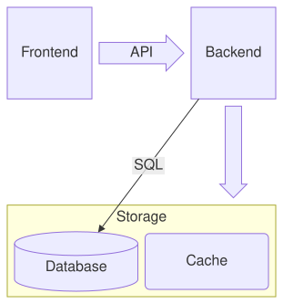

A [BlockDiagram](cref:Meziantou.Framework.Diagrams.BlockDiagram) places blocks on a grid, in the order they are declared,
left to right then top to bottom (Mermaid `block`). Unlike a flowchart, the author decides where each block goes:

<!-- ref:../../../tests/Meziantou.Framework.Diagrams.Tests/BlockDiagramTests.cs;region=Diagrams_BlockDiagram;format=md-fenced-code-block;dedent=true -->
```csharp
var diagram = new BlockDiagram { Columns = 3 };
diagram.AddBlock("frontend", "Frontend");
diagram.Items.Add(new BlockDiagramArrow("toBackend", "API", BlockArrowDirections.Right));
var backend = diagram.AddBlock("backend", "Backend");
diagram.Items.Add(new BlockDiagramSpace { Span = 2 });
diagram.Items.Add(new BlockDiagramArrow("down", " ", BlockArrowDirections.Down));

// A composite block spans 3 columns, with its own grid
var storage = new BlockDiagramComposite("storage", "Storage") { Span = 3, Columns = 2 };
var database = new BlockDiagramBlock("database", "Database") { Shape = FlowchartNodeShape.Cylinder };
var cache = new BlockDiagramBlock("cache", "Cache") { Shape = FlowchartNodeShape.RoundedRectangle };
storage.Items.Add(database);
storage.Items.Add(cache);
diagram.Items.Add(storage);

diagram.AddEdge(backend, database, "SQL");
```
<!-- endref -->



## The grid

[Columns](cref:Meziantou.Framework.Diagrams.BlockDiagram.Columns) sets the number of columns; without it, every item is
on one row. An item takes [Span](cref:Meziantou.Framework.Diagrams.BlockDiagramItem.Span) columns. As in Mermaid, the
items of a group have the same height, and the width of the widest one per column they span.

## Items

- A [BlockDiagramBlock](cref:Meziantou.Framework.Diagrams.BlockDiagramBlock) has the
  [shape](cref:Meziantou.Framework.Diagrams.BlockDiagramBlock.Shape) of a node of a flowchart: rectangle, rounded
  rectangle, stadium, subroutine, cylinder, circle, double circle, diamond, hexagon, parallelograms, trapezoids...
- A [BlockDiagramComposite](cref:Meziantou.Framework.Diagrams.BlockDiagramComposite) frames items placed on its own grid.
- A [BlockDiagramArrow](cref:Meziantou.Framework.Diagrams.BlockDiagramArrow) is a wide arrow with a text, pointing in
  one or more [directions](cref:Meziantou.Framework.Diagrams.BlockArrowDirections).
- A [BlockDiagramSpace](cref:Meziantou.Framework.Diagrams.BlockDiagramSpace) leaves columns empty.

A [BlockDiagramEdge](cref:Meziantou.Framework.Diagrams.BlockDiagramEdge) is a straight line between two blocks, with the
line styles and the arrowheads of the flowcharts.

## Mermaid syntax

<!-- ref:../../../tests/Meziantou.Framework.Mermaid.Tests/BlockDiagramParserTests.cs;region=Mermaid_BlockDiagram;format=md-fenced-code-block;dedent=true -->
```csharp
var diagram = (BlockDiagram)MermaidDocument.Parse("""
    block
      columns 3
      frontend["Frontend"] api<["API"]>(right) backend["Backend"]
      space:2 down<[" "]>(down)
      block:storage:3
        columns 2
        database[("Database")] cache("Cache")
      end
      backend --> database
    """).Content;
```
<!-- endref -->

The statements are separated by white space, so a line can hold several blocks. The parser reads `columns`, the blocks
with their shape and their quoted or markdown text (`id["text"]`), their span (`id:2`), `space` and `space:n`, the
composite blocks (`block:id ... end`, or `block ... end` without identifier), the block arrows
(`id<["text"]>(right, down)`), the edges and their texts (`a -- "text" --> b`), `classDef`, `class` and `style`. A block
takes its place where it is first named.
