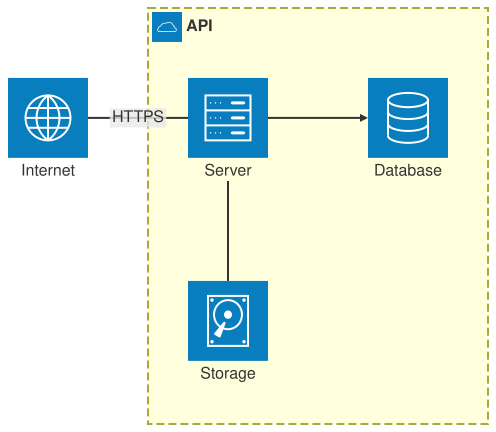

An [ArchitectureDiagram](cref:Meziantou.Framework.Diagrams.ArchitectureDiagram) draws services as icons, grouped in
frames, and the edges between them (Mermaid `architecture-beta`):

<!-- ref:../../../tests/Meziantou.Framework.Diagrams.Tests/ArchitectureDiagramTests.cs;region=Diagrams_ArchitectureDiagram;format=md-fenced-code-block;dedent=true -->
```csharp
var diagram = new ArchitectureDiagram();
var api = diagram.AddGroup("api", "API", icon: "cloud");
var server = new ArchitectureService("server") { Title = "Server", Icon = "server" };
var database = new ArchitectureService("db") { Title = "Database", Icon = "database" };
var disk = new ArchitectureService("disk") { Title = "Storage", Icon = "disk" };
api.Nodes.Add(server);
api.Nodes.Add(database);
api.Nodes.Add(disk);
var internet = diagram.AddService("internet", "Internet", icon: "internet");

// The sides place the services: the database is on the right of the server
diagram.AddEdge(server, ArchitectureSide.Right, database, ArchitectureSide.Left).ToArrow = true;
diagram.AddEdge(disk, ArchitectureSide.Top, server, ArchitectureSide.Bottom);
diagram.AddEdge(internet, ArchitectureSide.Right, server, ArchitectureSide.Left).Label = "HTTPS";
```
<!-- endref -->



## Layout

An [ArchitectureEdge](cref:Meziantou.Framework.Diagrams.ArchitectureEdge) leaves a side of a node and reaches a side of
another one, and these sides place the nodes on a grid: an edge from the right of A to the left of B puts B on the right
of A, an edge from the top of A to the left of B puts B above and on the right of A. The edges are lines with right
angles. An [ArchitectureAlignment](cref:Meziantou.Framework.Diagrams.ArchitectureAlignment) puts nodes on a row or a
column, in order. Mermaid refines the grid with a force-directed layout, so the positions can differ.

## Nodes and groups

- An [ArchitectureService](cref:Meziantou.Framework.Diagrams.ArchitectureService) is an
  [icon](cref:Meziantou.Framework.Diagrams.ArchitectureService.Icon) with a title below: `cloud`, `database`, `disk`,
  `internet` and `server` are built in; another icon, such as one of an icon pack of Mermaid, is a question mark.
- An [ArchitectureJunction](cref:Meziantou.Framework.Diagrams.ArchitectureJunction) is a point where edges meet.
- An [ArchitectureGroup](cref:Meziantou.Framework.Diagrams.ArchitectureGroup) frames services, junctions and groups,
  with an icon and a title. An edge can start or end at the frame of the group of its node
  ([FromGroup](cref:Meziantou.Framework.Diagrams.ArchitectureEdge.FromGroup)).

## Mermaid syntax

<!-- ref:../../../tests/Meziantou.Framework.Mermaid.Tests/ArchitectureDiagramParserTests.cs;region=Mermaid_ArchitectureDiagram;format=md-fenced-code-block;dedent=true -->
```csharp
var diagram = (ArchitectureDiagram)MermaidDocument.Parse("""
    architecture-beta
        group api(cloud)[API]
        service db(database)[Database] in api
        service disk(disk)[Storage] in api
        service server(server)[Server] in api
        db:L -- R:server
        disk:T --> B:server
    """).Diagram;
```
<!-- endref -->

The parser reads the groups (`group id(icon)[title] in parent`), the services (`service id(icon)[title]`, or
`service id "text"` for a text in the square), the junctions, the edges (`a:R --> L:b`, `a:B -[label]- T:b`,
`a{group}:R -- L:b{group}`), `align row` and `align column`, and the `iconSize` and `padding` configuration. As in
Mermaid, an item is declared before it is used.
