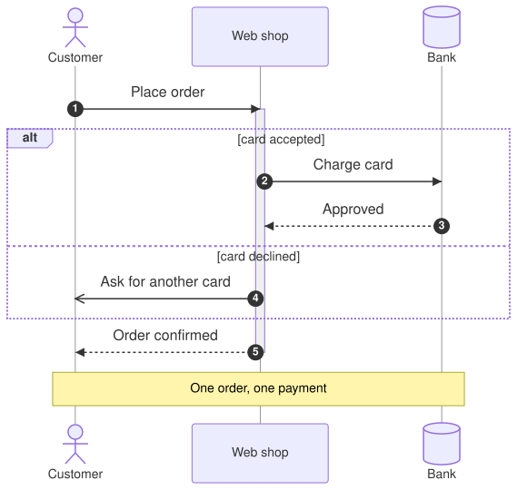

A [SequenceDiagram](cref:Meziantou.Framework.Diagrams.SequenceDiagram) draws participants side by side, with their
lifelines, and the messages they exchange from the top to the bottom (Mermaid `sequenceDiagram`):

<!-- ref:../../../tests/Meziantou.Framework.Diagrams.Tests/SequenceDiagramTests.cs;region=Diagrams_SequenceDiagram;format=md-fenced-code-block;dedent=true -->
```csharp
var diagram = new SequenceDiagram();
var customer = diagram.AddParticipant("customer", "Customer", SequenceParticipantKind.Actor);
var shop = diagram.AddParticipant("shop", "Web shop");
var bank = diagram.AddParticipant("bank", "Bank", SequenceParticipantKind.Database);

diagram.Steps.Add(new SequenceAutonumber());
diagram.AddMessage(customer, shop, "Place order").ActivatesReceiver = true;
var payment = diagram.AddBlock(SequenceBlockKind.Alternative, "card accepted");
payment.Sections[0].Steps.Add(new SequenceMessage(shop, bank) { Text = "Charge card", EndArrowHead = SequenceArrowHead.Arrow });
payment.Sections[0].Steps.Add(new SequenceMessage(bank, shop) { Text = "Approved", LineStyle = SequenceLineStyle.Dotted, EndArrowHead = SequenceArrowHead.Arrow });
var declined = new SequenceBlockSection("card declined");
declined.Steps.Add(new SequenceMessage(shop, customer) { Text = "Ask for another card", EndArrowHead = SequenceArrowHead.OpenArrow });
payment.Sections.Add(declined);
var confirmation = diagram.AddMessage(shop, customer, "Order confirmed", SequenceLineStyle.Dotted);
confirmation.DeactivatesSender = true;
diagram.AddNote("One order, one payment", SequenceNotePosition.Over, customer, bank);
```
<!-- endref -->



## Participants

A [SequenceParticipant](cref:Meziantou.Framework.Diagrams.SequenceParticipant) is drawn at the top of its lifeline, and
at the bottom too unless [MirrorParticipants](cref:Meziantou.Framework.Diagrams.SequenceDiagram.MirrorParticipants) is
`false`. Its [Kind](cref:Meziantou.Framework.Diagrams.SequenceParticipant.Kind) is a box, a stick figure, or a symbol
of UML: boundary, control, entity, database, collections or queue. The participants are as far apart as their messages
and notes need. A [SequenceBox](cref:Meziantou.Framework.Diagrams.SequenceBox) draws a colored background with a title
behind a group of participants.

## Messages

A [SequenceMessage](cref:Meziantou.Framework.Diagrams.SequenceMessage) goes from the lifeline of a participant to
another one, or to itself. Its line is solid or dotted, and each end has a decoration:

| Mermaid | Line | Decoration |
| --- | --- | --- |
| `->`, `-->` | solid, dotted | none |
| `->>`, `-->>` | solid, dotted | an arrowhead |
| `<<->>`, `<<-->>` | solid, dotted | arrowheads at both ends |
| `-x`, `--x` | solid, dotted | a cross |
| `-)`, `--)` | solid, dotted | an open arrowhead (asynchronous) |
| `-\|\`, `-\|/` | solid (`--` for dotted) | the top or the bottom half of an arrowhead |
| `-\\`, `-//` | solid (`--` for dotted) | the top or the bottom stroke of an open arrowhead |
| `/\|-`, `\\-`... | solid (`--` for dotted) | the same halves at the sender |

A message can [activate](cref:Meziantou.Framework.Diagrams.SequenceMessage.ActivatesReceiver) its receiver or
[deactivate](cref:Meziantou.Framework.Diagrams.SequenceMessage.DeactivatesSender) its sender (Mermaid `+` and `-`),
start or end at a circle on a lifeline (`()`), [create](cref:Meziantou.Framework.Diagrams.SequenceMessage.CreatesReceiver)
its receiver, which then appears at the message, or [destroy](cref:Meziantou.Framework.Diagrams.SequenceMessage.DestroyedParticipant)
a participant, whose lifeline ends at a cross.

## Other steps

- A [SequenceActivation](cref:Meziantou.Framework.Diagrams.SequenceActivation) starts or ends a bar on a lifeline; the
  activations of a participant nest.
- A [SequenceNote](cref:Meziantou.Framework.Diagrams.SequenceNote) is on the left or the right of a participant, or over
  one or two participants.
- A [SequenceBlock](cref:Meziantou.Framework.Diagrams.SequenceBlock) frames steps: a loop, alternatives, an option,
  parallel branches, a critical region, a break, or a colored background (`rect`). Its
  [Sections](cref:Meziantou.Framework.Diagrams.SequenceBlock.Sections) are separated by dashed lines.
- A [SequenceAutonumber](cref:Meziantou.Framework.Diagrams.SequenceAutonumber) numbers the next messages, from a start
  and by an increment, or stops the numbering.

## Mermaid syntax

<!-- ref:../../../tests/Meziantou.Framework.Mermaid.Tests/SequenceDiagramParserTests.cs;region=Mermaid_SequenceDiagram;format=md-fenced-code-block;dedent=true -->
```csharp
var diagram = (SequenceDiagram)MermaidDocument.Parse("""
    sequenceDiagram
        actor Customer
        participant Shop as Web shop
        participant Bank@{ "type": "database" }
        Customer->>+Shop: Place order
        alt card accepted
            Shop->>Bank: Charge card
            Bank-->>Shop: Approved
        else card declined
            Shop-)Customer: Ask for another card
        end
        Shop-->>-Customer: Order confirmed
        Note over Customer,Bank: One order, one payment
    """).Diagram;
```
<!-- endref -->

The parser reads the participants and the actors (`participant A as Alice`, `actor B`, `participant C@{ "type": "database" }`),
the boxes, `create` and `destroy`, every arrow of Mermaid 12, the activations, the notes, the blocks (`loop`, `alt`/`else`,
`opt`, `par`/`and`, `par_over`, `critical`/`option`, `break`, `rect`), `autonumber`, `title` and the accessibility
statements. The keywords ignore the case, a semicolon separates statements, `#` starts a comment, and the entity codes
such as `#59;` write the characters that the syntax reserves. The actor menus (`link`, `links`) are ignored, with a warning.
