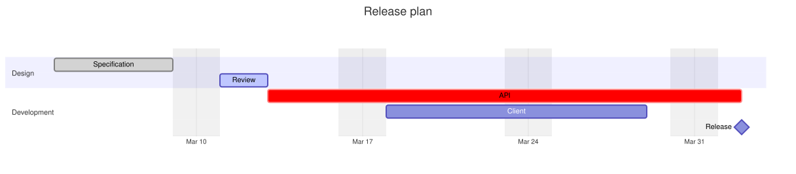

A [GanttDiagram](cref:Meziantou.Framework.Diagrams.GanttDiagram) draws tasks as bars on a time axis, grouped in sections
(Mermaid `gantt`). A task starts at a date or after other tasks, and ends at a date, after a duration, or when other
tasks start:

<!-- ref:../../../tests/Meziantou.Framework.Diagrams.Tests/GanttDiagramTests.cs;region=Diagrams_GanttDiagram;format=md-fenced-code-block;dedent=true -->
```csharp
var diagram = new GanttDiagram
{
    Title = "Release plan",
    AxisFormat = "%b %d",
    TickInterval = new GanttTickInterval(1, GanttTimeUnit.Week),
};
diagram.Excludes.Add("weekends");

var design = diagram.AddSection("Design");
var specification = design.AddTask("Specification");
specification.Id = "spec";
specification.Start = new DateTime(2024, 3, 4);
specification.Duration = new GanttDuration(5, GanttTimeUnit.Day);
specification.IsDone = true;
var review = design.AddTask("Review");
review.Id = "review";
review.After.Add("spec");
review.Duration = new GanttDuration(2, GanttTimeUnit.Day);
review.IsActive = true;

var development = diagram.AddSection("Development");
var api = development.AddTask("API");
api.Id = "api";
api.After.Add("review");
api.Duration = new GanttDuration(2, GanttTimeUnit.Week);
api.IsCritical = true;
var client = development.AddTask("Client");
client.Start = new DateTime(2024, 3, 18);
client.End = new DateTime(2024, 3, 29);

var release = development.AddTask("Release");
release.Id = "release";
release.After.Add("api");
release.Duration = new GanttDuration(0, GanttTimeUnit.Day);
release.IsMilestone = true;
```
<!-- endref -->



## Tasks

A [GanttTask](cref:Meziantou.Framework.Diagrams.GanttTask) has a name, an optional
[Id](cref:Meziantou.Framework.Diagrams.GanttTask.Id) that other tasks reference, a start and an end:

- The start is [Start](cref:Meziantou.Framework.Diagrams.GanttTask.Start), or the end of the latest task of
  [After](cref:Meziantou.Framework.Diagrams.GanttTask.After). Without either, the task starts when the previous task
  ends.
- The end is [End](cref:Meziantou.Framework.Diagrams.GanttTask.End), the start of the earliest task of
  [Until](cref:Meziantou.Framework.Diagrams.GanttTask.Until), or the start plus
  [Duration](cref:Meziantou.Framework.Diagrams.GanttTask.Duration). A
  [GanttDuration](cref:Meziantou.Framework.Diagrams.GanttDuration) counts milliseconds to years; as in Mermaid, the
  days and the weeks are rounded to whole days, and the months and the years are truncated to whole units.

[IsDone](cref:Meziantou.Framework.Diagrams.GanttTask.IsDone),
[IsActive](cref:Meziantou.Framework.Diagrams.GanttTask.IsActive) and
[IsCritical](cref:Meziantou.Framework.Diagrams.GanttTask.IsCritical) change the colors of the bar.
[IsMilestone](cref:Meziantou.Framework.Diagrams.GanttTask.IsMilestone) draws a diamond at the middle of the task, and
[IsVertical](cref:Meziantou.Framework.Diagrams.GanttTask.IsVertical) a vertical line across the chart at its start.
[Link](cref:Meziantou.Framework.Diagrams.GanttTask.Link) makes the name a hyperlink.

The tasks of [Tasks](cref:Meziantou.Framework.Diagrams.GanttDiagram.Tasks) come before the
[sections](cref:Meziantou.Framework.Diagrams.GanttDiagram.Sections). A reference to an unknown task, or a cycle of
references, places the task at the start of the chart.

## Dates

The dates are [DateTime](cref:System.DateTime) values without time zone, and the chart never reads the clock: the
output depends on the diagram only.

- [DateFormat](cref:Meziantou.Framework.Diagrams.GanttDiagram.DateFormat) is the format of the dates of the Mermaid
  text, with the tokens of dayjs: `YYYY`, `YY`, `M`, `MM`, `MMM`, `MMMM`, `D`, `DD`, `Do`, `d`, `dd`, `ddd`, `dddd`,
  `H`, `HH`, `h`, `hh`, `k`, `kk`, `m`, `mm`, `s`, `ss`, `SSS`, `A`, `a`, `Q`, `X` (Unix seconds), `x` (Unix
  milliseconds), and literal text between brackets. The names of the months and of the days are English. A date that
  does not match the format is read as an ISO date (`2014-01-06`, `2014-01-06T10:30:00`), and
  [FormatDate](cref:Meziantou.Framework.Diagrams.GanttDiagram.FormatDate(System.DateTime)) writes the dates the format
  cannot represent as ISO dates.
- [AxisFormat](cref:Meziantou.Framework.Diagrams.GanttDiagram.AxisFormat) is the format of the labels of the axis, with
  the tokens of d3 (`%Y-%m-%d` by default, `%b %d`, `%H:%M`...), in English.
- [TickInterval](cref:Meziantou.Framework.Diagrams.GanttDiagram.TickInterval) sets the interval between the ticks, such
  as one week; [WeekStart](cref:Meziantou.Framework.Diagrams.GanttDiagram.WeekStart) is the first day of the weeks of
  these ticks. Without it, the axis has about ten ticks.
- [Today](cref:Meziantou.Framework.Diagrams.GanttDiagram.Today) draws a vertical line at a date, styled by
  [TodayMarkerStyle](cref:Meziantou.Framework.Diagrams.GanttDiagram.TodayMarkerStyle). Mermaid draws it at the current
  date; here, nothing is drawn unless the date is set.

## Excluded days

[Excludes](cref:Meziantou.Framework.Diagrams.GanttDiagram.Excludes) lists the days that do not count: `weekends`, names
of days (`friday`), or dates in the date format or as `YYYY-MM-DD`.
[Includes](cref:Meziantou.Framework.Diagrams.GanttDiagram.Includes) lists exceptions. As in Mermaid, a task whose end is
not a `YYYY-MM-DD` date ends later by one day per excluded day it spans, and the excluded days are shaded.
[WeekendStart](cref:Meziantou.Framework.Diagrams.GanttDiagram.WeekendStart) sets whether the weekend is Friday and
Saturday, or Saturday and Sunday.

[InclusiveEndDates](cref:Meziantou.Framework.Diagrams.GanttDiagram.InclusiveEndDates) makes the end dates include their
day: a task from 2024-01-01 to 2024-01-02 then lasts two days.

## Layout

[Compact](cref:Meziantou.Framework.Diagrams.GanttDiagram.Compact) puts the tasks of a section that do not overlap on the
same row. [TopAxis](cref:Meziantou.Framework.Diagrams.GanttDiagram.TopAxis) adds an axis above the tasks.
[Width](cref:Meziantou.Framework.Diagrams.GanttDiagram.Width),
[BarHeight](cref:Meziantou.Framework.Diagrams.GanttDiagram.BarHeight),
[BarGap](cref:Meziantou.Framework.Diagrams.GanttDiagram.BarGap) and
[LeftPadding](cref:Meziantou.Framework.Diagrams.GanttDiagram.LeftPadding) set the size of the chart. The name of a
task is in its bar when it fits, otherwise next to it.

## Mermaid syntax

<!-- ref:../../../tests/Meziantou.Framework.Mermaid.Tests/GanttDiagramParserTests.cs;region=Mermaid_GanttDiagram;format=md-fenced-code-block;dedent=true -->
```csharp
var diagram = (GanttDiagram)MermaidDocument.Parse("""
    gantt
        title A Gantt Diagram
        dateFormat YYYY-MM-DD
        excludes weekends
        section Section
            A task       :done, a1, 2014-01-01, 30d
            Another task :after a1, 20d
        section Another
            Task in sec  :crit, 2014-01-12, 12d
            Release      :milestone, 2014-02-20, 0d
    """).Diagram;
```
<!-- endref -->

A task is `name : data`, where the data is a list separated by commas: the tags (`done`, `active`, `crit`, `milestone`,
`vert`), then the end, or the start and the end, or the identifier, the start and the end. The start is a date or
`after id1 id2`; the end is a date, a duration (`3d`, `2w`, `12h`, `1.5M`) or `until id1 id2`. The parser also reads
`title`, `section`, `dateFormat`, `axisFormat`, `tickInterval`, `weekday`, `weekend`, `excludes`, `includes`,
`inclusiveEndDates`, `topAxis`, `todayMarker` (`off` or a style), `click id href "url"`, and the `displayMode: compact`
setting of the front matter. The keywords ignore the case. `click id call function()` is ignored with a warning, as the
diagrams run no script; so is an end that is neither a date nor a duration, which makes the task last no time.
