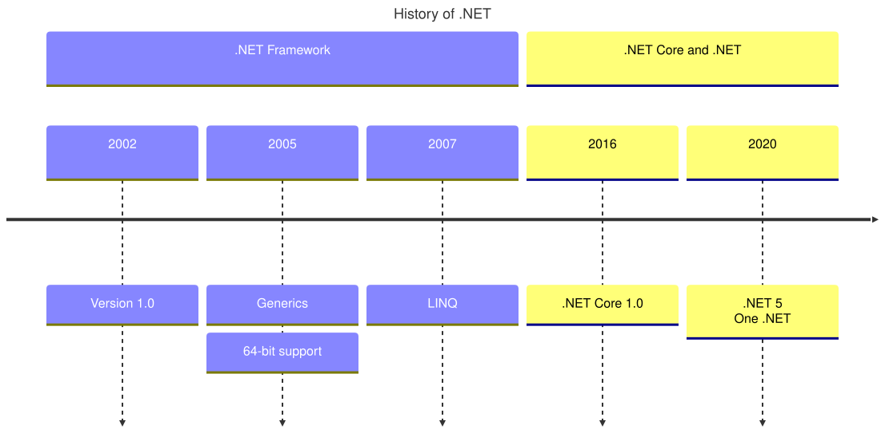

A [TimelineDiagram](cref:Meziantou.Framework.Diagrams.TimelineDiagram) shows periods of time in order, each with its
events (Mermaid `timeline`). Sections group the periods:

<!-- ref:../../../tests/Meziantou.Framework.Diagrams.Tests/TimelineDiagramTests.cs;region=Diagrams_TimelineDiagram;format=md-fenced-code-block;dedent=true -->
```csharp
var diagram = new TimelineDiagram { Title = "History of .NET" };
var framework = diagram.AddSection(".NET Framework");
framework.AddPeriod("2002", "Version 1.0");
framework.AddPeriod("2005", "Generics", "64-bit support");
framework.AddPeriod("2007", "LINQ");

var core = diagram.AddSection(".NET Core and .NET");
core.AddPeriod("2016", ".NET Core 1.0");
core.AddPeriod("2020", ".NET 5\nOne .NET");
```
<!-- endref -->



## Periods and sections

A [TimelinePeriod](cref:Meziantou.Framework.Diagrams.TimelinePeriod) has a
[Label](cref:Meziantou.Framework.Diagrams.TimelinePeriod.Label), such as a year, and
[Events](cref:Meziantou.Framework.Diagrams.TimelinePeriod.Events), drawn in boxes below the period. The texts wrap, and
a line feed starts a new line.

A [TimelineSection](cref:Meziantou.Framework.Diagrams.TimelineSection) groups periods under a title, in a color of the
palette of the [theme](cref:Meziantou.Framework.Diagrams.DiagramTheme). The periods of
[Periods](cref:Meziantou.Framework.Diagrams.TimelineDiagram.Periods) come before the sections; without sections, each
period takes the next color of the palette, unless
[DisableMulticolor](cref:Meziantou.Framework.Diagrams.TimelineDiagram.DisableMulticolor) is set.

[Direction](cref:Meziantou.Framework.Diagrams.TimelineDiagram.Direction) draws the periods from left to right, with
their events below them, or from top to bottom, with their events on the right of the axis.

## Mermaid syntax

<!-- ref:../../../tests/Meziantou.Framework.Mermaid.Tests/TimelineDiagramParserTests.cs;region=Mermaid_TimelineDiagram;format=md-fenced-code-block;dedent=true -->
```csharp
var diagram = (TimelineDiagram)MermaidDocument.Parse("""
    timeline
        title History of Social Media Platform
        2002 : LinkedIn
        2004 : Facebook
             : Google
        2005 : YouTube : Twitch
        2006
    """).Content;
```
<!-- endref -->

A line is a period, followed by its events, each introduced by a colon and a space; a line that starts with a colon adds
events to the previous period. The parser also reads `title`, `section`, the direction after the keyword
(`timeline LR`, `timeline TD`) and the `disableMulticolor` setting. As in Mermaid, `#` starts a comment in a period, and
a period cannot contain a colon, while the events and the section titles can contain `#` and the entity codes
(`#35;`).
