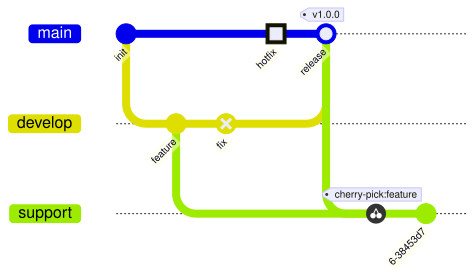
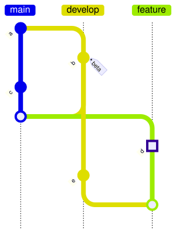

A [GitGraphDiagram](cref:Meziantou.Framework.Diagrams.GitGraphDiagram) draws the history of a Git repository (Mermaid
`gitGraph`). It is a list of [operations](cref:Meziantou.Framework.Diagrams.GitGraphDiagram.Operations), replayed in
order as Git would: a commit goes on the current branch, a branch starts at the current commit, a merge joins a branch
into the current one.

<!-- ref:../../../tests/Meziantou.Framework.Diagrams.Tests/GitGraphDiagramTests.cs;region=Diagrams_GitGraph;format=md-fenced-code-block;dedent=true -->
```csharp
var diagram = new GitGraphDiagram();
diagram.Commit("init");
diagram.Branch("develop");
diagram.Commit("feature");
diagram.Commit("fix", GitGraphCommitType.Reverse);
diagram.Checkout("main");
diagram.Commit("hotfix", GitGraphCommitType.Highlight);
diagram.Merge("develop", "release").Tags.Add("v1.0.0");
diagram.Branch("support");
diagram.CherryPick("feature");
diagram.Commit();
```
<!-- endref -->



## Operations

- [Commit](cref:Meziantou.Framework.Diagrams.GitGraphDiagram.Commit)
  adds a [GitGraphCommit](cref:Meziantou.Framework.Diagrams.GitGraphCommit), with an optional identifier, message, tags
  and [type](cref:Meziantou.Framework.Diagrams.GitGraphCommitType): a normal commit is a filled circle, a reverse commit
  a crossed circle, a highlighted commit a square. A commit without identifier gets a generated one, the same at each
  drawing.
- [Branch](cref:Meziantou.Framework.Diagrams.GitGraphDiagram.Branch) creates
  a branch and checks it out. Its optional order sorts the lanes; the main branch takes
  [MainBranchOrder](cref:Meziantou.Framework.Diagrams.GitGraphDiagram.MainBranchOrder).
- [Checkout](cref:Meziantou.Framework.Diagrams.GitGraphDiagram.Checkout) changes the current branch.
- [Merge](cref:Meziantou.Framework.Diagrams.GitGraphDiagram.Merge) adds a merge commit, drawn
  as a ring, with an optional identifier, type and tags.
- [CherryPick](cref:Meziantou.Framework.Diagrams.GitGraphDiagram.CherryPick) copies a
  commit to the current branch. It is tagged `cherry-pick:<id>` unless
  [ShowDefaultTag](cref:Meziantou.Framework.Diagrams.GitGraphCherryPick.ShowDefaultTag) is `false` or it has its own
  tags; cherry-picking a merge commit needs the parent to take.

An operation that Git refuses, such as a checkout of a branch that does not exist, is skipped by the drawing. The Mermaid
parser reports it as an error, as Mermaid does.

## Layout and colors

[Orientation](cref:Meziantou.Framework.Diagrams.GitGraphDiagram.Orientation) puts the time from left to right (the
default), from top to bottom, or from bottom to top. [ParallelCommits](cref:Meziantou.Framework.Diagrams.GitGraphDiagram.ParallelCommits)
aligns the commits by their distance to the first one instead of giving each commit its own column.
[ShowBranches](cref:Meziantou.Framework.Diagrams.GitGraphDiagram.ShowBranches),
[ShowCommitLabels](cref:Meziantou.Framework.Diagrams.GitGraphDiagram.ShowCommitLabels) and
[RotateCommitLabels](cref:Meziantou.Framework.Diagrams.GitGraphDiagram.RotateCommitLabels) hide the names of the
branches, hide the identifiers of the commits, or write them horizontally.



The branches take 8 colors in turn. They are the colors of Mermaid for its themes, and the palette of a custom theme
otherwise. [BranchColors](cref:Meziantou.Framework.Diagrams.GitGraphDiagram.BranchColors),
[BranchLabelColors](cref:Meziantou.Framework.Diagrams.GitGraphDiagram.BranchLabelColors),
[HighlightColors](cref:Meziantou.Framework.Diagrams.GitGraphDiagram.HighlightColors) and the colors of the labels and
the tags replace them, as the `git0`...`git7`, `gitBranchLabel0`... and `gitInv0`... theme variables of Mermaid.

## Mermaid syntax

<!-- ref:../../../tests/Meziantou.Framework.Mermaid.Tests/GitGraphDiagramParserTests.cs;region=Mermaid_GitGraph;format=md-fenced-code-block;dedent=true -->
```csharp
var diagram = (GitGraphDiagram)MermaidDocument.Parse("""
    gitGraph
      commit id: "init"
      branch develop
      commit id: "feature" tag: "beta"
      commit type: REVERSE
      checkout main
      commit type: HIGHLIGHT msg: "hotfix"
      merge develop id: "release" tag: "v1.0.0"
      branch support order: 2
      cherry-pick id: "feature"
    """).Diagram;
```
<!-- endref -->

The parser reads the orientation (`gitGraph TB:`), `commit` with `id:`, `msg:`, `tag:` and `type:`, `branch` with
`order:`, `checkout` and `switch`, `merge` with `id:`, `tag:` and `type:`, `cherry-pick` with `id:`, `parent:` and
`tag:`, the title and the accessibility statements. It reads the `gitGraph` section of the configuration
(`mainBranchName`, `mainBranchOrder`, `showBranches`, `showCommitLabel`, `rotateCommitLabel`, `parallelCommits`) and the
theme variables of the colors. The writer writes the colors as an `%%{init}%%` directive.
