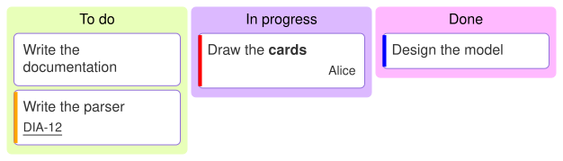

A [KanbanDiagram](cref:Meziantou.Framework.Diagrams.KanbanDiagram) draws a board of
[columns](cref:Meziantou.Framework.Diagrams.KanbanColumn) that hold [cards](cref:Meziantou.Framework.Diagrams.KanbanCard)
(Mermaid `kanban`):

<!-- ref:../../../tests/Meziantou.Framework.Diagrams.Tests/KanbanDiagramTests.cs;region=Diagrams_KanbanDiagram;format=md-fenced-code-block;dedent=true -->
```csharp
var diagram = new KanbanDiagram { TicketLinkFormat = "https://tracker.example.com/browse/#TICKET#" };
var todo = diagram.AddColumn("todo", "To do");
todo.AddCard("docs", "Write the documentation");
var parser = todo.AddCard("parser", "Write the parser");
parser.Priority = KanbanPriority.High;
parser.Ticket = "DIA-12";

var doing = diagram.AddColumn("doing", "In progress");
var renderer = doing.AddCard("renderer", DiagramText.Markdown("Draw the **cards**"));
renderer.Assigned = "Alice";
renderer.Priority = KanbanPriority.VeryHigh;

var done = diagram.AddColumn("done", "Done");
done.AddCard("model", "Design the model").Priority = KanbanPriority.Low;
```
<!-- endref -->



## Columns and cards

A column and a card have an identifier and an optional text, which can be markdown; without text, the identifier is
written. The text of a card wraps to the width of the column,
[ColumnWidth](cref:Meziantou.Framework.Diagrams.KanbanDiagram.ColumnWidth). The columns take the colors of the palette
of the theme.

A card can show:

- a [ticket](cref:Meziantou.Framework.Diagrams.KanbanCard.Ticket), at the bottom left. When
  [TicketLinkFormat](cref:Meziantou.Framework.Diagrams.KanbanDiagram.TicketLinkFormat) is set, the ticket is a link to
  this address, where `#TICKET#` is replaced by the ticket;
- the person it is [assigned](cref:Meziantou.Framework.Diagrams.KanbanCard.Assigned) to, at the bottom right;
- a [priority](cref:Meziantou.Framework.Diagrams.KanbanPriority), as a stripe on its left side: red for very high,
  orange for high, blue for low, light blue for very low, and none for medium.

## Mermaid syntax

<!-- ref:../../../tests/Meziantou.Framework.Mermaid.Tests/KanbanDiagramParserTests.cs;region=Mermaid_KanbanDiagram;format=md-fenced-code-block;dedent=true -->
```csharp
var diagram = (KanbanDiagram)MermaidDocument.Parse("""
    ---
    config:
      kanban:
        ticketBaseUrl: 'https://tracker.example.com/browse/#TICKET#'
    ---
    kanban
      todo[To do]
        docs[Write the documentation]
        parser[Write the parser]@{ ticket: DIA-12, priority: 'High' }
      doing[In progress]
        renderer[Draw the cards]@{ assigned: 'Alice', priority: 'Very High' }
      [Done]
        [Design the model]
    """).Diagram;
```
<!-- endref -->

The indentation makes the board: the items as indented as the first one are the columns, the items indented more are
the cards of the column above them. An item is `id`, `id[text]` or `[text]` (the text is then the identifier too), with
a plain, quoted (`["text"]`) or markdown (`` ["`**text**`"] ``) text; the other shapes of the mind maps (`(text)`,
`((text))`, `{{text}}`...) are read as rectangles. The metadata `@{ ticket: ..., assigned: ..., priority: ... }` follows
the item, and a line `:::class1 class2` adds classes to the item above it. The parser reads `ticketBaseUrl` and
`sectionWidth` in the `kanban` section of the configuration. It ignores the icons (`::icon(...)`), with a warning.
